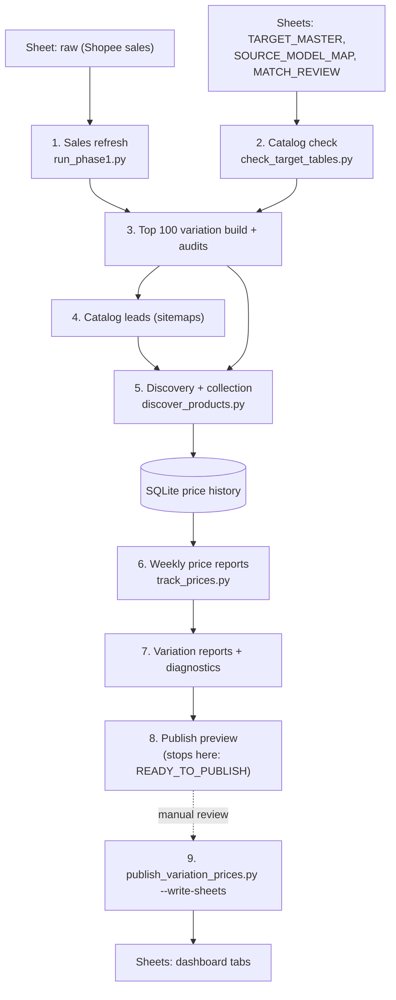

# Laptop Price Tracker

A competitive-pricing pipeline for laptops sold on Shopee in the Philippines. It takes internal
Shopee sales data from a Google Sheet, works out which laptop variations matter most, finds the
same laptop configurations at five Philippine electronics retailers, compares prices and
availability, and publishes the result to a Google Sheets dashboard.

Tracked retailers: **DataBlitz**, **Laptop Factory**, **PC Express**, **PC Central** and **Octagon**.

## Why it exists

Comparing hundreds of Shopee laptop variations against five retailer websites by hand is slow and
error-prone. Laptop names are inconsistent (the same machine appears under several titles, RAM and
storage options hide inside variants), so a naive title match produces wrong comparisons. The
pipeline automates the repetitive parts (ranking, searching, page collection, matching, report
building) and keeps people in the loop for the judgement calls: the approved catalog, the
mappings from Shopee listings to laptop configurations, and the final publication.

## Key features

- **Sales ranking.** Reads the `raw` sheet, validates it, applies eligibility rules and duplicate
  decisions, and ranks Shopee variations by combined last-month (M-1) and month-to-date (MTD) GMV.
- **Catalog-driven selection.** A **Top 100 eligible mapped Shopee variations** list: only
  variations with a verified mapping to an active `TARGET_MASTER` configuration are selected.
  The filter runs before the 100-row limit, and a shortfall is reported, never padded.
- **Retailer discovery and collection.** Bounded search of the five retailers, ranked candidates,
  variant inspection from each page's own structured data, and page collection through one
  adapter per retailer.
- **Exact configuration matching.** Offers are matched to a target on five fields (model, screen
  size, CPU family, RAM, storage). Ambiguous or contradictory evidence goes to review instead of
  being matched. Close alternatives (`ALT 1`, `ALT 2`) are labelled separately from matches.
- **Price history.** Observations are stored in an append-only local SQLite store and compared
  week by week (Monday to Monday, Asia/Singapore).
- **Rate limiting and caching.** One request scheduler per retailer (spacing, `Retry-After`
  cooldowns, pauses) with state that survives restarts, plus a replay cache for saved search and
  inspection responses.
- **Dashboard publication.** A manual, preview-first publisher writes a fixed set of tabs, snapshots
  them first, verifies every cell by readback, and supports rollback.

## How the pipeline works



Steps 1 to 8 are run in order by the driver script [scripts/run_variation_week.sh](scripts/run_variation_week.sh),
which stops at the publish preview and writes `status.json` (`READY_TO_PUBLISH` or
`FAILED_AT_<stage>`) into its run folder. **The driver never runs step 9.** A person reviews the
audits and the preview, then runs the publisher, or the GitHub Actions workflow does after its
readiness gate (see Automation and scheduling).

Two stages need human attention outside the driver:

- **Catalog maintenance** (`TARGET_MASTER`, `SOURCE_MODEL_MAP`, `MATCH_REVIEW`) is done by hand in the
  Google Sheet. The pipeline validates these tabs but never creates targets or mappings.
- **Conflicting duplicate sales rows** are quarantined. The driver applies the standing owner rule
  "keep the latest sheet row" for same-date conflicts (`apply_latest_row_decisions.py --write`, which
  backs up `config/duplicate_decisions.csv` first); anything else stays quarantined and the stage fails.

## Repository structure

```text
laptop-price-tracker/
├── src/laptop_tracker/        Application package: schema, eligibility, matching, rate limiting,
│   └── adapters/              scraping, price tracking, Sheets reader/writer/publisher.
│                              One adapter per retailer (datablitz, laptop_factory, pcx, pcc, oct).
├── scripts/                   Command-line entry points (40 Python scripts, see the catalogue
│                              below) and run_variation_week.sh, the weekly driver that
│                              stops at the publish preview.
├── config/                    Rules, registries, templates and owner decisions (see Configuration).
├── data/                      Runtime state and generated output (mostly Git-ignored):
│   ├── output/                  generated reports; weekly runs under output/weekly_runs/<UTC time>/
│   ├── history/                 price_history.sqlite3 and retailer_rate_limits.json (persistent state)
│   ├── collection/              saved collection runs
│   ├── review/                  local review files
│   └── backups/                 backups written before decision-file changes
├── tests/                     pytest suite; fixtures in tests/scraping_fixtures/
├── docs/                      Design, schema and operations documents (index below)
├── .env.example               Template for the local .env
├── pyproject.toml             Python version, dependencies, pytest and ruff settings
└── requirements.txt           Runtime plus test/lint dependencies
```

Run every command from the repository root, for example `python scripts/run_phase1.py --dry-run`.
Each script finds `src/`, `config/` and `data/` relative to its own location, but `.env` is read
from the current directory, so the root is the supported working directory.

### Script catalogue

| Purpose | Scripts |
|---|---|
| Sales refresh | `smoke_test.py`, `run_phase1.py` |
| Duplicate decisions | `apply_latest_row_decisions.py`, `migrate_duplicate_decisions.py` |
| Catalog validation and review | `check_target_master.py`, `check_target_tables.py`, `seed_match_review.py`, `audit_top_100_coverage.py`, `propose_catalog_conventions.py`, `propose_catalog_corrections.py`, `reconcile_catalog.py`, `build_catalog_correction_queue.py` |
| Top 100 selection | `build_top_shopee_variations.py`, `audit_top_shopee_variations.py`, `audit_variation_selection.py`; earlier configuration-grain: `build_verified_top_100.py`, `audit_verified_top_100.py` |
| Discovery and collection | `discover_catalog_leads.py`, `discover_products.py`, `collect_and_match.py`, `search_catalog_index.py`, `discover_candidates.py` |
| Matching and prices | `match_offers.py`, `track_prices.py`, `audit_alternatives.py` |
| Reports and diagnostics | `build_variation_reports.py`, `build_publication_diagnostics.py`, `build_before_after_report.py`, `coverage_report.py`, `diagnose_blank_cells.py` |
| Replay and benchmarking | `replay_extraction.py`, `compare_alternative_replay.py`, `measure_discovery.py`, `benchmark_catalog_index.py` |
| Publication (writes Sheets) | `publish_variation_prices.py` (current), `publish_prices.py` (earlier configuration grain; refuses a workbook prepared for the variation grain) |
| GitHub Actions helpers | `ci_plan.py`, `ci_state.py`, `ci_run_gate.py`, `ci_publish.py` (see Automation and scheduling) |

All names below are files in `scripts/`. Run a script with `--help` for its options, except
`smoke_test.py`, which takes no arguments: it ignores `--help` and runs its read-only check against the
configured spreadsheet.

## Requirements

- Python 3.11 or newer (`pyproject.toml`). The maintained environment is a Linux (WSL) virtualenv.
- Packages: `pandas`, `gspread`, `google-auth`, `python-dotenv`, `cryptography`, `requests`; `pytest`,
  `pyyaml` and `ruff` for development (all in `requirements.txt`). No other dependency manager is used.
- A Google Cloud **service account** with a JSON key, and the spreadsheet shared with the
  service account's email address. Reading needs access to the spreadsheet; publishing needs edit
  access.
- Outbound HTTPS access to the retailer sites for live discovery and collection.

## Installation and setup

```bash
git clone https://github.com/jarlericaa/laptop-price-tracker.git
cd laptop-price-tracker
python3 -m venv .venv
source .venv/bin/activate
python -m pip install -r requirements.txt
cp .env.example .env
```

Edit `.env` (see Configuration). Keep the service-account JSON **outside** the repository.

Validate the installation without any credentials or network access:

```bash
python -m pytest -q
python -m ruff check .
```

`pytest` should pass completely. `ruff` currently reports 13 pre-existing style findings
(line length and import order) in `src/laptop_tracker/catalog_proposals.py`,
`src/laptop_tracker/page_cache.py`, `scripts/collect_and_match.py` and a few tests; none affect behaviour.

With credentials configured, `python scripts/smoke_test.py` reads the `raw` tab with the read-only scope and
prints the headers it found.

## Configuration

### Environment variables (`.env`)

Loaded by `src/laptop_tracker/config.py`. `.env` is Git-ignored.

| Variable | Required | Purpose |
|---|---|---|
| `SPREADSHEET_ID` | for any Sheets access | ID of the tracker spreadsheet. |
| `GOOGLE_SERVICE_ACCOUNT_FILE` | one of the two credential variables | Path to the service-account JSON key. |
| `GOOGLE_SERVICE_ACCOUNT_JSON` | one of the two credential variables | The key's JSON content, as an alternative to the file. Takes precedence over the file. |
| `RAW_TAB_NAME` | optional, default `raw` | Name of the sales tab. |
| `MAX_VALIDATION_ERRORS` | optional, default `1000` | Cap on validation errors reported per run. |
| `SKIP_FRESHNESS_CHECK` | optional, default `false` | Set `true` only to deliberately process an older sales snapshot. |

### Files in `config/`

| File | Tracked | Purpose |
|---|---|---|
| `eligibility_rules.csv` | yes | Rules deciding which Shopee listings are eligible laptops. |
| `eligibility_decisions.csv` | no (local) | Manual eligibility overrides. Read from here, not from the sheet copy. |
| `duplicate_decisions.csv` | no (local) | Recorded decisions for conflicting duplicate sales rows. |
| `identity_review_register.csv` | no (local) | Owner identity review register used by the Top 100 build. |
| `product_family_registry.csv`, `product_name_registry.csv` | yes | Product-family and product-name conventions used in extraction and alternatives. |
| `retailer_evidence_approvals.csv` | yes | Owner-recorded approvals of specific retailer evidence. |
| `supplied_candidate_urls.csv` | yes | Retailer URLs supplied by the owner as discovery leads. |
| `shopee_variation_sheet_contract.json` | yes | Tab headers and layout contract for the variation publisher. |
| `collection_manifest.csv` | no (local) | URL list for `collect_and_match.py`; copy `collection_manifest_template.csv`. |
| `*_template.csv`, `recovery_*_2026-11-03.csv` | yes | Header templates and a dated recovery scope/leads set (used by tests and docs). |

`.gitignore` keeps credentials, `.env`, local decision files and everything under `data/output/`,
`data/review/`, `data/history/` and `data/collection/` out of Git.

## Running the pipeline

Each command is labelled by what it can touch:

- **Local**: reads and writes local files only.
- **Reads Sheets**: network read of the spreadsheet (read-only scope).
- **Retailer requests**: sends HTTP requests to retailer sites.
- **Writes Sheets**: modifies the spreadsheet.

### Recommended first-time workflow

1. `python -m pytest -q` (local).
2. `python scripts/smoke_test.py` (reads Sheets) to confirm credentials and the `raw` headers.
3. `python scripts/run_phase1.py --dry-run` (reads Sheets, writes local files under `data/output/`).
4. `python scripts/check_target_tables.py --from-sheets` (reads Sheets, writes validated copies locally).
5. Read [docs/WEEKLY_WORKFLOW.md](docs/WEEKLY_WORKFLOW.md) and
   [docs/MAPPED_TOP_100_2026-11-03.md](docs/MAPPED_TOP_100_2026-11-03.md) before the first full run.
6. Run the weekly driver (below), review its output, and only then consider publishing.

### Sales refresh

```bash
python scripts/run_phase1.py --dry-run          # default; reads Sheets, writes local files
python scripts/run_phase1.py --write-sheets     # WRITES the nine P1_* output tabs
```

`--write-sheets` replaces only the allowed `P1_*` tabs (see Google Sheets integration) and can never
write to `raw`. The write scope is requested only when this flag is given. Do not use it for testing.

### Weekly run (stops at the publish preview)

```bash
setsid nohup bash scripts/run_variation_week.sh > /tmp/run_variation_week.out 2>&1 < /dev/null &
cat "$(cat /tmp/current_weekly_run.txt)/status.json"       # READY_TO_PUBLISH or FAILED_AT_<stage>
tail -3 "$(cat /tmp/current_weekly_run.txt)/driver.log"
```

**Reads Sheets, retailer requests, local writes. It does not write Sheets.** A full run takes
roughly 25 to 50 minutes with a warm cache and over three hours cold. Run folders are created under
`data/output/weekly_runs/<UTC timestamp>/`; the driver also writes `stages.jsonl` (per-stage exit
codes) and one log per stage there.

Optional environment variables for the driver (documented at the top of the script):

| Variable | Effect |
|---|---|
| `SEARCH_CACHE` | Earlier discovery folder whose saved responses are replayed instead of re-requested. Default: the newest other run that has its index files. `SEARCH_CACHE=none` sends every request. |
| `CACHE_HOURS` | Replay only responses retrieved within this many hours (default 24). |
| `PREV_RUN` | Earlier run folder whose catalog is diffed in the selection audit. The script has a hard-coded default (`data/output/weekly_runs/20261103T062304Z`); set this to the previous run. |

To stop a run: `pkill -f run_variation_week.sh; pkill -f "discover_products.py --live"`, then check
`pgrep -fa discover_products`. Avoid aborting and restarting repeatedly; it tends to trigger
retailer 429 responses.

### Individual stages

| Command | Touches |
|---|---|
| `python scripts/check_target_tables.py --from-sheets --output-dir DIR` | Reads Sheets; local writes |
| `python scripts/check_target_tables.py --target-master tm.csv --source-model-map map.csv --match-review review.csv` | Local |
| `python scripts/build_top_shopee_variations.py --help` (see the driver for the full argument set) | Local |
| `python scripts/discover_products.py --preview ...` | Local (plans; no requests) |
| `python scripts/discover_products.py --live --collect ...` | Retailer requests; local writes; updates the SQLite store |
| `python scripts/discover_products.py --live --replay-only --search-cache DIR ...` | Local (sends no request; uses saved responses only) |
| `python scripts/discover_catalog_leads.py --preview ...` / `--live ...` | Local / retailer requests (robots.txt and sitemaps) |
| `python scripts/collect_and_match.py --preview --manifest config/collection_manifest.csv` | Local |
| `python scripts/collect_and_match.py --live --manifest config/collection_manifest.csv` | Retailer requests; updates the SQLite store |
| `python scripts/track_prices.py --store ... --week-start YYYY-MM-DD --as-of ISO8601 ...` | Local (never contacts Sheets or retailers) |
| `python scripts/build_variation_reports.py ...`, `audit_alternatives.py ...`, `build_publication_diagnostics.py ...` | Local |
| `python scripts/publish_variation_prices.py --preview ...` | Reads Sheets; local writes (plan only) |

The exact argument sets used each week are in [scripts/run_variation_week.sh](scripts/run_variation_week.sh);
copy them rather than composing arguments from memory.

### Publishing to Google Sheets

Publication is a separate, deliberate step after `READY_TO_PUBLISH`. Review `shopee_variations/selection_audit.md`,
`variation_audit.log` and `publish_preview.log` in the run folder, then:

```bash
source .venv/bin/activate
W="$(cat /tmp/current_weekly_run.txt)"
python scripts/publish_variation_prices.py --write-sheets --variation-dir "$W/shopee_variations" \
  --reports-dir "$W/variation_reports" --context-report-dir "$W/context_reports" \
  --collection-dir "$W/discovery/collection" --output-root "$W/publications"
# rollback: python scripts/publish_variation_prices.py --rollback <publication folder>
```

**Writes Sheets.** Safeguards: every input is validated before any Sheets access; only the prepared
publisher tabs are written (a missing tab or one with a foreign header is refused); each tab is
snapshotted locally first; every cell is verified by readback; `--rollback` restores the snapshot.
Details: [docs/SHEETS_DASHBOARD_2026-11-05.md](docs/SHEETS_DASHBOARD_2026-11-05.md).

### Other maintenance commands

| Command | Touches |
|---|---|
| `python scripts/apply_latest_row_decisions.py` (preview) / `--write` | Local; `--write` backs up then rewrites `config/duplicate_decisions.csv` |
| `python scripts/migrate_duplicate_decisions.py` (preview) / `--write` | Reads Sheets; `--write` backs up first |
| `python scripts/replay_extraction.py ...`, `compare_alternative_replay.py ...`, `measure_discovery.py ...` | Local |
| `python scripts/build_before_after_report.py ...` | Local (compares two runs' artifacts) |

## Google Sheets integration

One spreadsheet (`SPREADSHEET_ID`) holds both the inputs and the dashboard outputs.

**Inputs (read by the pipeline, edited by people):**

| Tab | Content |
|---|---|
| `raw` | Imported Shopee sales data. Read-only for this project; never written. |
| `TARGET_MASTER` | Approved laptop configurations with stable `target_id`s. Validated, never auto-extended. |
| `SOURCE_MODEL_MAP` | Approved links from Shopee variations (`source_model_id`) to targets. |
| `MATCH_REVIEW` | Catalog candidates, missing specs and review history. |
| `TRACKER_GUIDE` | Owner-maintained guide. The publisher only updates the text of rows it owns, keyed by the label in column A. |

**Outputs of `publish_variation_prices.py` (replaced on each publication):**

| Tab | Content |
|---|---|
| `TOP_100_SHOPEE_VARIATIONS` | The selected Top 100 eligible mapped Shopee variations. |
| `PILOT_PRICE_COMPARISON` | Main dashboard: Shopee snapshot price against each retailer's price and result label (`MATCH`, `ALT 1`, `ALT 2`, `RECHECK ...`), plus collapsed detail column groups. |
| `PILOT_PRICE_OVERVIEW` | Compact numeric overview of the same prices. |
| `PILOT_PRICE_ALTERNATIVES` | The close-alternative offers. |
| `PILOT_PRICE_HISTORY` | Dated observations. |
| `PILOT_PRICE_REVIEW` | Retailer matching problems and exclusions. |
| `PILOT_PRICE_RUN_LOG` | One row per publication (appended, not replaced). |

**Outputs of `run_phase1.py --write-sheets`:** `P1_TOP_100_TARGETS`, `P1_ELIGIBLE_RANKING`,
`P1_EXCLUDED_LISTINGS`, `P1_ELIGIBILITY_REVIEW`, `P1_ELIGIBILITY_DECISIONS`,
`P1_CONFLICTING_DUPLICATES`, `P1_VALIDATION_ERRORS`, `P1_PERIOD_SUMMARY`, `P1_RUN_LOG`. Not part of the
weekly driver.

Retired tabs `PILOT_PRICE_SUMMARY` and `P1_TOP_100_CONFIGURATIONS` are never recreated or written.

How inputs shape the dashboard: a Shopee variation is selected only if `SOURCE_MODEL_MAP` links it to
exactly one active, complete, non-`LISTING_ONLY` target in `TARGET_MASTER` with no open conflict; the
target's five identity fields then decide which retailer offers count as a `MATCH`. Fix the mapping or
target in the sheet and rerun the stage; do not edit published tabs. Schemas:
[docs/TARGET_MASTER_SCHEMA.md](docs/TARGET_MASTER_SCHEMA.md),
[docs/PRICE_TRACKING_OUTPUT_SCHEMA.md](docs/PRICE_TRACKING_OUTPUT_SCHEMA.md).

## Automation and scheduling

A GitHub Actions workflow ([.github/workflows/weekly-laptop-tracker.yml](.github/workflows/weekly-laptop-tracker.yml))
runs the same pipeline unattended: **Mondays 09:17 Asia/Manila**, or on demand. It restores the
persistent state from **encrypted assets of private GitHub Releases** of this repository (written
with the built-in `GITHUB_TOKEN`; no Google Cloud project, bucket or billing account), runs
`scripts/run_variation_week.sh`, checks readiness from the run's own metadata, saves a new versioned
state, and (only when asked) publishes once through `publish_variation_prices.py` with verification,
rollback of a partial write and a durable record of every attempt. Google Sheets access uses the
service-account key in the Secret `GOOGLE_SERVICE_ACCOUNT_JSON`; archives are encrypted with the
Secret `STATE_ENCRYPTION_KEY`. Modes:

| Mode | Writes Sheets |
|---|---|
| Manual preview (default) | no |
| Manual production (`publish` ticked), or `existing_run_id` to publish a saved run without scraping | yes, after the gates |
| Scheduled | only when the repository Variable `WEEKLY_AUTOMATION` is `publish` (inert until set) |

The automation is **implemented and tested offline but not yet run on GitHub Actions**.
Setup, the first hosted test, activation, recovery and troubleshooting:
[docs/GITHUB_ACTIONS_SETUP.md](docs/GITHUB_ACTIONS_SETUP.md). Locally nothing changes: the driver is
still started by hand and publication is still a separate command. To see how a run went, read
`status.json`, `driver.log` and `stages.jsonl` in its run folder; a stage that exits with an
unaccepted code stops the driver and records `FAILED_AT_<stage>` (the discovery stage accepts exit
code 2, partial success).

CI helper scripts (all in `scripts/`): `ci_plan.py` (mode and configuration check), `ci_state.py`
(keygen, seed, restore, save, versions, verify, rollback, report, publication-fetch, run bundles),
`ci_run_gate.py` (readiness gate and job summary), `ci_publish.py` (gated, idempotent publication).
First-time seeding of the history: `python scripts/ci_state.py seed` (see the setup guide).

## Testing and validation

```bash
python -m pytest -q                # whole suite, offline, uses fixtures in tests/scraping_fixtures/
python -m pytest -q tests/test_pcx.py   # one module
python -m ruff check .
```

The tests use saved fixtures and fakes: no credentials, retailer requests or Sheets access. Commands
that need credentials are `smoke_test.py`, `run_phase1.py`, `check_target_tables.py --from-sheets`,
`publish_variation_prices.py` and `migrate_duplicate_decisions.py`. To avoid unintended publication:
never pass `--write-sheets` while testing, use a separate test spreadsheet (`SPREADSHEET_ID`) if you
need to exercise the writer, and use `--preview` first. Verify run outputs with the audit scripts
(`audit_top_shopee_variations.py`, `audit_variation_selection.py`, `audit_alternatives.py`).

## Troubleshooting

| Symptom | What to do |
|---|---|
| Retailer returns HTTP 429 | The rate limiter persists cooldowns in `data/history/retailer_rate_limits.json`, so a restart does not skip the wait. Work whose wait cannot be afforded is recorded as deferred, not dropped. Let the cooldown pass and rerun with the replay cache. |
| Stopped discovery run cannot be replayed | Index files (`search_requests.csv`, `product_inspections.csv`) are written at the end of a round; a run stopped early leaves unindexed `evidence/`. Rerun; completed earlier runs are used automatically. |
| Cache not reused | Responses older than `CACHE_HOURS` (default 24) are ignored; raise it, or point `SEARCH_CACHE` at the right folder. |
| Discovery finds no listing for a target | Inspect `search_requests.csv` and `candidates.csv` in the run's `discovery/` folder, and `diagnose_blank_cells.py` for the stage each cell reached. A lead can be supplied in `config/supplied_candidate_urls.csv`. |
| Retailer cell blank or `RECHECK` | The result label and `PILOT_PRICE_REVIEW` give the reason (specs incomplete, variant ambiguous, price restricted, out of stock). A promising title never authorises a match; fix catalog data or approve evidence explicitly. |
| Variation not selected | Check `mapping_exclusions.csv` in `shopee_variations/`: unmapped, inactive, `LISTING_ONLY` or conflicting targets are excluded. |
| `SPREADSHEET_ID is required` / credentials errors | Set `SPREADSHEET_ID` and `GOOGLE_SERVICE_ACCOUNT_FILE` (or `_JSON`) in `.env`; the file must exist and the spreadsheet must be shared with the service account. |
| Sales stage fails: stale month | Check the upstream import. Use `SKIP_FRESHNESS_CHECK=true` only to process an old snapshot on purpose. |
| Sales stage fails: conflicting duplicates | Review `data/output/duplicate_review.csv`; run `apply_latest_row_decisions.py` or record a decision in `config/duplicate_decisions.csv`. Model-identity conflicts cannot be overridden. |
| Publish reports a failure after a Sheets quota error | A read-quota 429 during readback was once reported as a failure although the write completed. Check `publication_report.json` and the newest `PILOT_PRICE_RUN_LOG` row before rerunning. |
| Run takes hours | The discovery stage dominates; a cold cache run exceeds three hours. Use the replay cache, and do not abort and restart. |

## Maintenance notes

- **Targets and mappings.** Edit `TARGET_MASTER`, `SOURCE_MODEL_MAP` and `MATCH_REVIEW` in the sheet,
  then validate with `python scripts/check_target_tables.py --from-sheets`. The pipeline never promotes review
  rows. `build_catalog_correction_queue.py` produces an owner review queue of suspicious bindings
  (read-only).
- **Unmatched products.** Review `PILOT_PRICE_REVIEW` and each run's `catalog_corrections/` and
  `diagnostics/` folders.
- **Adding a retailer.** Use an existing adapter (for example `src/laptop_tracker/adapters/pcx.py`) and
  [docs/SCRAPING_FRAMEWORK.md](docs/SCRAPING_FRAMEWORK.md) as the template, add offline fixtures and
  tests, and add a `docs/adapters/` page. Retailer IDs are used in several modules (for example
  `rate_limit.py`, `price_tracking.py`, `extraction.py`, `cell_diagnostics.py`); search `src/` for an
  existing ID such as `oct` to find every integration point. Note the data-use findings in
  [docs/RETAILER_DATA_USE_REVIEW.md](docs/RETAILER_DATA_USE_REVIEW.md).
- **Dependencies.** Edit `pyproject.toml` and `requirements.txt` together, then run the full test suite.
- **Before publishing.** Run `python -m pytest -q`, review the audits and publish preview for the run.
- **Unexpected report changes.** Use `build_before_after_report.py` to compare two runs' own artifacts,
  and `audit_variation_selection.py` for selection and catalog differences.
- **Persistent state.** Back up `data/history/price_history.sqlite3` and `config/*decisions.csv`
  before risky operations; they are not in Git. Once the GitHub Actions automation is in use, the
  private Releases hold the authoritative copy: `python scripts/ci_state.py restore --overwrite` before
  working locally. Back up the encryption key too; without it the stored history cannot be read.

## Documentation

Start here:

- [GitHub Actions automation: setup and operation](docs/GITHUB_ACTIONS_SETUP.md)
- [Weekly workflow, dataflow and commands](docs/WEEKLY_WORKFLOW.md)
- [Setup and operations](docs/SETUP_AND_OPERATIONS.md)
- [Top 100 eligible mapped variations and the next-run commands](docs/MAPPED_TOP_100_2026-11-03.md)
- [Compact Sheets dashboard](docs/SHEETS_DASHBOARD_2026-11-05.md)
- [Shopee variation grain](docs/SHOPEE_VARIATION_GRAIN_2026-10-27.md)

Reference:

- [Architecture](docs/ARCHITECTURE.md), [TARGET_MASTER schema](docs/TARGET_MASTER_SCHEMA.md),
  [Exact matching](docs/MATCHING.md), [Price tracking output schema](docs/PRICE_TRACKING_OUTPUT_SCHEMA.md),
  [Scraping framework](docs/SCRAPING_FRAMEWORK.md), [Cached catalog search](docs/CATALOG_INDEX.md)
- Retailer adapters: [DataBlitz](docs/adapters/DATABLITZ.md), [Laptop Factory](docs/adapters/LAPTOP_FACTORY.md),
  [PC Express](docs/adapters/PCX.md), [PC Central](docs/adapters/PCC.md), [Octagon](docs/adapters/OCT.md);
  [retailer data-use review](docs/RETAILER_DATA_USE_REVIEW.md)
- Policies: [Close alternatives](docs/CLOSE_ALTERNATIVES_2026-10-27.md), [Decision log](docs/DECISIONS.md)
- Sheet migrations: [tracking modes](docs/SHEET_MIGRATION_TRACKING_MODES.md),
  [model/CPU conventions](docs/SHEET_MIGRATION_MODEL_CPU_CONVENTIONS.md)
- Dated change notes: [discovery 2026-10-22](docs/DISCOVERY_IMPROVEMENTS_2026-10-22.md),
  [discovery 2026-11-03](docs/DISCOVERY_IMPROVEMENTS_2026-11-03.md),
  [extraction fixes](docs/EXTRACTION_FIXES_2026-11-03.md),
  [catalog bindings and diagnostics](docs/CATALOG_BINDINGS_AND_DIAGNOSTICS_2026-11-03.md)

Project history (written during development; some statements describe past states):
[PRD](docs/PRD.md), [implementation phases](docs/IMPLEMENTATION_PHASES.md),
[progress log](docs/PROGRESS_LOG.md), [Phase 10 pilot runbook](docs/PHASE_10_PILOT.md).
`run_phase1.py` keeps its historical name; it is the sales-refresh step.
