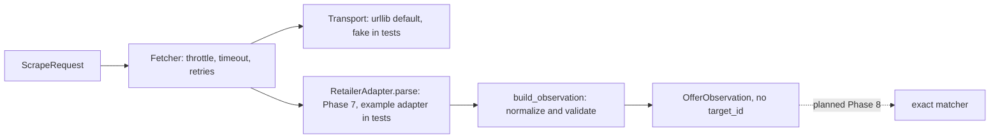

# Architecture

## System overview

The current system is a local Python pipeline that reads Shopee data from Google Sheets, processes it in memory, writes local diagnostics and ranking files, and optionally writes a guarded set of output worksheets. The `raw` worksheet is always a read-only input.

```mermaid
flowchart LR
    S[Google Sheets: raw] -->|read-only scope| R[sheets_source]
    R --> N[schema normalization]
    N --> V[data validation]
    V --> D[duplicate decisions and quarantine]
    D --> P[period and freshness checks]
    P --> E[eligibility classification]
    E --> A[model aggregation and ranking]
    A --> L[local CSV and JSON outputs]
    A -. explicit --write-sheets only .-> W[guarded P1_* writer]
    W --> O[approved output tabs]
    L -->|top_100_targets.csv| SD[seed_match_review.py]
    SD --> MC[local MATCH_REVIEW candidates: NEW, specs blank]
    T[Sheets: TARGET_MASTER, SOURCE_MODEL_MAP, MATCH_REVIEW] -. manual local CSV export .-> C[check_target_tables.py / check_target_master.py]
    T -->|"--from-sheets (read-only scope)"| C
    C --> TM[target_master and supporting_tables validators]
    TM --> TL[local error reports and validated copies]
    TM -. validated rows only; integration planned .-> X[future retailer adapters, exact matching, comparison]
```



The current and planned portions are different deliverables. The shared scraping framework (overall Phase 6) is implemented and tested offline, but it has no retailer adapter and is not connected to the pipeline above. Retailer scraping, exact configuration matching, price history, and GitHub Actions are not implemented.

## Repository structure

```text
.
├── config/
│   ├── duplicate_decisions.csv       # Human decisions for duplicate conflicts
│   ├── eligibility_decisions.csv     # Model-level ELIGIBLE/EXCLUDED overrides
│   ├── eligibility_rules.csv         # Keyword inclusion and exclusion rules
│   ├── target_master_template.csv     # Header-only approved TARGET_MASTER layout
│   ├── source_model_map_template.csv  # Header-only Shopee-to-target mapping layout
│   └── match_review_template.csv      # Header-only candidate review layout
├── data/
│   ├── output/                       # Ignored local reports and target files
│   └── review/                       # Reserved local review area
├── docs/                             # Project and operations documentation
├── src/laptop_tracker/
│   ├── config.py
│   ├── data_quality.py
│   ├── eligibility.py
│   ├── offers.py                     # Offer observation model (overall Phase 6)
│   ├── periods.py
│   ├── pipeline.py
│   ├── ranking.py
│   ├── schema.py
│   ├── scraping.py                   # Shared adapter contract and retrieval (overall Phase 6)
│   ├── sheets_source.py
│   ├── sheets_writer.py
│   ├── supporting_tables.py
│   └── target_master.py
├── tests/
│   ├── example_adapter.py            # Offline example adapter (not a retailer integration)
│   └── scraping_fixtures/            # Synthetic HTML pages for the framework tests
├── check_target_master.py            # Local TARGET_MASTER CSV check (overall Phase 5)
├── check_target_tables.py            # Three-table CSV or read-only sheet check (overall Phase 5)
├── seed_match_review.py              # Top 100 -> local MATCH_REVIEW candidates (overall Phase 5)
├── run_phase1.py                     # Legacy Phase 1 command name; overall Phase 4 work
├── smoke_test.py
├── pyproject.toml
└── requirements.txt
```

`data/output/`, `data/review/` (including seeded review candidates), credentials, and local decision CSVs are ignored by Git. The project setup, implementation, tests, and initial docs are recorded in four purpose-based commits; the Phase 5 validator and this status refresh are recorded in follow-up feature and documentation commits. Generated reports and local decisions remain ignored; see [the progress log](PROGRESS_LOG.md).

## Current components

| Module or file | Responsibility |
|---|---|
| `config.py` | Loads settings from environment and `.env`; validates required Sheet and credential settings without printing secrets. |
| `schema.py` | Defines the required raw headers, checks header uniqueness, preserves cells as strings, and maps source names to internal names. |
| `sheets_source.py` | Loads service-account credentials, opens the configured spreadsheet, and reads the configured raw worksheet. `read_target_table_values()` reads the `TARGET_MASTER`, `SOURCE_MODEL_MAP`, and `MATCH_REVIEW` tabs with `get_all_values()` only, and reports a missing tab instead of creating it. Source reads always use the read-only OAuth scope. |
| `data_quality.py` | Validates row values, collapses exact duplicates, fingerprints duplicate conflicts, applies recorded human decisions, and detects model IDs mapped to multiple shop/item identities. |
| `periods.py` | Detects latest month and M-1, enforces the Manila-timezone freshness check, and builds period summaries. |
| `eligibility.py` | Loads keyword rules and local model-level decisions, then classifies listings. |
| `ranking.py` | Aggregates model GMV, selects a single distinct MTD price or flags a conflict, ranks eligible active models, and prepares review/excluded lists. |
| `pipeline.py` | Orchestrates read-independent processing, diagnostics, local files, conflict blocking, and the optional sheet-write path. |
| `sheets_writer.py` | Enforces the `P1_*` tab allowlist, prevents `raw` from being a destination, preserves the remote decision tab, replaces approved outputs, and appends run logs. |
| `run_phase1.py` | CLI entry point. Local output is the default; `--write-sheets` opts into the writer. |
| `smoke_test.py` | Read-only check for spreadsheet access, raw headers, and string-valued sample cells. |
| `target_master.py` | Holds the approved `TARGET_MASTER` column definitions and identity key. Validates worksheet-shaped values (header row first) for headers, required fields, formats, dates, URLs, and duplicate `target_id` or configuration identity, keeping exact strings. Uses no Google access. |
| `check_target_master.py` | Local CLI that validates a CSV export. Writes a local error report and, only on a full pass, a validated copy. Prints counts only. |
| `supporting_tables.py` | Validates `SOURCE_MODEL_MAP` and `MATCH_REVIEW` against their exact `config/` header templates, reusing the `TARGET_MASTER` cell checks. Mapping checks cover one target per source ID and target references to valid master rows. Review checks cover the four statuses and blank-tolerant specs in master formats. Also builds seed candidates from Top 100 values. It never promotes or maps a row. |
| `check_target_tables.py` | CLI that checks any of the three tables from local CSV snapshots, or with `--from-sheets` from the master sheet through the read-only reader. Writes per-table local reports and prints counts and codes only. |
| `seed_match_review.py` | CLI that writes one `NEW` candidate per distinct Top 100 model ID to an ignored local file. Specs, URLs, and approvals are left blank, and it refuses to overwrite an existing file. |
| `offers.py` | Retailer-neutral `OfferObservation` with `Decimal` price, ISO currency, availability evidence, and retrieval metadata, but no `target_id`. Also holds deterministic helpers for price parsing, text cleanup, and URL redaction. Uses no network or Google access. |
| `scraping.py` | Shared adapter contract (`RetailerAdapter`, `ParsedOffer`), `Fetcher` with timeouts, bounded retries, and per-retailer throttling, injectable `Transport`/`Clock`, the `scrape()` runner, stage-specific failures, and redacted logging. The default transport is the standard-library `urllib`. See [SCRAPING_FRAMEWORK.md](SCRAPING_FRAMEWORK.md). |

Validation runs on local CSV exports or on read-only sheet reads; nothing writes the three Phase 5 tabs. The current `TARGET_MASTER` identity key is documented in [TARGET_MASTER_SCHEMA.md](TARGET_MASTER_SCHEMA.md) and aligned with the requested downstream fields in [PRICE_TRACKING_OUTPUT_SCHEMA.md](PRICE_TRACKING_OUTPUT_SCHEMA.md). Header templates for `TARGET_MASTER`, `SOURCE_MODEL_MAP`, and `MATCH_REVIEW` live under `config/`. No downstream consumer, retailer adapter, exact matcher, comparison-history, or approval-workflow module exists. The Phase 6 scraping framework does not read these tables. Promotion from review to master is a manual, human-approved step.

## Data-processing flow

1. `read_raw_values()` uses the configured spreadsheet ID and raw tab name, then calls `get_all_values()`; it does not call any write API.
2. `normalize_raw_values()` checks the required headers, pads short rows, converts cells to strings, assigns source row numbers, and creates the internal model/shop/item keys.
3. `validate_rows()` rejects rows with invalid dates, IDs, required names, prices, or GMV. Invalid rows are reported in `validation_errors.csv` and do not enter aggregation.
4. `collapse_duplicates()` groups by `(period_month, shop_id, item_id, model_id)`. Identical rows retain one copy. Conflicts require a fingerprint-matched decision from `config/duplicate_decisions.csv`; the redacted review template is local-only.
5. The pipeline detects the latest valid month and its preceding calendar month, then checks that the latest month is current in Manila time unless freshness checking is disabled.
6. Model identity conflicts are excluded. The remaining rows are classified using `eligibility_rules.csv` and `eligibility_decisions.csv`.
7. `aggregate_models()` calculates M-1 and MTD GMV by model, sums them for ranking GMV, selects one MTD price only when exactly one distinct value exists, and marks eligibility disagreements as `REVIEW`.
8. `rank_eligible_models()` retains `ELIGIBLE` models present in MTD and orders them deterministically. `top_100()` selects at most 100.
9. The pipeline saves local files and a run summary. In the CLI path, any unresolved duplicate or model-identity conflict then blocks a successful run before optional Google Sheets writes.

## Google Sheets integration and authentication

`Settings.from_env()` reads `.env` without overriding environment variables. It accepts either a service-account JSON file path (`GOOGLE_SERVICE_ACCOUNT_FILE`) or JSON text in an environment variable (`GOOGLE_SERVICE_ACCOUNT_JSON`); use the external file path for the documented local setup.

The `raw` read and the Phase 5 table reads use `https://www.googleapis.com/auth/spreadsheets.readonly`. Only the explicit writer path reconnects with `https://www.googleapis.com/auth/spreadsheets`. The service account also needs to be shared on the spreadsheet with the appropriate spreadsheet-level permission. Credentials remain outside the repository; `.env`, JSON keys, and common key formats are ignored by `.gitignore`.

The writer accepts only these tabs: `P1_TOP_100_TARGETS`, `P1_ELIGIBLE_RANKING`, `P1_EXCLUDED_LISTINGS`, `P1_ELIGIBILITY_REVIEW`, `P1_ELIGIBILITY_DECISIONS`, `P1_CONFLICTING_DUPLICATES`, `P1_VALIDATION_ERRORS`, `P1_PERIOD_SUMMARY`, and `P1_RUN_LOG`. It refuses the `raw` tab even with case or whitespace variations. There is no arbitrary test-tab writer.

Current read-only checks on 2026-09-28 found `TARGET_MASTER` but no rows or header, and found no existing `P1_*` output tabs. No output tab was written during documentation work.

On 2026-09-29, the user reported that all nine approved `P1_*` tabs had been created in the intended spreadsheet with verified headers and blank second rows. A synthetic-data writer test then completed against a dedicated test spreadsheet, and a user-provided read-only report confirmed all nine test tabs and headers, the expected synthetic rows, and a run-log count of 1. No production write or `run_phase1.py --write-sheets` run has occurred. The raw worksheet was not listed in the test-spreadsheet inspection report.

## Local execution and outputs

From the repository root in WSL, `python smoke_test.py` checks connectivity and raw headers. `python run_phase1.py --dry-run` reads the source and saves local CSV/JSON files under `data/output/`; running without a write flag has the same local-only write behavior. The reports can contain business data and are ignored by Git.

`duplicate_review.csv` is a redacted local decision template. The other output reports can include model and shop identifiers, names, prices, and GMV, so they should be handled as private business data.

## Error and failure boundaries

- Missing settings, inaccessible spreadsheet, missing raw worksheet, or invalid headers stop the run with an actionable error.
- Invalid rows are excluded and recorded. More than `MAX_VALIDATION_ERRORS` stops processing after the validation report is saved.
- An empty valid period set, stale latest month, invalid decision schema, stale duplicate fingerprint, or unresolved duplicate/model-identity record prevents publication.
- Source-read failures never fall back to a write-capable source scope.
- The write path is only reached after the local pipeline returns successfully and the caller set `--write-sheets`.
- `raw` is outside the writer allowlist and has a separate explicit safety guard.

## Planned GitHub Actions flow

There is no workflow in the repository today. Once the controlled pilot passes, a future scheduled workflow can install the pinned project dependencies, obtain credentials through an approved secret mechanism, run validation and generation, publish only approved outputs under explicit configuration, and retain logs or alert an operator on failure. Schedule, retention, secret rotation, approvals, and notification ownership remain to be decided during Phases 10-12.

## Retailer adapter boundary

The shared framework (overall Phase 6) exists; retailer adapters (Phase 7) do not. The boundary is:

1. *(Planned)* Read only validated laptop configurations from `TARGET_MASTER`, meaning rows that pass `validate_target_master` under the approved schema, and only `SOURCE_MODEL_MAP` links that pass `validate_source_model_map`. `read_target_table_values()` provides the read-only input. How scrape requests are derived from targets is not yet defined, and the framework does not assume `TARGET_MASTER` is populated.
2. *(Implemented)* `scrape()` takes a `ScrapeRequest` (retailer ID and URL) and fetches through the shared `Fetcher`. The adapter parses the page into `ParsedOffer` values. Nothing changes any sheet.
3. *(Implemented)* The framework returns `OfferObservation` values with retailer, offer URL, UTC retrieval time, raw product and configuration text, `Decimal` price, ISO currency, availability evidence, and retrieval metadata, plus stage-specific `ScrapeFailure` records.
4. *(Planned, Phase 8)* Pass normalized observations to a shared exact-configuration matcher. Ambiguous or partial matches must be review cases, not silent matches. Observations carry no `target_id`.
5. *(Planned, Phase 9)* Send confirmed comparisons to the future weekly comparison and price-history outputs defined by [PRICE_TRACKING_OUTPUT_SCHEMA.md](PRICE_TRACKING_OUTPUT_SCHEMA.md).



The framework is standalone: no pipeline, CLI, or Sheets code calls it yet, and it stores no observations.
