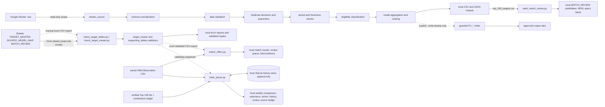
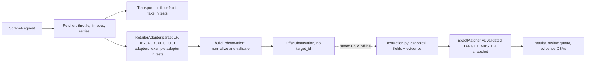

# Architecture

## System overview

The current system is a local Python pipeline that reads Shopee data from Google Sheets, processes it in memory, writes local diagnostics and ranking files, and optionally writes a guarded set of output worksheets. The `raw` worksheet is always a read-only input.



The current and planned portions are different deliverables. The shared scraping framework (overall Phase 6) and five retailer adapters, Laptop Factory, DataBlitz, PC Express, PC Central, and Octagon (Phase 7), are implemented and tested offline. All five are enabled for live use under project-owner decisions. Laptop Factory and DataBlitz each have one user-reported live check; a user-reported PC Express check returned one in-stock Acer offer. Controlled 2026-10-01 checks confirmed plain-string URLs for Laptop Factory (bare-URL recheck) and PC Express (`repr()` of the offer URL). PC Express's external-policy finding remains RESTRICTED under the retailer's terms. PC Central's finding is UNKNOWN; a bare-URL check failed safely with `AMBIGUOUS_VARIANT`, and a selected-variant check returned one in-stock offer. Octagon's finding is RESTRICTED under its terms; a user-reported live check returned one in-stock HP offer. These retailer paths remain separate from the Phase 4 Shopee pipeline. Phase 8 matching is implemented offline for saved observations and validated target CSV snapshots. Phase 9 (2026-10-12) adds an offline observation store, weekly comparisons, and price history over the published Top 100 verified configurations; it has no live collector or schedule. GitHub Actions is not implemented.

## Repository structure

```text
.
├── config/
│   ├── duplicate_decisions.csv       # Human decisions for duplicate conflicts
│   ├── eligibility_decisions.csv     # Model-level ELIGIBLE/EXCLUDED overrides
│   ├── eligibility_rules.csv         # Keyword inclusion and exclusion rules
│   ├── target_master_template.csv     # Header-only approved TARGET_MASTER layout
│   ├── source_model_map_template.csv  # Header-only Shopee-to-target mapping layout
│   ├── match_review_template.csv      # Header-only candidate review layout
│   └── identity_review_register_template.csv  # Header for the ignored local identity register
├── data/
│   ├── output/                       # Ignored local reports and target files
│   └── review/                       # Reserved local review area
├── docs/                             # Project and operations documentation
├── src/laptop_tracker/
│   ├── adapters/
│   │   ├── datablitz.py              # DataBlitz (DBZ) product-page adapter (Phase 7, offline)
│   │   ├── laptop_factory.py         # Laptop Factory (LF) product-page adapter (Phase 7, offline)
│   │   ├── oct.py                    # Octagon (OCT) product-page adapter (Phase 7, live use enabled)
│   │   ├── pcc.py                    # PC Central (PCC) product-page adapter (Phase 7, live use enabled)
│   │   └── pcx.py                    # PC Express (PCX) product-page adapter (Phase 7, live use enabled)
│   ├── config.py
│   ├── data_quality.py
│   ├── eligibility.py
│   ├── conventions.py                # model-code and cpu_series convention rules (2026-10-08)
│   ├── catalog_conventions.py        # Per-target convention proposals and sheet report
│   ├── extraction.py                 # Retailer spec rows -> canonical match fields (overall Phase 8)
│   ├── match_run.py                  # Offline batch matching and report records (overall Phase 8)
│   ├── matching.py                   # Five-field ExactMatcher (overall Phase 8)
│   ├── normalization.py              # Shared core-key comparison rules (Phases 5 and 8)
│   ├── collection.py                 # URL manifest, adapter routing, collection, match reports
│   ├── sheet_publication.py          # Pilot report validation, cell plans, guarded Sheets writes
│   ├── observation_store.py          # Append-only SQLite observation/match store (overall Phase 9)
│   ├── offers.py                     # Offer observation model (overall Phase 6)
│   ├── price_tracking.py             # Weekly comparison, selection, and history rules (Phase 9)
│   ├── periods.py
│   ├── pipeline.py
│   ├── ranking.py
│   ├── schema.py
│   ├── scraping.py                   # Shared adapter contract and retrieval (overall Phase 6)
│   ├── sheets_source.py
│   ├── sheets_writer.py
│   ├── supporting_tables.py
│   └── target_master.py
├── tests/
│   ├── example_adapter.py            # Offline example adapter (not a retailer integration)
│   ├── scraping_fakes.py             # Shared fake transport/clock and no-network guard
│   └── scraping_fixtures/            # Synthetic pages; laptop_factory/, datablitz/, pcx/, pcc/, and oct/ hold minimal retailer fixtures
├── check_target_master.py            # Local TARGET_MASTER CSV check (overall Phase 5)
├── check_target_tables.py            # Three-table CSV or read-only sheet check (overall Phase 5)
├── seed_match_review.py              # Top 100 -> local MATCH_REVIEW candidates (overall Phase 5)
├── match_offers.py                   # Observation CSV x TARGET_MASTER (CSV or read-only tab) matching (overall Phase 8)
├── audit_top_100_coverage.py         # Accepted Top 100 source-ID coverage report (overall Phase 5)
├── propose_catalog_conventions.py    # Local model/cpu_series correction proposals (read-only)
├── build_verified_top_100.py         # Top 100 verified configurations working list (Phase 5)
├── audit_verified_top_100.py         # Independent audit of a verified-configuration run
├── track_prices.py                   # Offline weekly comparisons and price history (Phase 9)
├── collect_and_match.py              # Manual online collection of listed pages + matching
├── publish_prices.py                 # Manual pilot publication to four PILOT_PRICE_* tabs
├── run_phase1.py                     # Legacy Phase 1 command name; overall Phase 4 work
├── smoke_test.py
├── pyproject.toml
└── requirements.txt
```

`data/output/`, `data/review/` (including seeded review candidates), `data/history/` (the Phase 9 SQLite store; `*.sqlite`, `*.sqlite3`, and `*.db` are also ignored), credentials, and local decision CSVs are ignored by Git. The project setup, implementation, tests, and initial docs are recorded in four purpose-based commits; the Phase 5 validator and this status refresh are recorded in follow-up feature and documentation commits. Generated reports and local decisions remain ignored; see [the progress log](PROGRESS_LOG.md).

## Current components

| Module or file | Responsibility |
|---|---|
| `config.py` | Loads settings from environment and `.env`; validates required Sheet and credential settings without printing secrets. |
| `schema.py` | Defines the required raw headers, checks header uniqueness, preserves cells as strings, and maps source names to internal names. |
| `sheets_source.py` | Loads service-account credentials, opens the configured spreadsheet, and reads the configured raw worksheet. `read_target_table_values()` reads the `TARGET_MASTER`, `SOURCE_MODEL_MAP`, and `MATCH_REVIEW` tabs with `get_all_values()` only, and reports a missing tab instead of creating it. Source reads always use the read-only OAuth scope. |
| `data_quality.py` | Validates row values, collapses exact duplicates, fingerprints duplicate conflicts, applies recorded human decisions, and detects model IDs mapped to multiple shop/item identities. |
| `periods.py` | Detects latest month and M-1, enforces the Manila-timezone freshness check, and builds period summaries. |
| `eligibility.py` | Loads keyword rules and local model-level decisions, then classifies listings. |
| `ranking.py` | Aggregates model GMV, selects a single distinct MTD price or flags a conflict, ranks eligible active models, and prepares review/excluded lists. |
| `pipeline.py` | Orchestrates read-independent processing, diagnostics, local files, conflict blocking, and the optional sheet-write path. |
| `sheets_writer.py` | Enforces the `P1_*` tab allowlist, prevents `raw` from being a destination, preserves the remote decision tab, replaces approved outputs, and appends run logs. |
| `run_phase1.py` | CLI entry point. Local output is the default; `--write-sheets` opts into the writer. |
| `smoke_test.py` | Read-only check for spreadsheet access, raw headers, and string-valued sample cells. |
| `target_master.py` | Holds the approved `TARGET_MASTER` column definitions and the five-field core identity key. Validates worksheet-shaped values (header row first) for headers, required fields, formats, dates, URLs, and duplicate `target_id` or core identity (compared with `normalization.py`), keeping exact strings. Uses no Google access. |
| `check_target_master.py` | Local CLI that validates a CSV export. Writes a local error report and, only on a full pass, a validated copy. Prints counts only. |
| `supporting_tables.py` | Validates `SOURCE_MODEL_MAP` against its exact `config/` header template and `MATCH_REVIEW` by header name (template columns in any order), reusing the `TARGET_MASTER` cell checks. Mapping checks cover one target per source ID and target references to valid master rows. Review checks cover the five statuses (`COMPLETE` requires the five core fields) and blank-tolerant specs in master formats. Also builds seed candidates from Top 100 values. It never promotes or maps a row. |
| `check_target_tables.py` | CLI that checks any of the three tables from local CSV snapshots, or with `--from-sheets` from the master sheet through the read-only reader. Writes per-table local reports and prints counts and codes only. |
| `seed_match_review.py` | CLI that writes one `NEW` candidate per distinct Top 100 model ID to an ignored local file. Specs, URLs, and approvals are left blank, and it refuses to overwrite an existing file. |
| `offers.py` | Retailer-neutral `OfferObservation` with `Decimal` price, ISO currency, availability evidence, and retrieval metadata, but no `target_id`. It also has optional `OfferDetails`: SKU, regular and sale price with `price_type`, raw specs, categories, and bundle flag. Also holds deterministic helpers for price parsing, text cleanup, and URL redaction. Uses no network or Google access. |
| `normalization.py` | Comparison-only keys for the five core fields (NFC, trademark marks removed, collapsed whitespace, case-fold; numeric screen size, RAM, and storage). Shared by the `TARGET_MASTER` duplicate check and the matcher. |
| `extraction.py` | Per-retailer extractors that map an adapter's labeled spec rows and structured details to canonical core and selected secondary fields, recording per-field evidence. Never parses titles or free text; refuses PCC/OCT shared multi-variant descriptions. See [MATCHING.md](MATCHING.md). |
| `conventions.py` | The 2026-10-08 value conventions shared by extraction and catalog proposals: the explicit model-code token rule (`model_codes`) and the canonical `cpu_series` forms (tiered families; `Apple` chips; `Intel N…` and `Celeron N…` processor numbers). |
| `catalog_conventions.py` / `propose_catalog_conventions.py` | Read-only proposals per `target_id` from a validated snapshot. A verified `manufacturer_model_code` becomes `model`, with the family name moved to `series`; `Apple` is added to bare Apple chips. It reports evidence, wording to preserve, unresolved issues, retailer discrepancies, and the duplicate core keys proposals would create. It also writes a diagnostic READY-only copy and a sheet correction report. It never edits Sheets, IDs, or mappings. |
| `verified_top.py` / `build_verified_top_100.py` / `audit_verified_top_100.py` | The Top 100 verified configurations (2026-10-12). It validates the full Phase 4 eligible ranking (one run, adjacent periods, unique exact-text IDs, sound decimal GMV) and checks it against the source Top 100 reference. It decides each source's contribution: mapped, target ACTIVE `CONFIGURATION` and unconflicted, COMPLETE review agreeing with the target under the 2026-10-08 conventions, and no open register entry. It aggregates by `target_id` with `Decimal`, ranks the full pool deterministically, then selects the top N. It writes the ranking, ledger, exclusions, review priority, and summary; the audit re-checks a published run. Read-only; no Sheets writes, `raw` reads, promotions, or mappings. The 2026-10-12 run (100 of 128) was published to `P1_TOP_100_CONFIGURATIONS` by the owner outside this code. |
| `matching.py` | `ExactMatcher`: five-field exact matching with secondary corroboration/conflict, near-candidate hints, and fail-closed `UNMATCHED`/`AMBIGUOUS`/`REVIEW_REQUIRED` outcomes. Never assigns inactive or duplicate-key targets. |
| `coverage.py` / `audit_top_100_coverage.py` | Phase 5 coverage audit. It classifies each accepted Top 100 `model_id` (exact text) against validated `TARGET_MASTER`, `SOURCE_MODEL_MAP`, and `MATCH_REVIEW` snapshots or read-only tabs, and lists `COMPLETE` review rows without an ACTIVE mapping. It writes local reports, prints counts only, and never promotes or maps. |
| `match_run.py` / `match_offers.py` | Batch matching path: rebuilds observations from CSV, reads `TARGET_MASTER` from a local snapshot (an export or a validated copy) or from the live tab read-only (`--target-master-from-sheets`), refuses a partly invalid `TARGET_MASTER`, and writes result, review-queue, and evidence CSVs. Prints counts only. No network access except the optional read-only `TARGET_MASTER` tab read; never reads `raw` or writes Sheets. |
| `collection.py` / `collect_and_match.py` | Manual online collection and matching (2026-10-12). Validates a five-column URL manifest as a whole against each adapter's `product_request()` and the selected working list, routes each enabled row to its adapter, and collects with `scrape_one()` on one shared `Fetcher` (host, live-use, timeout, retry, redirect, and throttle controls unchanged). Persists with `persist_scrape_results()`, matches under the current matching context, and writes a new run directory with request and failure reports, an observation CSV, match results, a review queue, field evidence, and a summary. `--preview` sends nothing. No search, crawling, or URL discovery. |
| `sheet_publication.py` / `publish_prices.py` | Manual Phase 10 publication (2026-10-12), separate from the legacy `sheets_writer.py`. It validates reviewed `track_prices.py` reports, the pilot scope, the selected list, and collection evidence as a whole, then filters to the scope and builds exact cell plans for four tabs (`PILOT_PRICE_COMPARISON`, `_HISTORY`, `_REVIEW`, `_RUN_LOG`). Preview uses the read-only scope. A write backs up existing publisher tabs locally, sends `updateCells` requests (literal text, PHP-formatted numbers, cell links) checked against the four tabs' sheet IDs, reads every cell back, and logs the status. It never touches the store, retailers, `raw`, or other tabs. |
| `observation_store.py` | Phase 9 SQLite store. Deterministic observation identity (offer + retrieval time) and offer key; batch validation and single-transaction imports; duplicate counting and conflict refusal; append-only triggers; matching contexts (catalog SHA-256 + rule version/fingerprint) with one result per observation and context. `persist_scrape_results()` accepts `scrape()` results directly. No network or Sheets access. |
| `price_tracking.py` / `track_prices.py` | Phase 9 offline reporting. Validates the selected list against the catalog and contribution ledger, matches pending stored observations, classifies comparability (EXACT, in scope, IN_STOCK, non-bundle, PHP, known price type), selects the lowest comparable price per target and retailer per Asia/Singapore week with deterministic ties, and writes the comparison, selections, weekly series, per-observation history with price changes, review queue, source ledger, and run summary. Prints counts only. See [PRICE_TRACKING_OUTPUT_SCHEMA.md](PRICE_TRACKING_OUTPUT_SCHEMA.md#phase-9-implementation-2026-10-12). |
| `scraping.py` | Shared adapter contract (`RetailerAdapter`, `ParsedOffer`), `Fetcher` with timeouts, bounded retries, per-retailer throttling, and redirects checked before they are sent. Injectable `Transport`/`Clock`, a fail-closed live-use gate, the `scrape()` runner, stage-specific failures, and redacted logging. The default transport is the standard-library `urllib`, with redirects disabled. See [SCRAPING_FRAMEWORK.md](SCRAPING_FRAMEWORK.md). |
| `adapters/laptop_factory.py` | Laptop Factory product-page parser. It prefers JSON-LD and falls back to visible content, gives sale versus regular price, combines stock evidence, flags bundles, and keeps raw Tech Specs. It makes no HTTP calls itself. `live_use_approved = True` under the project-owner policy; retailer permission remains unverified. See [adapters/LAPTOP_FACTORY.md](adapters/LAPTOP_FACTORY.md) and [RETAILER_DATA_USE_REVIEW.md](RETAILER_DATA_USE_REVIEW.md). |
| `adapters/datablitz.py` | DataBlitz Shopify product-page parser for `ecommerce.datablitz.com.ph`. It prefers JSON-LD and falls back to visible content, separates sale and compare-at prices, combines JSON-LD availability with the add-to-cart button, flags bundle wording, and keeps raw description specs. It ignores the quick-buy `<template>` copy and makes no HTTP calls itself. `live_use_approved = True` under the project-owner policy; retailer permission remains unverified. See [adapters/DATABLITZ.md](adapters/DATABLITZ.md). |
| `adapters/pcx.py` | PC Express Shopify (Kalles theme) product-page parser for `pcx.com.ph`. It reads the visible main block and reconciles the page's two Product JSON-LD blocks, failing when they disagree. It separates `<del>`/`<ins>` prices, combines JSON-LD availability with the add-to-cart and notify-me buttons, fails on variant markup, flags bundle wording, and keeps raw specs. It makes no HTTP calls itself. `live_use_approved = True` under an explicit project-owner decision; the retailer's published restriction remains recorded as RESTRICTED. See [adapters/PCX.md](adapters/PCX.md). |
| `adapters/pcc.py` | PC Central Shopify (Dawn theme) product-page parser for `pccentralcomputerstore.com`. For a multi-variant product it requires a `?variant=<id>` URL whose variant the page selected; otherwise it fails with `AMBIGUOUS_VARIANT`. It cross-checks the displayed price with the selected JSON-LD offer and the variant JSON. It gives a sale price only for Dawn's on-sale state with a higher compare-at price, and combines JSON-LD, variant, button, and sold-out-state availability. It checks product identity, flags bundle wording, and keeps raw description lines. It makes no HTTP calls itself. `live_use_approved = True` under the project-wide owner decision; the external-policy finding is UNKNOWN. See [adapters/PCC.md](adapters/PCC.md). |
| `adapters/oct.py` | Octagon Shopify ("Multi" theme) product-page parser for `www.octagon.com.ph`. It cross-checks the displayed `dl.#price` amount with the selected JSON-LD offer and the analytics variant price. It gives a sale price only for `@on-sale` with a higher `@compare` amount, and combines JSON-LD, stock-alert, and button availability. It checks SKU and product-path identity and quotes the theme's invalid leading-zero `gtin12` values before reading JSON-LD. It never takes the store name as brand, follows the PCC `?variant=<id>` rule, flags bundle wording, and keeps raw "Tech Specification" lines. It makes no HTTP calls itself. `live_use_approved = True` under the project-wide owner decision; the external-policy finding is RESTRICTED. See [adapters/OCT.md](adapters/OCT.md). |

Validation runs on local CSV exports or on read-only sheet reads; nothing writes the three Phase 5 tabs. The current `TARGET_MASTER` identity key is documented in [TARGET_MASTER_SCHEMA.md](TARGET_MASTER_SCHEMA.md) and aligned with the requested downstream fields in [PRICE_TRACKING_OUTPUT_SCHEMA.md](PRICE_TRACKING_OUTPUT_SCHEMA.md). Header templates for `TARGET_MASTER`, `SOURCE_MODEL_MAP`, and `MATCH_REVIEW` live under `config/`. The offline Phase 8 matcher reads a local `TARGET_MASTER` CSV snapshot only. The offline Phase 9 path (`track_prices.py`) reads the three validated snapshots plus the selected list; no approval-workflow module exists. The Phase 6 scraping framework does not read these tables. Promotion from review to master is a manual, human-approved step.

## Data-processing flow

1. `read_raw_values()` uses the configured spreadsheet ID and raw tab name, then calls `get_all_values()`; it does not call any write API.
2. `normalize_raw_values()` checks the required headers, pads short rows, converts cells to strings, assigns source row numbers, and creates the internal model/shop/item keys.
3. `validate_rows()` rejects rows with invalid dates, IDs, required names, prices, or GMV. Invalid rows are reported in `validation_errors.csv` and do not enter aggregation.
4. `collapse_duplicates()` groups by `(period_month, shop_id, item_id, model_id)`. Identical rows retain one copy. Conflicts require a fingerprint-matched decision from `config/duplicate_decisions.csv`; the redacted review template is local-only.
5. The pipeline detects the latest valid month and its preceding calendar month, then checks that the latest month is current in Manila time unless freshness checking is disabled.
6. Model identity conflicts are excluded. The remaining rows are classified using `eligibility_rules.csv` and `eligibility_decisions.csv`.
7. `aggregate_models()` calculates M-1 and MTD GMV by model, sums them for ranking GMV, selects one MTD price only when exactly one distinct value exists, and marks eligibility disagreements as `REVIEW`.
8. `rank_eligible_models()` retains `ELIGIBLE` models present in MTD and orders them deterministically. `top_100()` selects at most 100.
9. The pipeline saves local files and a run summary. In the CLI path, any unresolved duplicate or model-identity conflict then blocks a successful run before optional Google Sheets writes.

## Google Sheets integration and authentication

`Settings.from_env()` reads `.env` without overriding environment variables. It accepts either a service-account JSON file path (`GOOGLE_SERVICE_ACCOUNT_FILE`) or JSON text in an environment variable (`GOOGLE_SERVICE_ACCOUNT_JSON`); use the external file path for the documented local setup.

The `raw` read and the Phase 5 table reads use `https://www.googleapis.com/auth/spreadsheets.readonly`. Only the explicit writer path reconnects with `https://www.googleapis.com/auth/spreadsheets`. The service account also needs to be shared on the spreadsheet with the appropriate spreadsheet-level permission. Credentials remain outside the repository; `.env`, JSON keys, and common key formats are ignored by `.gitignore`.

The writer accepts only these tabs: `P1_TOP_100_TARGETS`, `P1_ELIGIBLE_RANKING`, `P1_EXCLUDED_LISTINGS`, `P1_ELIGIBILITY_REVIEW`, `P1_ELIGIBILITY_DECISIONS`, `P1_CONFLICTING_DUPLICATES`, `P1_VALIDATION_ERRORS`, `P1_PERIOD_SUMMARY`, and `P1_RUN_LOG`. It refuses the `raw` tab even with case or whitespace variations. There is no arbitrary test-tab writer.

Current read-only checks on 2026-09-28 found `TARGET_MASTER` but no rows or header, and found no existing `P1_*` output tabs. No output tab was written during documentation work.

On 2026-09-29, the user reported that all nine approved `P1_*` tabs had been created in the intended spreadsheet with verified headers and blank second rows. A synthetic-data writer test then completed against a dedicated test spreadsheet, and a user-provided read-only report confirmed all nine test tabs and headers, the expected synthetic rows, and a run-log count of 1. No production write or `run_phase1.py --write-sheets` run has occurred. The raw worksheet was not listed in the test-spreadsheet inspection report.

## Local execution and outputs

From the repository root in WSL, `python smoke_test.py` checks connectivity and raw headers. `python run_phase1.py --dry-run` reads the source and saves local CSV/JSON files under `data/output/`; running without a write flag has the same local-only write behavior. The reports can contain business data and are ignored by Git.

`duplicate_review.csv` is a redacted local decision template. The other output reports can include model and shop identifiers, names, prices, and GMV, so they should be handled as private business data.

## Error and failure boundaries

- Missing settings, inaccessible spreadsheet, missing raw worksheet, or invalid headers stop the run with an actionable error.
- Invalid rows are excluded and recorded. More than `MAX_VALIDATION_ERRORS` stops processing after the validation report is saved.
- An empty valid period set, stale latest month, invalid decision schema, stale duplicate fingerprint, or unresolved duplicate/model-identity record prevents publication.
- Source-read failures never fall back to a write-capable source scope.
- The write path is only reached after the local pipeline returns successfully and the caller set `--write-sheets`.
- `raw` is outside the writer allowlist and has a separate explicit safety guard.

## Planned GitHub Actions flow

There is no workflow in the repository today. Once the controlled pilot passes, a future scheduled workflow can install the pinned project dependencies, obtain credentials through an approved secret mechanism, run validation and generation, publish only approved outputs under explicit configuration, and retain logs or alert an operator on failure. Schedule, retention, secret rotation, approvals, and notification ownership remain to be decided during Phases 10-12.

## Retailer adapter boundary

The shared framework (overall Phase 6) exists. Five retailer adapters (Phase 7) exist and are enabled for live use under project-owner decisions. Laptop Factory, DataBlitz, and PC Express each have one user-reported live check; Laptop Factory and PC Express also have a controlled 2026-10-01 check. The external-policy findings for PC Express and Octagon are RESTRICTED. PC Central's bare-URL check stopped at `AMBIGUOUS_VARIANT` as designed; a selected-variant check returned one in-stock offer. A user-reported Octagon live check returned one in-stock HP offer at PHP 37,999. The boundary is:

1. *(Partly implemented)* `match_offers.py` reads `TARGET_MASTER` from a validated snapshot or read-only from the live tab, and matches only if every row passes; deriving scrape requests from targets is still planned. Read only validated laptop configurations from `TARGET_MASTER`, meaning rows that pass `validate_target_master` under the approved schema, and only `SOURCE_MODEL_MAP` links that pass `validate_source_model_map`. `read_target_table_values()` provides the read-only input. How scrape requests are derived from targets is not yet defined, and the framework does not assume `TARGET_MASTER` is populated.
2. *(Implemented)* `scrape()` takes a `ScrapeRequest` (retailer ID and URL) and fetches through the shared `Fetcher`. The adapter parses the page into `ParsedOffer` values. Nothing changes any sheet.
3. *(Implemented)* The framework returns `OfferObservation` values with retailer, offer URL, UTC retrieval time, raw product and configuration text, `Decimal` price, ISO currency, availability evidence, and retrieval metadata, plus stage-specific `ScrapeFailure` records.
4. *(Implemented offline, Phase 8)* `match_offers.py` matches saved observations (a CSV of `to_full_record()` rows) against a validated `TARGET_MASTER` snapshot through `extraction.py` and `ExactMatcher`. Ambiguous or partial matches are review-queue rows, not silent matches. Observations themselves still carry no `target_id`, and nothing yet persists live observations for this step. See [MATCHING.md](MATCHING.md).
5. *(Implemented offline, Phase 9)* `track_prices.py` stores saved observations in the local SQLite history store, matches them under a recorded matching context, and writes the weekly comparison and price-history outputs defined in [PRICE_TRACKING_OUTPUT_SCHEMA.md](PRICE_TRACKING_OUTPUT_SCHEMA.md). A future supervised collector can call `persist_scrape_results()`; none is scheduled.



The framework is called by one command, `collect_and_match.py`, for explicitly listed product pages; no scheduled job or Sheets code calls it. Its observations are stored with `observation_store.persist_scrape_results()` (Phase 9).
