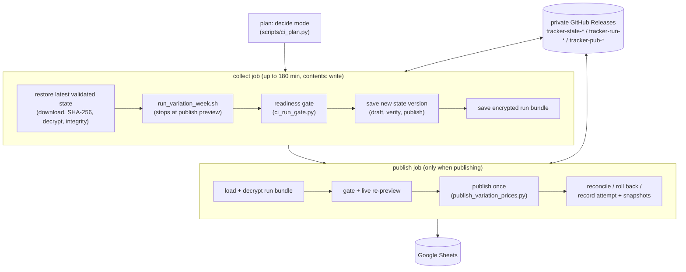

# GitHub Actions automation: setup and operation

The weekly tracker runs on GitHub-hosted runners. **Nothing from Google Cloud except the Sheets
service account is involved: no billing account, no Cloud Storage bucket, no Workload Identity
Federation, no homelab, no always-on computer.**

- **Where it runs:** GitHub Actions, workflow
  [.github/workflows/weekly-laptop-tracker.yml](../.github/workflows/weekly-laptop-tracker.yml).
- **Where the history lives:** encrypted assets of **private GitHub Releases** of this repository,
  written with the built-in `GITHUB_TOKEN`.
- **How it reaches Google Sheets:** the service-account key you already use locally, kept in the
  GitHub Actions Secret `GOOGLE_SERVICE_ACCOUNT_JSON`.
- **What it runs:** the unchanged driver `scripts/run_variation_week.sh` and the unchanged publisher
  `scripts/publish_variation_prices.py`.

> **Status.** Implemented and tested offline (`python -m pytest -q`), and the GitHub Releases calls
> were probed once against the real API with draft releases (below). **It has not run on GitHub
> Actions yet**, so it is not production-ready until the first hosted preview, a controlled
> publication and a second run have passed ([First test](#first-test-in-this-order)).

## Contents

1. [What was found in the repository](#what-was-found-in-the-repository)
2. [Architecture](#architecture)
3. [GitHub Releases as storage: facts and limits](#github-releases-as-storage-facts-and-limits)
4. [Modes, schedule and activation](#modes-schedule-and-activation)
5. [Safety gates and idempotency](#safety-gates-and-idempotency)
6. [Secrets and Variables](#secrets-and-variables)
7. [Prerequisites](#prerequisites)
8. [One-time setup](#one-time-setup)
9. [First test, in this order](#first-test-in-this-order)
10. [Enable the weekly schedule](#enable-the-weekly-schedule)
11. [Operating it](#operating-it)
12. [Sheets quota handling](#sheets-quota-handling)
13. [Encryption key: backup and rotation](#encryption-key-backup-and-rotation)
14. [Storage size and retention](#storage-size-and-retention)
15. [Runtime and cost](#runtime-and-cost)
16. [Troubleshooting](#troubleshooting)
17. [What has and has not been verified](#what-has-and-has-not-been-verified)

## What was found in the repository

- **Authoritative pipeline command:** `bash scripts/run_variation_week.sh`. It runs 15 stages in
  order (`sales_refresh` to `publish_preview`), logs each to `stages.jsonl`, and writes `status.json`
  in `data/output/weekly_runs/<UTC time>/` (`READY_TO_PUBLISH` or `FAILED_AT_<stage>`). The workflow
  calls this driver; it does not repeat the stages. Stage 1 (sales refresh) reads the Shopee sales
  tab from the workbook, so the workbook is also the data source.
- **Publication command:** `python scripts/publish_variation_prices.py --write-sheets ...`. Automation
  calls it through `scripts/ci_publish.py`; there is no second publisher.
- **Google authentication:** `GOOGLE_SERVICE_ACCOUNT_JSON` (the key's JSON text) or
  `GOOGLE_SERVICE_ACCOUNT_FILE` (a path), read by `src/laptop_tracker/sheets_source.py`. The workflow
  uses the JSON variant from a Secret, so **no credentials file is ever written on the runner**.
  Local use is unchanged.
- **Persistent state that is not in Git** (authoritative, not reproducible), 40 MB uncompressed and
  about 4 MB compressed today: `data/history/price_history.sqlite3` (append-only observations),
  `data/history/retailer_rate_limits.json` (429 cooldowns that keep requests respectful),
  `config/duplicate_decisions.csv`, `config/eligibility_decisions.csv`,
  `config/identity_review_register.csv` (owner decisions; a missing file would silently change
  eligibility or duplicates).
- **Deliberately not persisted:** everything under `data/output/` (rebuilt each run), retailer HTML
  evidence, and the search cache (only valid for 24 hours, so a weekly run is always cold).
- **Existing publisher guarantees:** the publication ID is derived from the report content, the run
  log (`PILOT_PRICE_RUN_LOG`) is keyed by it, each tab is replaced as a whole, every cell is read
  back, the previous tabs are snapshotted first and `--rollback` restores them.

Findings that shaped the design (all still true): a read-quota 429 during the final run-log read was
once reported as a failed publication after a successful write (handled by `SUCCEEDED_UNREPORTED`);
discovery exit code 2 (`PARTIAL_SUCCESS`) is **normal**, so only significant retailer request failures block
unattended publication (see [Retailer request failure policy](#retailer-request-failure-policy)); the throttled 2026-11-09 run was `READY_TO_PUBLISH` with 30 instead of 41
matching rows, which the gate now blocks; the compact dashboard layout has **never been written
live** (adjacent column groups are written as one merged group, tested only against a fake that
merges like Sheets).

## Architecture



### How the Releases are organised

Every object is its **own release with a unique tag that is never reused**, so nothing is ever
overwritten, whether or not "immutable releases" is enabled.

| Tag | Assets | Holds | Created |
|---|---|---|---|
| `tracker-state-000001`, `-000002`, ... | `manifest.json` (public metadata), `state.tar.gz.enc` | **Collection state**: the five files above, in one encrypted, compressed archive | First by `ci_state.py seed`, then after every collection run (even a failed one, if the database validates), and by `rollback` |
| `tracker-run-<run id>` | `manifest.json`, `bundle.tar.gz.enc` | **Run bundle**: reports and preview of one run (no saved retailer pages) | When the pipeline reached `READY_TO_PUBLISH` |
| `tracker-pub-<publication id>-a01`, `-a02`, ... | `manifest.json`, `attempt.tar.gz.enc` | **One publication attempt**: classification, counts, and the publisher's snapshots of the tabs it replaced (recovery data) | After each publish attempt that changed or tried to change the Sheet |

`manifest.json` is deliberately non-sensitive: sequence number, run ID, timestamps, parent version
and its manifest hash, SHA-256 and size of the encrypted archive, algorithm and key ID. It holds no
row counts, prices, sheet names or credentials. Release titles and bodies are fixed, generic text.
GitHub Actions cache is not used for any of this. The only workflow artifact is a 7-day
`diagnostics-*` file with `status.json`, `stages.jsonl`, `driver.log` and `gate.json`.

### How a version is written (and why a half upload is never state)

1. The post-run files are checked: SQLite `integrity_check`, foreign keys, required tables, schema
   version; CSV and JSON shape; the database must still contain every restored observation unchanged
   (id, retrieval time, price, digest) and every batch and context.
2. The files are packed into a reproducible `tar.gz` and encrypted with AES-256-GCM.
3. A **draft** release for the next sequence number is created. A draft is invisible to every
   reader, so nothing is state yet. A draft younger than 6 hours with the same tag stops this run
   (another writer may be active); an older one is treated as abandoned and removed.
4. If two writers create drafts at the same moment the **lowest release ID wins** and the other stops
   without saving.
5. Both assets are uploaded, then **downloaded again, checksummed, decrypted and fully validated**.
6. Just before publishing, the latest published version is checked once more; if it moved, nothing is
   published.
7. The draft is **published**. Only now is it a state version.

Saving the same content for the same run twice returns the existing version instead of a duplicate.
Any failure deletes the draft and leaves the previous version latest.

**Restore** takes the highest published version, downloads it, verifies the SHA-256, decrypts,
validates every file and only then replaces local files. If the newest published version is damaged
it **fails loudly instead of quietly using an older one** (older data would silently drop weeks of
observations); recover with `rollback` ([Operating it](#operating-it)). Without any state, or with
a wrong or missing key, it stops. **An empty history is never created automatically.**

## GitHub Releases as storage: facts and limits

**Verified against the real API on 2026-11-10** (read access, plus draft releases created and deleted
again; the repository ended with no releases and no tags; probe made with the owner's `gh` login, not
with an Actions token):

- The repository is **private** and **immutable releases are currently off**
  (`GET /repos/.../immutable-releases` returned `enabled: false`).
- A token with push access **lists draft releases**, with their assets, and can download draft assets.
- **Two drafts may share one tag**, so a tag does not work as a lock. The lowest-release-ID rule above
  exists because of this.
- Uploading an asset whose name already exists in a release is **refused** (HTTP 422).
- The release object has an `immutable` field.

**From GitHub's documentation:** a file in a release must be under 2 GiB, a release holds up to 1,000
assets, and there is no limit on a release's total size or on bandwidth. With immutable releases a
published release's assets and tag can no longer be changed, uploads to it fail with 422, and
deleting it does not free its tag name. The recommended flow, which this design uses, is draft, then
attach assets, then publish. The compressed state (about 4 MB) is far below every limit.

**Limitations you should know about (not hidden):**

- **Releases are not a database and give no atomic compare-and-swap.** One run at a time comes from
  the workflow's concurrency group; unique sequence numbers, the draft claim rule, the parent check
  before publishing, and read-back verification are the best achievable equivalent. A second writer
  outside Actions (for example `ci_state.py save` from a laptop at the same moment) is caught by the
  same checks, but this is not a transaction.
- **No lease lock.** The previous design's state lock does not exist; a crashed run leaves at worst a
  draft, which is ignored and expires.
- **Tags accumulate** in the repository (`tracker-state-000012` and so on). Releases are published
  with "latest release" disabled so they do not appear as your product's release.
- **Draft visibility needs write access.** That is why the `collect` and `publish` jobs request
  `contents: write`. This was not tested with a real Actions token yet.
- **Do not delete state releases by hand.** If immutability is on, a deleted release keeps its tag
  reserved, so that sequence number could never be reused.
- **Private storage is not permission.** Storing company sales and pricing data in GitHub, even
  privately and encrypted, may need approval from your organisation: see [Prerequisites](#prerequisites).

## Modes, schedule and activation

| Mode | Trigger | Collect | Write Sheets |
|---|---|---|---|
| **A. Manual preview** (default) | Actions, Run workflow, `publish` unchecked | yes | **no** |
| **B. Manual production** | Run workflow, `publish` checked | yes | yes, after the gates |
| **B2. Publish a saved run** | `publish` checked and `existing_run_id` set | no | yes, after the gates |
| **C. Scheduled** | Mondays 09:17 `Asia/Manila` | per `WEEKLY_AUTOMATION` | per `WEEKLY_AUTOMATION` |

The schedule uses GitHub's `timezone: "Asia/Manila"` key (an IANA zone, no daylight saving; I could
not confirm the key on the official syntax page, so **the first scheduled week must be watched**).
Scheduled runs only start from the default branch and may be delayed by several minutes.
`WEEKLY_AUTOMATION` is a repository Variable and is **inert until set**: unset or `off` skips the
scheduled run before anything happens; `preview` runs mode A weekly; `publish` is the full unattended
run. Scheduled runs never use the manual acceptance of retailer failures; minor failures publish with a
warning under the [policy](#retailer-request-failure-policy).

Every mode saves the validated collection state (new observations are real evidence and the
rate-limit cooldowns must carry over). Only the `publish` job writes to Sheets, and only in a run that
asked for it.

## Safety gates and idempotency

`scripts/ci_run_gate.py` reads the run's own `status.json`, `stages.jsonl`, discovery summary and the
publisher's preview report, never console text. It blocks when:

- `status.json` is not `READY_TO_PUBLISH`, or any of the 15 stages is missing or exited with a code
  the driver does not accept (the stage list is tested against the driver);
- a report folder is empty, the discovery summary or preview report is missing, or the preview is not
  `PREVIEW_ONLY`;
- discovery failed outright, or **significant retailer request failures** occurred (graded by the
  [policy below](#retailer-request-failure-policy): minor, isolated failures only warn). A person can
  accept a blocking finding explicitly (`accept_retailer_failures`) after reading the diagnostics;
- the run is older than 7 days;
- optionally, `MAX_MATCHING_DROP_PCT` is set and matching rows fell by more than that percentage
  against the last successful publication. **Off by default**: no coverage threshold is invented.

`scripts/ci_publish.py` then, in the `publish` job: repeats the gate on the downloaded bundle; runs
the publisher's own `--preview` against the **live** workbook and requires the same publication ID;
reads the live run log and, if this publication is already `SUCCESS` with readback `PASSED`, stops
with `ALREADY_PUBLISHED` and **writes nothing and records nothing**; otherwise writes **once** (never
an automatic second attempt); classifies a failure (`FAILED_BEFORE_WRITE`, `SUCCEEDED_UNREPORTED` =
written and verified, `PARTIAL_WRITE` = the publisher's own `--rollback` restores the snapshots); then
stores one attempt record with the snapshots. A record that cannot be stored fails the job even if the
Sheet was published, so it is never silent.

The run bundle is stored **before** any publication starts, so a failed publication never needs
another scrape.

### Retailer request failure policy

The gate used to block on **any** failed request. One failed Octagon page among about 770 requests
(2026-11-22) stopped an otherwise complete report. `src/laptop_tracker/retailer_failure_policy.py`
now grades the failures instead; the decision is `PASS`, `PASS_WITH_WARNINGS` or `BLOCKED`
(`gate.json` field `decision`; `ok`, `blocking`, `warnings` and `metrics` are unchanged).

**What is counted** (each failure once; `discovery/search_requests.csv`, `product_inspections.csv`):
a search whose outcome is `SEARCH_ERROR` or `UNSUPPORTED_LAYOUT`, and a page inspection that is
`FETCH_FAILED`. Rows answered from a saved copy and requests never sent are not attempts. A 429 is an
attribute of the failed row, and the summary's `PROVIDER_FAILURE` / `RETAILER_STOPPED_AFTER_ERRORS`
counters are cross-checked against the rows, never added to them.

| Level | Condition | Result |
|---|---|---|
| A, minor | all thresholds below hold, no retailer stopped or unavailable, and every failed request is visible in the report as an unresolved candidate or incomplete search | `PASS_WITH_WARNINGS`, publishes |
| B, moderate | two or more failures on one target; or a failed search whose job still ended as "searched, nothing found" (it would read as a confirmed absence); or a failed request whose job outcome cannot be read | blocks when material (a target with no retailer price anywhere, a silent negative, unknown impact), otherwise warns |
| C, significant | a threshold is exceeded; a retailer was stopped after repeated errors or answered no search; too much of the plan was never executed; provider failures the request files do not explain | `BLOCKED` |

Not retailer failures, and never accepted by anyone: missing, unreadable or mutually inconsistent
discovery files, a failed stage, an invalid preview, a stale run, a coverage drop beyond
`MAX_MATCHING_DROP_PCT`. If the diagnostics cannot establish that a failure is minor, the gate fails
closed.

**Thresholds** (optional repository Variables; unset or empty means the default; a set but invalid
value, such as `-1`, `2.5` for a count, `101` or `nan` for a percentage, **blocks** instead of falling
back):

| Variable | Default | Meaning |
|---|---|---|
| `RETAILER_FAILURE_MAX_TOTAL` | `3` | failed requests across all retailers (whole number) |
| `RETAILER_FAILURE_MAX_PER_RETAILER` | `2` | failed requests of any one retailer (whole number) |
| `RETAILER_FAILURE_MAX_RETAILER_PCT` | `10` | failed / attempted of any one retailer, 0 to 100 |
| `RETAILER_FAILURE_MAX_TOTAL_PCT` | `1` | failed / attempted over all retailers, 0 to 100 |
| `RETAILER_FAILURE_MAX_UNSENT_PCT` | `5` | planned searches never executed (budget, search limit, retailer failing) / planned searches, 0 to 100; checked only when a request failed |

Why these: with about 680 discovery requests, three failures is 0.4%, so the 1% overall limit is the
binding one only for small runs and the counts are the real brake; two per retailer and 10% of a
retailer's requests keep one flaky site from hiding behind a large total; a retailer that stopped
searching after two consecutive errors, or answered nothing, is never "minor". The unsent limit
catches a run whose request budget ran out, which the old gate ignored when nothing had failed.
Percentages are compared exactly, not as rounded floats.

**Manual acceptance** (`accept_retailer_failures`, scheduled runs never use it) lets a person publish
a run whose retailer-failure findings block. It is recorded: `gate.json` and the publication attempt
record carry `manual_acceptance` (`requested`, `used`, `overrode_block`) and the job summary says so.
It cannot reach any other check (see above).

**Bundles and the two jobs.** Collect and Publish evaluate the same files with the same Variables:
run bundles now also keep `discovery/search_requests.csv` and `discovery/product_inspections.csv`
(a few hundred KB, encrypted like the rest). A bundle saved before this change (for example
`tracker-run-20261122T071112Z`) holds neither file, so its failures cannot be recounted; the gate
blocks it with a message that **only** `accept_retailer_failures` clears (read that run's collection
job summary first).

## Secrets and Variables

Secrets are passed **only to the steps that need them** (never workflow-wide or job-wide, never in a
`run:` line). The scraper step receives the Sheets secret but neither the state key nor a GitHub token.

| Name | Kind | Required | Format | Used for |
|---|---|---|---|---|
| `GOOGLE_SERVICE_ACCOUNT_JSON` | **Secret** | yes | the whole service-account key file, as text | Sheets read/write (the run log prints only the account's e-mail) |
| `STATE_ENCRYPTION_KEY` | **Secret** | yes | 32 random bytes, base64url, made by `ci_state.py keygen` | Encrypting and decrypting state, bundles, records |
| `STATE_ENCRYPTION_KEY_PREVIOUS` | Secret | only during key rotation | same format | Decrypting older versions after a rotation |
| `GITHUB_TOKEN` | built in | automatic | issued per run, expires with it | Reading and writing the private Releases. **You create nothing.** |
| `SPREADSHEET_ID` | Variable | yes | the part of the Sheet URL between `/d/` and `/edit` | Which workbook |
| `WEEKLY_AUTOMATION` | Variable | no, **set last** | `preview` or `publish` | Activates the schedule |
| `MAX_MATCHING_DROP_PCT` | Variable | no | `30` | Optional coverage-drop gate |
| `RETAILER_FAILURE_MAX_TOTAL`, `_MAX_PER_RETAILER`, `_MAX_RETAILER_PCT`, `_MAX_TOTAL_PCT`, `_MAX_UNSENT_PCT` | Variable | no | defaults `3`, `2`, `10`, `1`, `5` | Thresholds of the [retailer failure policy](#retailer-request-failure-policy) |

A missing or malformed Secret fails the run in its first step naming **only the setting**, never its
value (an invalid service-account text or key is rejected without being echoed).

## Prerequisites

1. **Authorisation for the data.** The tracker holds Shopee sales and pricing data for your company.
   Check that storing it, encrypted, in a private GitHub repository's Releases and processing it on
   GitHub-hosted runners is allowed by your company's policy. Private storage is not approval.
2. **Keep the repository private.** Never change its visibility; Releases and logs would become
   public.
3. **Service-account key creation must be allowed.** You already use a key locally. If your
   organisation blocks key creation (`iam.disableServiceAccountKeyCreation`), do **not** bypass it;
   the key you already have can be used, and a different approved method would need a code change.
4. **GitHub Actions minutes.** A private repository on GitHub Free includes 2,000 minutes a month;
   see [Runtime and cost](#runtime-and-cost).

## One-time setup

Do these in order. **Never paste a key, token or the JSON file into this chat or any document.**

### 1. Check the Google service account and the workbook (no billing needed)

Service accounts, their keys and the Google Sheets API are free; a Google Cloud project without a
billing account is enough for this.

1. Open <https://docs.google.com/spreadsheets/d/1QPN5vaxv8rNlpnSzsvQh_iX11ppGbKOPmELxSOAnyt0/edit>,
   click **Share** (top right). In the list, find the service account's address (it ends in
   `.iam.gserviceaccount.com`) and check its role is **Editor**. **Verify:** it is listed as Editor.
2. You will use the **same JSON key file** your local `.env` points to with
   `GOOGLE_SERVICE_ACCOUNT_FILE`. Only if you have lost it: <https://console.cloud.google.com/> >
   your project > **IAM & Admin > Service Accounts** > click the account > **Keys > Add key > Create
   new key > JSON > Create**; the file downloads. Keep it outside the repository.

### 2. Add the Sheets Secret

Easiest and safest (the key never touches the clipboard), from your Linux/WSL terminal:

```bash
gh auth status                       # must show you are logged in to github.com
gh secret set GOOGLE_SERVICE_ACCOUNT_JSON < /path/to/your-service-account-key.json
```

Or in the browser: <https://github.com/jarlericaa/laptop-price-tracker> > **Settings > Secrets and
variables > Actions > Secrets tab > New repository secret** > Name `GOOGLE_SERVICE_ACCOUNT_JSON` >
Secret: open the JSON file in a text editor, **select all**, copy, paste > **Add secret**.
**Verify:** the secret is listed under *Repository secrets* (its value is never shown again).

### 3. Create and store the encryption key

```bash
cd ~/laptop-price-tracker && source .venv/bin/activate
python -m pip install -r requirements.txt
python scripts/ci_state.py keygen --out ~/laptop-tracker-state.key   # prints only a key ID
gh secret set STATE_ENCRYPTION_KEY < ~/laptop-tracker-state.key
```

**Back the key file up now** (see [Encryption key](#encryption-key-backup-and-rotation)); without it
the stored history cannot be read. **Verify:** `gh secret list` shows `STATE_ENCRYPTION_KEY` and the
`keygen` output printed a `key_id`.

### 4. Add the Variable

**Settings > Secrets and variables > Actions > Variables tab > New repository variable**: name
`SPREADSHEET_ID`, value `1QPN5vaxv8rNlpnSzsvQh_iX11ppGbKOPmELxSOAnyt0` > **Add variable**.
Do **not** add `WEEKLY_AUTOMATION` yet. **Verify:** it appears under *Repository variables*.

### 5. Confirm Actions may create the state Releases

**Settings > Actions > General > Workflow permissions.** The workflow requests `contents: write` on
two jobs by itself, so either option normally works. If your organisation restricts it and the first
run fails with `HTTP 403 ... contents: write`, set *Read and write permissions* here (or ask the
organisation owner). **Verify:** the first preview run (below) reaches *Save validated state*.
Optional hardening: **Settings > Environments > New environment** named `production`, enable
**Required reviewers** (yourself) so every publication waits for your click, and under *Deployment
branches* choose *Selected branches* = `main`.

### 6. Merge the workflow

Open the pull request from `automation/github-actions-weekly` into `main`, check that the **Tests**
workflow is green, and merge. The *Run workflow* button only appears for workflows on `main`.
Merging starts nothing: the schedule is inert and the workflow has no push trigger.

### 7. Seed the first state (once, from the machine that holds the real history)

```bash
cd ~/laptop-price-tracker && source .venv/bin/activate
gh auth status                                # needs the default 'repo' scope; gh auth login if not
export STATE_ENCRYPTION_KEY="$(cat ~/laptop-tracker-state.key)"
python scripts/ci_state.py seed
```

It validates the SQLite history and the three decision files, builds the encrypted archive, uploads
it as `tracker-state-000001`, downloads it again and proves it restores. **Your local files are only
read, never changed.** **Verify:** the output shows `"version_id": "tracker-state-000001"` and
`"restore_check": "ok"`, and <https://github.com/jarlericaa/laptop-price-tracker/releases> lists
*Tracker state 000001* with the assets `manifest.json` and `state.tar.gz.enc`. `seed` refuses to run
twice. Afterwards the Releases hold the authoritative copy: run
`python scripts/ci_state.py restore --overwrite` before using the pipeline locally again.

## First test, in this order

1. **Preview run (mode A).** **Actions > Weekly laptop price tracker > Run workflow**, branch `main`,
   leave *publish* unchecked. The run checks the Secrets, reads the Sheet (the log of *Check Google
   Sheets access* prints `Spreadsheet title: ...`), restores state, runs the pipeline (about 70
   minutes) and the gate.
2. **Verify that state was restored.** The log of *Restore the latest validated state* prints
   `"version_id": "tracker-state-000001"` and the row counts matching your local database.
3. **Verify that a new version was saved.** The log of *Save validated state* prints a new
   `version_id` (`tracker-state-000002`) and `new_observations`; the Releases page shows it; the
   *Report stored size* step adds a size table to the run summary.
4. **Confirm production was not changed.** The *Publish to Google Sheets* job shows *Skipped*. In the
   Sheet, **File > Version history > See version history** shows no new version by the service
   account, and `PILOT_PRICE_RUN_LOG` has no new row.
5. **Test publication against a separate copy.** In the Sheet choose **File > Make a copy** (all
   tabs), open the copy, **Share** it with the service account as Editor, and copy its ID from the
   URL. Change the Variable `SPREADSHEET_ID` to the copy's ID. Run the workflow again with *publish*
   checked and *existing_run_id* = the folder name of the preview run (shown in its summary and in
   the *Run bundle* step, like `20261110T010000Z`), which avoids another scrape. If the gate blocked
   the run for retailer failures, read the table first; tick *accept_retailer_failures* only if you
   accept that coverage. Approve the waiting `production` job if you required reviewers.
6. **Verify the copy really was the destination.** The publish log prints `Destination spreadsheet:
   Copy of ...`; the **copy's** `PILOT_PRICE_RUN_LOG` has a row with the publication ID, `SUCCESS` and
   readback `PASSED`, and the copy has one visible `PRICE COMPARISON` tab (19 columns, one row per
   Top 100 variation) with the `PILOT_PRICE_*` tabs hidden (unhide `PILOT_PRICE_COMPARISON` to see the
   compact technical layout with collapsed detail columns); the **production** workbook's version
   history is unchanged.
7. **Test idempotency.** Repeat step 5 with the same `existing_run_id`: the job must end
   `ALREADY_PUBLISHED`, change nothing and add no new `tracker-pub-...` release.
8. **Test recovery.** Run `python scripts/ci_state.py verify` (downloads and validates the latest
   state) and `python scripts/ci_state.py publication-fetch --publication-id PUB-... --dest /tmp/p`
   (the snapshots needed for a rollback). Optionally rehearse `rollback` ([Operating it](#operating-it))
   only if you are happy to add a version.
9. **Persistence across two runs.** Run mode A once more; its *Restore* step must show the version the
   previous run saved.
10. **First approved production run.** Set `SPREADSHEET_ID` back to the production ID, make one more
    safety copy of the workbook, then run *publish* with the same or a new `existing_run_id`, approve
    it, and verify the production run log and layout as in step 6.

## Enable the weekly schedule

Only after the first test above succeeded, ideally after one scheduled week in `preview`:

1. **Settings > Secrets and variables > Actions > Variables > New repository variable**: name
   `WEEKLY_AUTOMATION`, value `publish` (`preview` for a dry week).
2. Verify the next Monday 09:17 Manila run starts (Actions tab; allow a few minutes of delay).

Nothing else changes. Switch it off by setting the value to `off` or deleting the Variable; stop
everything with **Actions > Weekly laptop price tracker > ... > Disable workflow**. If you added
required reviewers to `production`, a scheduled publication waits for your approval.

The weekly flow is: **Monday 09:17 Asia/Manila, restore state, scrape, reports, validate, publish
to Google Sheets, verify, save state**.

## Operating it

| Task | How |
|---|---|
| See what happened | Actions > the run > Summary; artifact `diagnostics-*`; the Sheet's `PILOT_PRICE_RUN_LOG`; the Releases page. |
| Retry a failed **publication** without scraping | Run workflow: *publish* checked, *existing_run_id* = the run folder name. A bundle exists for runs that reached `READY_TO_PUBLISH`. A previous `PARTIAL_WRITE` was already rolled back by the job; read its record first (`publication-fetch`). If the run log shows an earlier attempt of the same run as `IN_PROGRESS`, `PARTIAL_FAILURE` or `READBACK_FAILED`, the job stops (`BLOCKED_PRIOR_ATTEMPT`) until you have inspected the data tabs and tick *rerun_after_partial*. A failure **before** the first write (for example the Sheets quota while taking the backups) leaves no run-log row, so it needs no confirmation. |
| Retry a failed **collection** | Run workflow again. State from the failed run was saved if its database validated, so no evidence is lost; do not rerun repeatedly, retailers answer 429. |
| List stored versions | `python scripts/ci_state.py versions` (shows `complete: false` for a damaged one). |
| Check a version end to end | `python scripts/ci_state.py verify [--version N]` |
| Restore a version locally | `python scripts/ci_state.py restore --version N --overwrite` |
| **Roll state back** | `python scripts/ci_state.py rollback --to N` validates version N and publishes it as a **new** latest version; the bad one stays for inspection (releases are never edited or deleted). |
| Roll back a publication | `python scripts/ci_state.py publication-fetch --publication-id PUB-... --dest /tmp/pub`, then `python scripts/publish_variation_prices.py --rollback /tmp/pub/snapshots` |
| Stop automatic publication | `WEEKLY_AUTOMATION` = `preview` or `off`. |

Local commands need `gh auth login`, `STATE_ENCRYPTION_KEY` in the environment, and (if
`STATE_ENCRYPTION_KEY_PREVIOUS` was used) that too. They never print key material.

## Sheets quota handling

Google allows 60 read and 60 write requests per minute per user. One publication needs about 45
reads (a preview, the pre-write inspection, the snapshots, the readback) and 8 writes, so it sits
close to the read limit. `src/laptop_tracker/sheets_quota.py` therefore protects every Sheets call
(it is gspread's HTTP layer, installed by `sheets_source.connect`):

| Part | Behaviour |
|---|---|
| Throttle | At most 40 reads and 40 writes in any 60 seconds, process-wide (`SHEETS_READS_PER_MINUTE` / `SHEETS_WRITES_PER_MINUTE` override, both must stay under 60). A burst waits instead of being refused. |
| Worksheet list | Fetched once per publication phase (inspect, back up, write, read back) instead of before every tab read; dropped when a write can add, remove or rename a tab. Tab **contents** are never cached. About 91 % fewer listing requests (44 to 4 per preview plus write on the test fixture). |
| Retry | HTTP 429 and quota-style 403: up to 6 attempts, waits of about 4, 8, 16, 32 and 60 seconds plus up to 25 % jitter, `Retry-After` honoured as a minimum, a request abandoned when Google asks for more than 120 s, 240 s of waiting in total. 5xx and network errors: **reads only**. A write is retried only after a 429, which Google rejects before running it. |
| Never retried | 401/403 (authentication, permission), 400 (validation), 404, and any data error: they fail on the first request. |
| When it gives up | `SheetsRetryExhausted` states the attempts, the seconds waited and Google's answer. Before the first write it is `FAILED_BEFORE_WRITE` (nothing changed). After the data tabs were written but could not be read back, the run log is set to `PARTIAL_FAILURE` and the job rolls back from the snapshots. |

Logs show the method, the endpoint with the spreadsheet ID removed, the status and the delay;
never headers, tokens or request bodies.

## Encryption key: backup and rotation

The key is generated **on your machine** (`ci_state.py keygen`), never inside a runner, and lives in
two places only: the GitHub Secret and **your own backup**. A key that exists only in GitHub cannot
be retrieved again, and **without it the stored history is unreadable**.

- **Back up:** keep `~/laptop-tracker-state.key` in your password manager (paste the file's single
  line as a secure note) and, if your company has one, in its approved secret vault. Do not email it,
  commit it or paste it into chat.
- **Rotate** (for example once a year, or if it may have leaked):
  1. `python scripts/ci_state.py keygen --out ~/laptop-tracker-state-new.key`
  2. Move the current value to `STATE_ENCRYPTION_KEY_PREVIOUS`
     (`gh secret set STATE_ENCRYPTION_KEY_PREVIOUS < ~/laptop-tracker-state.key`), then set
     `STATE_ENCRYPTION_KEY` from the new file.
  3. The next run restores with the old key and saves with the new one (each manifest records its
     key ID). Keep the old key until every version you may still need is newer than the rotation, and
     back both up.
- **A wrong or missing key stops the run.** It never falls back to plaintext or to an empty history.
- If the key is truly lost, older versions cannot be recovered. Your local files are still the
  source for a fresh start, but because sequence numbers and tags are never reused this needs a
  deliberate manual reset: do not delete releases without a plan.

## Storage size and retention

- A state version is about 4 MB compressed today (40 MB database); weekly bundles and records are
  small. Expect roughly 5 to 15 MB a week, so a few hundred MB a year, far below GitHub's limits.
- Every run adds a *Stored tracker data* table to its summary (with a warning above 1,024 MB in
  total) and lists unfinished drafts. `python scripts/ci_state.py report [--warn-mb N]` prints the
  same locally.
- **Nothing is deleted automatically.** Immutable releases cannot be safely pruned by a program: a
  deleted release keeps its tag reserved and its sequence number could not be reused. Safe manual
  approach if size ever matters: keep at least the newest 8 state versions, every publication record
  from the last 3 months, and bundles you may still need to publish; delete older `tracker-run-*`
  and `tracker-pub-*` releases from the Releases page, and **never** delete a state version that is
  the latest or that a newer one lists as its parent.

## Runtime and cost

- Latest complete run: about 70 minutes. A weekly run has no usable search cache, so expect 50 to 90
  minutes for `collect` and 5 to 25 for `publish`. The 180-minute timeout leaves room for the
  retailer pacing and 429 cooldowns, which are unchanged.
- Cost: nothing for storage (GitHub Releases) and nothing for Google. GitHub-hosted Ubuntu runners
  bill 1 minute per minute; about 4.3 runs a month at 75 to 120 minutes is 320 to 520 minutes. Public
  repositories run free; private ones consume the plan's included minutes (2,000 per month on GitHub
  Free). Check your plan before enabling.
- Retailers see requests from a GitHub datacenter address instead of your own; if they answer 429
  more often, the gate holds the publication and the Sheet keeps its previous data.

## Troubleshooting

| Symptom | Cause and fix |
|---|---|
| First step fails: `Missing or empty repository Variables/Secrets: ...` | Add the named Secret or Variable (setup steps 2 to 4). |
| `Invalid configuration: GOOGLE_SERVICE_ACCOUNT_JSON is not valid JSON` | The secret was pasted partly. Set it again with `gh secret set ... < file.json`. |
| `STATE_ENCRYPTION_KEY must decode to 32 bytes` | The secret was not made by `keygen` or was truncated; set it again from the key file. |
| `Check Google Sheets access` fails | The service account is not an Editor of the workbook, or `SPREADSHEET_ID` is wrong. |
| `No saved state exists ... seed` | Setup step 7 not done. |
| `... could not be decrypted` / `encrypted with key ... which is not available` | Wrong key, or a rotated key is missing: put the old one in `STATE_ENCRYPTION_KEY_PREVIOUS`. Nothing was restored. |
| `HTTP 403 ... contents: write` | Setup step 5: the token may not create Releases. |
| `... is incomplete: its archive is missing or truncated` / `fails its checksum` | The newest version is damaged. `ci_state.py rollback --to N` (N = last good from `versions`). |
| `Another writer is working on tracker-state-...` | A run is active, or a draft is younger than 6 hours. Wait; an older draft is removed automatically. |
| `Another writer claimed ... first` / `The saved state moved from version N to M` | Two writers overlapped; nothing was overwritten. Rerun. |
| `The price history is no longer append-only` | The pipeline changed or lost stored observations; the state was **not** saved. The previous state is intact. |
| `BLOCKED: Retailer request failures ...` | Read the summary table. Wait and rerun collection, or accept explicitly for a run you reviewed. |
| `BLOCKED: ... superseded` | The run is over 7 days old; run a new collection. |
| Publication `PARTIAL_WRITE` | The job rolled back from the snapshots; read the error in the summary, fix, inspect the data tabs, then publish again with *rerun_after_partial*. |
| Publication `FAILED_BEFORE_WRITE` with `SheetsRetryExhausted ... HTTP 429` | The Sheets read quota outlasted the retry policy (see [Sheets quota handling](#sheets-quota-handling)) while the destination was inspected or backed up. No tab was changed and no run-log row exists. Wait a few minutes and publish the same run again. |
| Publication `BLOCKED_PRIOR_ATTEMPT` | An earlier attempt of this run may have left the Sheet half written. Open `PILOT_PRICE_RUN_LOG` and the data tabs; if needed restore from that attempt's snapshots (`publication-fetch`, then `publish_variation_prices.py --rollback`). Then rerun with *rerun_after_partial*. |
| Publication `SUCCEEDED_UNREPORTED` | Written and verified; only the final run-log read hit a Sheets read quota. No action. |
| `Published but not recorded durably` | The Sheet changed; only the record failed. Check the Releases permission, then do not republish: the Sheet shows `SUCCESS`. |
| Scheduled run did not start | `WEEKLY_AUTOMATION` is not `preview`/`publish`; the workflow is not on `main`; GitHub disables schedules after 60 days without repository activity (re-enable in the Actions tab). |

## What has and has not been verified

**Verified offline** (`python -m pytest -q`, `ruff`, `actionlint`): workflow structure, pinned actions,
least-privilege permissions, secrets only in step environments, no Google Cloud dependency left, mode
decisions, missing and malformed configuration, Sheets authentication from the JSON Secret (a
generated key, no network), encryption (round trip, tampering, wrong key, rotation, key file),
state seed, restore, save, corruption, truncation, wrong key, append-only history, timestamps,
idempotent saves, abandoned drafts, concurrent writers, lost tag races, interrupted uploads,
rollback, immutable-release behaviour of the local stand-in, bundles, publication records and
snapshots, the GitHub client against a scripted HTTP session (pagination, retries, rate limits,
422 cases, token never in errors), gate decisions on synthetic and real run artifacts,
publication idempotency, partial-write rollback and reconciliation, three end-to-end mode flows over
a local store.

**Verified once against the real GitHub API** (draft releases only, on 2026-11-10): listing drafts,
upload, duplicate-name refusal, download, deletion, and the facts under *GitHub Releases as storage*.

**Requires a hosted integration test (not claimed):** GitHub accepting the workflow and the
`timezone` schedule key; the built-in `GITHUB_TOKEN` creating, publishing and listing releases from a
runner; **publishing** a release and the asset-upload path with a real Actions token; behaviour
with immutable releases enabled; Google accepting the Secret from a runner; a full hosted run
(runner network, datacenter-IP rate limiting, timing); the Sheets write of the compact layout (never
run live); persistence across two real runs.
