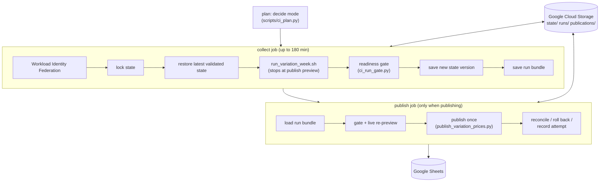

# GitHub Actions automation: setup and operation

This guide sets up the weekly run **Monday 09:17 Asia/Manila**: refresh sales, collect retailer
prices, build and validate the reports, publish to Google Sheets, verify, and keep the history.
The workflow is [.github/workflows/weekly-laptop-tracker.yml](../.github/workflows/weekly-laptop-tracker.yml).

> **Status.** The repository side is implemented and tested offline. Nothing in this guide has been
> run on GitHub or against Google Cloud yet: Workload Identity Federation, the storage bucket, the
> hosted run and the first production publication all need the hosted test in
> [First test](#first-test-in-this-order). Do not enable the schedule before that test passes.

## Contents

1. [What was found in the repository](#what-was-found-in-the-repository)
2. [Architecture](#architecture)
3. [Modes, schedule and activation](#modes-schedule-and-activation)
4. [Safety gates and idempotency](#safety-gates-and-idempotency)
5. [Variables and Secrets](#variables-and-secrets)
6. [One-time setup](#one-time-setup)
7. [First test, in this order](#first-test-in-this-order)
8. [Enable the weekly schedule](#enable-the-weekly-schedule)
9. [Operating it](#operating-it)
10. [Runtime and cost](#runtime-and-cost)
11. [Troubleshooting](#troubleshooting)

## What was found in the repository

- **Authoritative pipeline command:** `bash scripts/run_variation_week.sh`. It runs 15 stages in
  order (`sales_refresh` to `publish_preview`), logs each to `stages.jsonl`, and writes `status.json`
  in `data/output/weekly_runs/<UTC time>/` (`READY_TO_PUBLISH` or `FAILED_AT_<stage>`). The workflow
  calls this driver; it does not repeat the stages.
- **Publication command:** `python scripts/publish_variation_prices.py --write-sheets ...` is still
  the publisher (`scripts/publish_prices.py` is the earlier configuration grain and refuses this
  workbook). Automation calls it through `scripts/ci_publish.py`; there is no second publisher.
- **Authentication:** a service-account key (`GOOGLE_SERVICE_ACCOUNT_FILE` or `_JSON`) read by
  `src/laptop_tracker/sheets_source.py`. New and opt-in: `GOOGLE_USE_ADC=true` uses Application
  Default Credentials, which is what Workload Identity Federation provides in Actions. Local use with
  a key file is unchanged.
- **Persistent state that is not in Git** (authoritative, not reproducible):
  `data/history/price_history.sqlite3` (append-only observations, with triggers),
  `data/history/retailer_rate_limits.json` (429 cooldowns that keep requests respectful),
  `config/duplicate_decisions.csv`, `config/eligibility_decisions.csv`,
  `config/identity_review_register.csv` (owner decisions; a missing file would silently change
  eligibility or duplicates).
- **Reproducible, not persisted:** everything under `data/output/` (rebuilt each run). The saved
  search cache is only valid for 24 h, so a weekly run is always a cold run (about 840 requests, 45
  to 50 minutes of discovery). Retailer HTML evidence is not kept between runs.
- **Existing publisher guarantees:** the publication ID is derived from the report content, so the
  same reports always have the same ID; the run log (`PILOT_PRICE_RUN_LOG`) is keyed by it (a rerun
  replaces its row and counts attempts, it never appends a duplicate); each tab is replaced as a
  whole; every cell is read back; the previous tabs are snapshotted first and `--rollback` restores
  them.

### Blockers found and what was done about them

| Finding | Action |
|---|---|
| **The compact dashboard layout has never been written live.** Sheets merges adjacent column groups of one depth, so collapsing the nine detail groups one by one failed (`no group at depth 1 that spans exactly ...`) on 2026-11-09. The test fake did not model this. | Fixed: `TabLayout.merged_groups()` writes the touching groups as one group (the same columns collapse; the nine separate toggles become one). The test fake now merges groups like Sheets, and 16 tests fail without the fix. **Needs the hosted publication test.** |
| A read-quota 429 during the final run-log read was reported as `PARTIAL_FAILURE` after a successful write (2026-11-05). | `ci_publish.py` reconciles from the live run-log row and local report: `SUCCEEDED_UNREPORTED` is a success and is not rewritten or rolled back. |
| `PARTIAL_SUCCESS` (exit 2) from discovery is the **normal** result of a bounded search; every run on record has it, including the published 2026-11-05 run. | Not treated as a failure. Only real request failures (below) block unattended publication. |
| The throttled 2026-11-09 runs were `READY_TO_PUBLISH` with 30 matching rows instead of 41. | The new gate blocks it: `datablitz`, `pcx` and `pcc` had searches not sent after repeated errors and failed page fetches. |
| `.env` and a local `.venv` were assumed by the driver. | The driver activates `.venv` only if present; settings come from the environment. |
| No scheduler, no durable storage, no CI. | This work. |

## Architecture



**Two kinds of state are kept apart**, in one private Cloud Storage bucket (`GCS_STATE_BUCKET`):

| Prefix | Content | Written when |
|---|---|---|
| `state/versions/<time>-<run>/` | **Collection state**: the five files above plus a checksummed `manifest.json`. Immutable. | After every collection run, even a failed one, if the database validates. |
| `state/latest.json` | Pointer to the latest valid version. | Last, by compare-and-swap. |
| `locks/state.lock.json` | Lease (6 h) so two runs cannot overlap. | Start and end of a collection. |
| `runs/<run id>/` | **Run bundle**: the reports and preview of one run (no saved retailer pages). | When the pipeline reached `READY_TO_PUBLISH`. |
| `publications/<publication id>.json` | **Publication state**: every attempt and its classification. | After each publish attempt. |
| `publications/<id>/<time>_write/` | The publisher's snapshots of the previous tabs (recovery data). | After each publish attempt, including failures. |
| `publications/latest_success.json` | Counts of the last successful publication. | After a success. |

A failed Sheets publication therefore never needs another scrape: publish the saved bundle again
(`existing_run_id`, below). GitHub Actions cache is not used for any of this, and no runtime
database or raw export is stored in Git or in GitHub artifacts. The artifact is limited to
`status.json`, `stages.jsonl`, `driver.log` and `gate.json`, kept 7 days.

### State guarantees

- **Never an empty history.** Restore without a pointer stops with an error. The first state is
  created only by `ci_state.py seed`, once.
- **Restore is verified**: manifest hash against the pointer, every file's SHA-256, SQLite
  `integrity_check`, foreign keys, required tables, schema version; files are replaced only after all
  pass. Files are copied byte for byte, so restored observations keep their original `retrieved_at`.
- **Save is verified**: the new database must still contain every restored observation unchanged
  (id, retrieval time, price, digest) and every batch and context; each upload is downloaded again
  and hashed; the pointer moves only if nobody else saved meanwhile. A damaged or shrinking history
  is refused and the previous version stays latest.
- **Recovery**: `ci_state.py versions`, `restore --version`, and `promote --version` (makes an
  earlier validated version the latest again; nothing is deleted).

## Modes, schedule and activation

| Mode | Trigger | Collect | Write Sheets |
|---|---|---|---|
| **A. Manual preview** (default) | Actions, Run workflow, `publish` unchecked | yes | **no** |
| **B. Manual production** | Run workflow, `publish` checked | yes | yes, after the gates |
| **B2. Publish a saved run** | `publish` checked and `existing_run_id` set | no | yes, after the gates |
| **C. Scheduled** | Mondays 09:17 `Asia/Manila` | per `WEEKLY_AUTOMATION` | per `WEEKLY_AUTOMATION` |

The schedule uses GitHub's `timezone: "Asia/Manila"` key (IANA zone, no daylight saving).
Scheduled runs only start from the default branch, and GitHub may delay them by several minutes.
`WEEKLY_AUTOMATION` is a repository Variable and is **inert until set**: unset or `off` means the
scheduled run is skipped before anything happens; `preview` runs mode A weekly; `publish` is the
full unattended run. Scheduled runs never accept retailer failures.

Every mode saves the validated collection state (new observations are real evidence, and the
rate-limit cooldowns must carry over). Only the `publish` job writes to Sheets, and only in a run
that asked for it.

## Safety gates and idempotency

`scripts/ci_run_gate.py` reads the run's own `status.json`, `stages.jsonl`, discovery summary and the
publisher's preview report, never console text. It blocks when:

- `status.json` is not `READY_TO_PUBLISH`, or any of the 15 stages is missing or exited with a code
  the driver does not accept (the stage list is tested against the driver);
- a report folder is empty, the discovery summary or preview report is missing, or the preview is not
  `PREVIEW_ONLY` (the preview itself refuses invalid catalogs, mappings, targets, destinations or
  schema, and this status is how that reaches the gate);
- discovery failed outright, or **retailer request failures** occurred: searches with errors,
  searches not sent after repeated errors, failed page fetches, or targets with provider failures.
  HTTP 429 counts come from the discovery index and `rate_limit_events.csv`. A person can accept
  them explicitly (`accept_retailer_failures`) after reading the diagnostics;
- the run is older than 7 days (superseded by the next weekly run);
- optionally, `MAX_MATCHING_DROP_PCT` is set and matching rows fell by more than that percentage
  against the last successful publication. **Off by default**: no coverage threshold is invented.

Checked against real artifacts: the published 2026-11-05 run passes; the 2026-11-09 throttled run is
blocked.

`scripts/ci_publish.py` then, in the `publish` job:

1. repeats the gate on the downloaded bundle;
2. runs the publisher's own `--preview` against the **live** workbook and requires the same
   publication ID (schema, ownership and destination checks are the publisher's);
3. reads the live run log: if this publication ID is already `SUCCESS` with readback `PASSED`, it
   stops with `ALREADY_PUBLISHED` and writes nothing, so reruns cannot duplicate or reapply it;
4. writes **once** (never an automatic second attempt);
5. classifies a failure from the publisher's local report and the live row:
   `FAILED_BEFORE_WRITE` (nothing touched), `SUCCEEDED_UNREPORTED` (written and verified, only the
   final log read failed: success, no rewrite), `PARTIAL_WRITE` (some tabs, or readback differences:
   the publisher's own `--rollback` restores the snapshots, so the dashboard keeps the previous
   publication);
6. records the attempt, uploads the snapshots, and exits non-zero for anything but a success.

Run-log rows are keyed by publication ID, history is appended with the publisher's retention rules,
and tabs are replaced as a whole, so a deliberate rerun after a failure is idempotent.

## Variables and Secrets

No Secret is required: Workload Identity Federation gives each run a short-lived token and no key
is stored anywhere. Everything below is a **Variable** (not secret; none is a credential).

| Name | Required | Example / format | Used for |
|---|---|---|---|
| `SPREADSHEET_ID` | yes | `1QPN5vaxv8rNlpnSzsvQh_iX11ppGbKOPmELxSOAnyt0` (the part of the Sheet URL between `/d/` and `/edit`) | Which workbook |
| `GCS_STATE_BUCKET` | yes | `laptop-tracker-state-yourname` | State bucket name (no `gs://`) |
| `GCP_WORKLOAD_IDENTITY_PROVIDER` | yes | `projects/123456789012/locations/global/workloadIdentityPools/github-actions/providers/github` | WIF provider (full resource name) |
| `GCP_SERVICE_ACCOUNT` | yes | `tracker-runner@your-project.iam.gserviceaccount.com` | Service account the run acts as |
| `GCS_STATE_PREFIX` | no | `laptop-price-tracker` | Folder inside the bucket (lets one bucket serve several projects) |
| `WEEKLY_AUTOMATION` | no, **set last** | `preview` or `publish` | Activates the schedule |
| `MAX_MATCHING_DROP_PCT` | no | `30` | Optional coverage-drop gate |

`GOOGLE_USE_ADC=true` is set by the workflow itself. A missing required Variable fails the run in
its first step with the **names** of the missing ones (never values).

## One-time setup

Do these in order. Replace `PROJECT_ID`, `PROJECT_NUMBER` and the other examples with your values.

### 1. Google Cloud project and APIs

1. Open <https://console.cloud.google.com/> and select the project that already holds your tracker
   service account (the one whose key is in your local `.env`).
2. Open **APIs & Services > Library**. Search for and **Enable**: *Google Sheets API*,
   *IAM Service Account Credentials API*, *Security Token Service API*, *Cloud Storage API*.
   Verify: each shows "API enabled" in **APIs & Services > Enabled APIs**.

### 2. The state bucket

1. **Cloud Storage > Buckets > Create**.
2. Name: globally unique, for example `laptop-tracker-state-<yourname>`. Location type: *Region*,
   for example `asia-southeast1`. Storage class: *Standard*.
3. Access control: *Uniform*. Tick **Enforce public access prevention**.
4. Data protection: tick **Object versioning** (an extra safety net on top of the app's versions).
5. **Create**. Verify: the bucket opens and is empty.

### 3. The service account and its permissions

Reuse the existing tracker service account (it already has editor access to the Sheet, which is what
publishing needs). To find its email: **IAM & Admin > Service Accounts**, copy the *Email*.
(If you prefer a new one, create it here and share the Sheet with it as **Editor**.)

1. Open the bucket > **Permissions > Grant access**. New principal: the service account email.
   Role: **Storage Object Admin**. Save.
   (Object Admin, scoped to this bucket only, because replacing the pointer needs create and delete.)
2. Verify the Sheet: open the spreadsheet > **Share**; the service account must be listed as
   **Editor**.

### 4. Workload Identity Federation (no stored key)

1. **IAM & Admin > Workload Identity Federation > Create pool**. Name `github-actions`. Continue.
2. **Add provider**: *OpenID Connect (OIDC)*, name `github`, **Issuer URL**
   `https://token.actions.githubusercontent.com`, audience *Default*.
3. **Attribute mapping**: `google.subject` = `assertion.sub`; add `attribute.repository` =
   `assertion.repository`; add `attribute.ref` = `assertion.ref`.
4. **Attribute condition** (limits who can authenticate at all):
   `assertion.repository == 'jarlericaa/laptop-price-tracker' && assertion.ref == 'refs/heads/main'`
   Because of `ref`, only code on `main` can obtain a token, so a feature branch or fork cannot.
5. **Save**. Open the pool > **Grant access** > *Grant access using service account impersonation* >
   select the service account > *Only identities matching the filter*: attribute `repository`, value
   `jarlericaa/laptop-price-tracker`. Save.
   (This adds the *Workload Identity User* role on the service account for that repository.)
6. Open the provider and copy its **resource name**
   (`projects/<number>/locations/global/workloadIdentityPools/github-actions/providers/github`).
   This is `GCP_WORKLOAD_IDENTITY_PROVIDER`.

The same in the command line (optional):

```bash
gcloud iam workload-identity-pools create github-actions --location=global
gcloud iam workload-identity-pools providers create-oidc github --location=global \
  --workload-identity-pool=github-actions --issuer-uri=https://token.actions.githubusercontent.com \
  --attribute-mapping="google.subject=assertion.sub,attribute.repository=assertion.repository,attribute.ref=assertion.ref" \
  --attribute-condition="assertion.repository=='jarlericaa/laptop-price-tracker' && assertion.ref=='refs/heads/main'"
gcloud iam service-accounts add-iam-policy-binding SA_EMAIL \
  --role=roles/iam.workloadIdentityUser \
  --member="principalSet://iam.googleapis.com/projects/PROJECT_NUMBER/locations/global/workloadIdentityPools/github-actions/attribute.repository/jarlericaa/laptop-price-tracker"
```

### 5. GitHub: Variables and the production environment

1. Open <https://github.com/jarlericaa/laptop-price-tracker> > **Settings > Secrets and variables >
   Actions > Variables > New repository variable**. Add the four required Variables above, one by
   one (name, value, **Add variable**). Do **not** add `WEEKLY_AUTOMATION` yet.
2. **Settings > Environments > New environment**, name exactly `production`. Optional but
   recommended for the first weeks: tick **Required reviewers** and add yourself; every publish then
   waits for your click. Remove it later for fully unattended publishing.
3. **Settings > Actions > General**: *Actions permissions* must allow actions; under *Workflow
   permissions* leave *Read repository contents* (the workflows ask for nothing more).
4. If the repository is private and has a spending limit, check **Settings > Billing** (see
   [Runtime and cost](#runtime-and-cost)).

### 6. Merge the workflow

The "Run workflow" button only appears for workflows on the default branch. Open a pull request from
`automation/github-actions-weekly` into `main`, check that the *Tests* workflow passes, and merge.
Merging starts nothing: manual runs need a click and the schedule is inert (`WEEKLY_AUTOMATION` unset).

### 7. Seed the first state (once, from the machine that holds the real history)

This uploads your current `price_history.sqlite3`, rate-limit file and decision files as version 1.
Make sure no run is in progress and these local files are the ones you want to continue from.

```bash
cd ~/laptop-price-tracker && source .venv/bin/activate
python -m pip install -r requirements.txt
gcloud auth application-default login      # sign in as a Google user with access to the bucket
export GCS_STATE_BUCKET=laptop-tracker-state-yourname   # and GCS_STATE_PREFIX if you set one
python scripts/ci_state.py seed
```

Your own Google user needs the **Storage Object Admin** role on the bucket for this step (grant it as
in step 3.1, with your email). Verify: the command prints a `version_id`; the bucket shows
`state/latest.json` and `state/versions/<id>/`. From now on the bucket is the authority; to work
locally again, run `python scripts/ci_state.py restore --overwrite` first.

## First test, in this order

1. **Preview run (mode A).** GitHub > **Actions > Weekly laptop price tracker > Run workflow**,
   branch `main`, leave *publish* unchecked, **Run workflow**. The first run exercises Workload
   Identity Federation, Sheets access (a read-only smoke test in the first minutes), state restore,
   the full pipeline (about 70 minutes) and the gate.
2. **Inspect it.** Open the run: the **Summary** page shows run ID, status, duration, verified
   targets, comparable-price coverage, per-retailer searches/failures/HTTP 429, and the gate result.
   The log of *Restore the latest validated state* prints the restored `version_id` and row counts;
   *Save validated state* prints `new_observations`. Download the `diagnostics-...` artifact for
   `status.json`, `stages.jsonl` and `gate.json`.
3. **Confirm nothing was written to production.** The *Publish to Google Sheets* job shows
   *Skipped*; no log line contains `--write-sheets`. In the Sheet, **File > Version history > See
   version history** shows no new version by the service account, and `PILOT_PRICE_RUN_LOG` has no
   new row.
4. **Persistence across two runs.** Run mode A a second time (or let the next scheduled preview
   run). Its *Restore* step must show the `version_id` the first run saved, and observation counts
   at least as high. In the bucket, `state/versions/` has one more folder per run.
5. **Controlled publication (mode B2, no second scrape).** First make a safety copy: in the Sheet,
   **File > Make a copy**. Then **Run workflow** with *publish* checked and *existing_run_id* set to
   the run folder name from the preview run's summary (like `20261110T010000Z`). If the gate blocked
   the run because of retailer failures, read the per-retailer table first; only if you accept that
   coverage, also tick *accept_retailer_failures*. If you required reviewers on `production`,
   approve the waiting job.
6. **Verify the Sheet.** `PILOT_PRICE_RUN_LOG` has a row with the publication ID from the job
   summary, status `SUCCESS`, readback `PASSED`; `PILOT_PRICE_COMPARISON` shows the compact layout
   with the detail columns collapsed (one toggle above the visible block); the job summary shows
   `Publication status: PUBLISHED`. Run step 5 again: the job must end with `ALREADY_PUBLISHED` and
   change nothing.

## Enable the weekly schedule

Only after step 6 above succeeded (and ideally one scheduled week in `preview`):

1. **Settings > Secrets and variables > Actions > Variables > New repository variable**:
   name `WEEKLY_AUTOMATION`, value `publish` (use `preview` first if you want a dry week).
2. Verify the next Monday 09:17 Manila run starts (Actions tab; allow a few minutes of delay).

Nothing else changes: the workflow is already on `main`. To switch it off, set the value to `off` or
delete the Variable. To stop everything, **Actions > Weekly laptop price tracker > ... > Disable
workflow**.

## Operating it

| Task | How |
|---|---|
| See what happened | Actions > the run > Summary; artifact `diagnostics-*`; the Sheet's `PILOT_PRICE_RUN_LOG`. |
| Retry a failed **publication** without scraping | Run workflow: *publish* checked, *existing_run_id* = the run folder name. A bundle is kept for runs that reached `READY_TO_PUBLISH`. |
| Retry a failed **collection** | Run workflow again (mode A or B). State from the failed run was saved if its database validated, so no evidence is lost; do not rerun repeatedly, retailers answer 429. |
| List / restore / roll back state | `python scripts/ci_state.py versions`; `restore --version V --overwrite` (a local copy); `promote --version V` (makes it latest for CI). |
| Release a stuck state lock | Normally expires after 6 hours; or `python scripts/ci_state.py unlock --force`. |
| Roll back a publication | The publisher keeps snapshots: download `publications/<id>/<time>_write/` from the bucket into a local run folder and run `python scripts/publish_variation_prices.py --rollback <folder>`. |
| Safely stop automatic publication | `WEEKLY_AUTOMATION` = `preview` or `off`. |

## Runtime and cost

- Latest complete run: about 70 minutes (sales refresh and offline stages 5, discovery 44, reports and
  preview under 1, publication and checks about 20). A weekly run has no usable search cache, so
  expect 50 to 90 minutes for `collect` and 5 to 25 for `publish`. The 180-minute timeout leaves room
  for the retailer pacing and 429 cooldowns, which are unchanged.
- Cost: GitHub-hosted Ubuntu runners bill 1 minute per minute. Roughly 4.3 runs a month at 75 to 120
  minutes is 320 to 520 minutes a month, plus Cloud Storage for a few hundred MB (versions of a 40 MB
  database and small bundles; cents per month). Public repositories run free; private repositories
  consume the plan's included minutes (2,000 per month on GitHub Free) before any charge. Check your
  plan before enabling.
- Retailers see requests from a GitHub datacenter address instead of your own. If they answer 429
  more often, the gate holds the publication and the sheet keeps its previous data.

## Troubleshooting

| Symptom | Cause and fix |
|---|---|
| First step fails: `Missing or empty repository Variables/Secrets: ...` | Add the named Variables (Settings > Secrets and variables > Actions > Variables). |
| Authentication step: `could not generate credentials` / `Permission 'iam.serviceAccounts.getAccessToken' denied` | Step 4.5 not done, wrong `GCP_SERVICE_ACCOUNT`, or the attribute condition does not match (run from `main`, repository name exact). |
| `Check Google Sheets access` fails | The service account is not an Editor of the Sheet, or `SPREADSHEET_ID` is wrong. |
| `No saved state exists ... seed` | Step 7 not done, or `GCS_STATE_PREFIX` differs from the one used at seeding. |
| `Another run holds the state lock` | A run is active. If none is, wait for the lease (6 h) or `unlock --force`. |
| `The price history is no longer append-only` | The pipeline changed or lost stored observations; the state was **not** saved. Investigate the run's logs; the previous state is intact. |
| `state ... changed since it was read` | Another process saved state during this run; nothing was overwritten. Rerun. |
| `BLOCKED: Retailer request failures ...` | Read the summary table. Wait and rerun collection, or accept explicitly with `accept_retailer_failures` for a run you reviewed. |
| `BLOCKED: ... superseded` | The run is over 7 days old; run a new collection. |
| Publication `PARTIAL_WRITE` | The job rolled back from the snapshots; read the error in the summary, fix, rerun the publication. Do not re-run blindly more than once. |
| Publication `SUCCEEDED_UNREPORTED` | Written and verified; only the final run-log read hit a Sheets read quota. No action. |
| Scheduled run did not start | `WEEKLY_AUTOMATION` is not `preview`/`publish`; the workflow is not on `main`; the repository had no activity for 60 days (GitHub disables schedules; re-enable in the Actions tab). |

## What has and has not been verified

Verified offline (`python -m pytest -q`): workflow structure, pinned actions, permissions, modes,
missing-Variable handling, ADC scope selection, state restore/save/corruption/append-only/lock/promote
(local and a scripted Cloud Storage client), gate decisions on synthetic and real run artifacts,
publication idempotency, partial-write rollback, reconciliation and retries (scripted publisher), and
the column-group fix (Sheets-like fake).

**Requires a hosted integration test:** that GitHub accepts the workflow and the `timezone` schedule
key; Workload Identity Federation and bucket permissions; the real Cloud Storage client; a full
hosted run (runner network, datacenter-IP rate limiting, timing); the Sheets write of the compact
layout (never run live); the live readback after the column-group fix.
