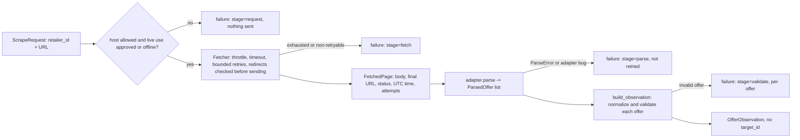

# Shared Scraping Framework (overall Phase 6)

**Status:** Implemented and tested offline on 2026-09-29 (Phase 6). Phase 7 then added three framework changes, which are backward-compatible for existing adapters and records:
- checked redirect following, which fixes a gap where `urllib` could follow a redirect before its host was checked
- a fail-closed [live-use gate](#live-use-gate)
- optional [offer details](#optional-offer-details)

The first adapter is [Laptop Factory](adapters/LAPTOP_FACTORY.md). Its external-policy finding is UNKNOWN, but project-owner policy authorizes internal collection and its live-use flag is enabled. The user reported one live smoke test, and a controlled bare-URL check on 2026-10-01 confirmed clean URL attribution. The second adapter, [DataBlitz](adapters/DATABLITZ.md) (2026-10-01), uses the same contract and owner policy with no framework change. Its external-policy finding is also UNKNOWN, and the user reported a one-product live spot check. The third adapter, [PC Express](adapters/PCX.md) (2026-10-01), also needed no framework change. Its live-use flag is enabled by an explicit owner decision; the external-policy finding remains RESTRICTED because the retailer's terms require written consent for automated collection. A user-reported live check returned one in-stock Acer offer, and a controlled 2026-10-01 check confirmed with `repr()` that the offer URL is a plain string. The fourth adapter, [PC Central](adapters/PCC.md) (2026-10-01), also needed no framework change. It is enabled under the project-wide owner decision, with external-policy finding UNKNOWN. It accepts a `?variant=<id>` product URL, because PC Central sells laptops in RAM variants at different prices. Its bare-URL live check failed safely with `AMBIGUOUS_VARIANT`; a selected-variant check returned one in-stock offer. The fifth adapter, [Octagon](adapters/OCT.md) (2026-10-01), also needed no framework change. It is enabled under the project-wide owner decision. Its external-policy finding is RESTRICTED, because Octagon's terms prohibit scraping. A user-reported live check returned one in-stock HP 15-FC0413AU offer at PHP 37,999. Nothing in the framework reads or writes Google Sheets, reads `TARGET_MASTER`, assigns a `target_id`, or matches offers to configurations (Phase 8).

## Modules

| Module | Responsibility |
|---|---|
| `src/laptop_tracker/offers.py` | `OfferObservation` model, optional `OfferDetails`, `RetrievalMetadata`, `Availability`, `PriceType`, and deterministic helpers: `parse_price`, `clean_text`, `redact_url`, `is_http_url`. |
| `src/laptop_tracker/scraping.py` | Adapter contract (`RetailerAdapter`, `ParsedOffer`), `ScrapeRequest`, `Fetcher` (timeouts, retries, throttling, checked redirects), injectable `Transport` and `Clock`, the live-use gate, the `scrape()` runner, error types, and structured logging. |
| `src/laptop_tracker/adapters/` | Retailer adapters (Phase 7): `laptop_factory.py`, `datablitz.py`, `pcx.py`, `pcc.py`, and `oct.py` (live use enabled by owner decisions). |
| `tests/example_adapter.py` | Offline example adapter for synthetic fixtures. It demonstrates the contract; it is not a retailer integration. |
| `tests/scraping_fakes.py` | Shared fake transport, fake clock, and no-network guard. |
| `tests/scraping_fixtures/` | Synthetic pages on the reserved `shop.example.test` host, plus minimal retailer fixtures in per-retailer folders. |

No dependency was added. The default transport uses the Python standard library (`urllib`).

## Flow



## Adapter contract

A future retailer adapter implements `RetailerAdapter`:

```python
class MyRetailerAdapter:
    retailer_id = "my_retailer"              # lowercase letters, digits, underscores
    adapter_version = "1"                    # bump when parsing rules change
    allowed_hosts = frozenset({"www.my-retailer.example"})
    live_use_approved = False                # True only after documented project-owner approval

    def parse(self, page: FetchedPage) -> Sequence[ParsedOffer]:
        ...                                  # page.text(), page.final_url
```

- **Input:** a `FetchedPage` the framework already retrieved. The adapter never performs HTTP itself, so every request goes through the shared timeouts, retries, and throttling.
- **Output:** zero or more `ParsedOffer` values. Each holds raw strings: title, optional configuration text, `price_text`, an ISO `currency`, an `Availability` mapped from the retailer's wording, the wording itself as `availability_evidence`, and an optional `offer_url` (relative URLs resolve against the page's final URL).
- **Failure:** raise `ParseError(code, message)` when the page cannot be understood, for example `NO_OFFERS_FOUND` after a layout change. Messages must not quote page content. Any other exception becomes a failure with code `ADAPTER_ERROR` and only the exception type.
- **Hosts:** requests, redirect targets, and offer links must use a host in `allowed_hosts` (exact, case-insensitive match; no subdomain wildcards).
- **Details:** an optional `ParsedOffer.details` (`OfferDetails`) carries retailer evidence; see [below](#optional-offer-details).

The framework, not the adapter, sets the retailer ID, URLs, retrieval time, attempt count, content hash, and adapter version, so adapters cannot produce unattributed observations.

Call it as:

```python
fetcher = Fetcher()   # or Fetcher(transport, FetchConfig(...), clock) in tests
results = scrape(adapter, [ScrapeRequest("my_retailer", url)], fetcher)
```

Each `ScrapeResult` has `observations`, `failures`, and `ok`. One failed request or offer never stops the others. Share one `Fetcher` so throttling state is shared.

## Normalized offer observation

| Field | Meaning |
|---|---|
| `retailer_id` | Adapter's retailer identifier. |
| `offer_url` | Absolute offer URL. |
| `retrieved_at` | UTC `datetime` when the successful attempt started. |
| `raw_title`, `raw_configuration_text` | Text as shown, NFC-normalized with whitespace collapsed. Case and wording are unchanged; no specifications are inferred. |
| `price` | Exact `Decimal` parsed from `price_text`. Floats are rejected. |
| `currency` | Three-letter uppercase ISO 4217 code. The code is syntax-checked only; mapping a retailer's symbol to a code is the adapter's job. |
| `raw_price_text` | The displayed price text, for audit. |
| `availability`, `availability_evidence` | `IN_STOCK`, `OUT_OF_STOCK`, `PREORDER`, or `UNKNOWN`, plus the retailer wording. Evidence is required unless the value is `UNKNOWN`. |
| `offer_index` | Position of the offer on the page. |
| `source` | `RetrievalMetadata`: requested and final URL, HTTP status, attempts, SHA-256 of the response body, content type, and adapter version. |

`to_record()` returns a flat string record in `OBSERVATION_COLUMNS` order. Prices keep their exact decimal text (`49999.00` stays `49999.00`), and times use ISO 8601 with a `Z` suffix. Identical inputs always produce identical records. The body hash identifies the exact page without storing it; response bodies are not retained.

### Optional offer details

`OfferObservation.details` is `None` unless the adapter supplies an `OfferDetails`. `to_record()` and `OBSERVATION_COLUMNS` are unchanged. `to_full_record()` appends `OFFER_DETAIL_COLUMNS`, which are blank when details are absent.

| Field | Meaning |
|---|---|
| `retailer_product_id`, `retailer_sku` | Retailer identifiers, kept as text. |
| `brand`, `manufacturer_part_number` | Only when the page states them; never guessed. |
| `price_type` | `SALE` (a higher regular price is shown), `REGULAR`, or blank. |
| `regular_price`, `regular_price_text`, `sale_price`, `sale_price_text` | `Decimal` values plus the shown text. Validated against `price`: for `SALE`, the sale price equals `price` and the regular price is higher; for `REGULAR`, there is no sale price. |
| `raw_specifications` | `(label, value)` pairs as shown, serialized as compact JSON. |
| `raw_categories` | Retailer categories as shown. |
| `bundle_flag`, `bundle_evidence` | `TRUE` with the matched evidence when a listing looks like a bundle; blank when the adapter does not check. Flagged offers are never dropped. |

Details text is normalized with `clean_text` on construction. None of these values are verified specifications or target matches.

`parse_price` accepts exactly one number with the declared decimal separator (`.` default, or `,`) and standard three-digit grouping. It rejects ranges, several prices, negative or zero values, and malformed grouping instead of guessing. Lakh-style grouping (`1,00,000`) is not supported.

## Retrieval defaults

All values are fields of `FetchConfig` and can be overridden. They are conservative implementation defaults, not approved retailer policies; confirm them per retailer in Phase 7.

| Setting | Default | Behavior |
|---|---|---|
| `timeout_seconds` | 20 | Per-attempt transport timeout. |
| `max_attempts` | 3 | Total attempts, including the first (allowed range 1-10). |
| `backoff_initial_seconds`, `backoff_multiplier`, `backoff_max_seconds` | 5, 2, 60 | Delays of 5 s, then 10 s, capped at 60 s. No jitter, so tests are deterministic. |
| `min_request_interval_seconds` | 10 | Minimum gap between request starts per retailer, including retries. |
| `retailer_min_intervals` | none | Per-retailer interval overrides. |
| `retry_statuses` | 408, 429, 500, 502, 503, 504 | Retried HTTP statuses. Other non-2xx statuses fail at once. |
| `Retry-After` | honored | Integer seconds are used when longer than the backoff. A value above `backoff_max_seconds` stops with `RETRY_AFTER_TOO_LONG` instead of waiting. The HTTP-date form is ignored. |
| `max_response_bytes` | 5,000,000 | Larger bodies fail with `RESPONSE_TOO_LARGE`. |
| `max_redirects` | 5 | Redirect hops per attempt (range 0-10). Each hop is throttled. |
| `user_agent` | `laptop-price-tracker/0.1` | Identifying User-Agent. |
| `extra_headers` | none | Sent to the transport; never logged and hidden from `repr`. |

Timeouts and connection errors are retryable. HTTP statuses are retryable only when listed. Parse and validation failures are never retried, because refetching the same page would not fix them.

`Transport` (one GET per call) and `Clock` (`now`, `monotonic`, `sleep`) are protocols. `UrllibTransport` and `SystemClock` are the defaults; tests inject fakes. `UrllibTransport` has no cookie jar. It keeps only the `Content-Type`, `Retry-After`, and `Location` response headers, drops `Set-Cookie`, and refuses non-HTTP(S) URLs.

### Redirects

Transports must not follow redirects. `UrllibTransport` installs a handler that stops `urllib` from doing so. The `Fetcher` handles each 301, 302, 303, 307, or 308 response itself:
1. It resolves `Location` against the current URL.
2. It rejects the target if it isn't a credential-free HTTP(S) URL (`INVALID_REDIRECT`) or its host isn't allowed (`REDIRECT_HOST_NOT_ALLOWED`).
3. Only then does it send the next, throttled request.

The disallowed request is never sent. `scrape()` passes the adapter's `allowed_hosts`; a direct `Fetcher.fetch()` call defaults to the request's own host. Loops stop at `max_redirects` with `TOO_MANY_REDIRECTS`. A 3xx without `Location` is an `HTTP_STATUS` failure. `scrape()` also re-checks the final URL, in case a transport reports a different final URL. Before Phase 7, the default `UrllibTransport` followed redirects inside `urllib`, so a redirect to another host would have been requested before the final-URL check. That gap is fixed and tested with fakes.

### Live-use gate

`scrape()` refuses to send any request through a live transport unless the adapter sets `live_use_approved = True`. It returns `LIVE_USE_NOT_APPROVED` at the `request` stage. A transport counts as live unless it declares `live = False`, which only offline fakes should do. A missing adapter attribute counts as not approved. This flag records project-owner authorization. It does not assert that retailer terms or written permission were verified; document that distinction in [RETAILER_DATA_USE_REVIEW.md](RETAILER_DATA_USE_REVIEW.md) and [DECISIONS.md](DECISIONS.md).

## Failures and logging

A `ScrapeFailure` records `retailer_id`, a redacted `url`, `stage` (`request`, `fetch`, `parse`, or `validate`), `error_code`, a caller-safe `message`, `retryable`, `attempts`, and, where relevant, `http_status` and `offer_index`.

| Stage | Codes |
|---|---|
| `request` | `RETAILER_MISMATCH`, `HOST_NOT_ALLOWED`, `LIVE_USE_NOT_APPROVED` (no network call is made). |
| `fetch` | `TIMEOUT`, `CONNECTION_ERROR`, `HTTP_STATUS`, `RETRY_AFTER_TOO_LONG`, `RESPONSE_TOO_LARGE`, `INVALID_URL`, `INVALID_REDIRECT`, `REDIRECT_HOST_NOT_ALLOWED`, `TOO_MANY_REDIRECTS`. |
| `parse` | Adapter `ParseError` codes, or `ADAPTER_ERROR`. |
| `validate` | `INVALID_OFFER`; the message names the field and rule, never the value. |

Logs go to the `laptop_tracker.scraping` logger as `event key=value ...`. The same fields are attached as `record.scrape` for structured handlers. Fields are the retailer, redacted URL, stage, attempt, error code, HTTP status, retry delay, and counts. URLs in logs and failures keep only scheme, host, port, and path; query strings and fragments are removed. Request headers, cookies, credentials, response bodies, and adapter exception messages are never logged. URLs with embedded `user:password@` credentials are rejected outright. Observation records keep the full offer and requested URLs, including query strings, because attribution needs them. Treat them as data, not log output.

## Offline tests

```bash
python -m pytest -q tests/test_offers.py tests/test_scraping.py tests/test_laptop_factory.py
python -m pytest -q tests/test_datablitz.py tests/test_pcx.py tests/test_pcc.py tests/test_oct.py
python -m pytest -q tests/test_collection.py   # manual collection command, fake transport
```

The tests use a fake transport and a fake clock, so no real time passes. A no-network fixture makes any socket connection fail the test. They cover:
- normalization, determinism, and attribution
- retry and backoff, `Retry-After`, per-retailer throttling, timeouts, and non-retryable statuses
- parse failures and per-offer validation
- host guards, checked redirects, and the live-use gate
- offer details and log redaction

## Left for later phases

- **Phase 7:** COMPLETE. Jarelle Ricaforte is the named maintainer for LF, DBZ, PCX, PCC, and OCT. Live-check evidence and known coverage limitations are recorded in the adapter docs and [PROGRESS_LOG.md](PROGRESS_LOG.md). Review additional page states when suitable products are identified; this is optional follow-up. External-policy findings remain separate from project-owner live-use decisions.
- **Phase 7 or 8:** Decide how scrape requests are built, for example from `TARGET_MASTER` search terms or retailer URLs, without assuming the table is populated. *Partly settled 2026-10-12:* `collect_and_match.py` builds requests only from an explicit, validated URL manifest through each adapter's `product_request()`, then calls `scrape_one()` with one shared `Fetcher`. There is still no search, category crawl, or URL discovery.
- **Phase 8:** Exact configuration matching of observations to `target_id`s. Observations deliberately carry no target.
- **Phase 9:** Observation storage, output schema, and history. *Implemented offline 2026-10-12:* `observation_store.persist_scrape_results()` stores `scrape()` observations in the local append-only SQLite store, and `track_prices.py` reports from it. No collector calls it yet.
