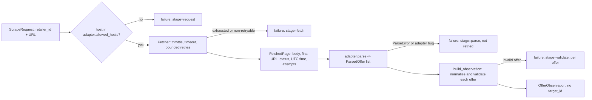

# Shared Scraping Framework (overall Phase 6)

**Status:** Implemented and tested offline on 2026-09-29. Phase 6 establishes the shared, retailer-neutral framework only. **No retailer adapter exists, no live request has been made, and the data-use review for any real retailer has not happened.** Those are Phase 7 work. Nothing in the framework reads or writes Google Sheets, reads `TARGET_MASTER`, assigns a `target_id`, or matches offers to configurations (Phase 8).

## Modules

| Module | Responsibility |
|---|---|
| `src/laptop_tracker/offers.py` | `OfferObservation` model, `RetrievalMetadata`, `Availability`, and deterministic helpers: `parse_price`, `clean_text`, `redact_url`, `is_http_url`. |
| `src/laptop_tracker/scraping.py` | Adapter contract (`RetailerAdapter`, `ParsedOffer`), `ScrapeRequest`, `Fetcher` (timeouts, retries, throttling), injectable `Transport` and `Clock`, the `scrape()` runner, error types, and structured logging. |
| `tests/example_adapter.py` | Offline example adapter for synthetic fixtures. It demonstrates the contract; it is not a retailer integration. |
| `tests/scraping_fixtures/*.html` | Synthetic pages on the reserved `shop.example.test` host. |

No dependency was added. The default transport uses the Python standard library (`urllib`).

## Flow



## Adapter contract

A future retailer adapter implements `RetailerAdapter`:

```python
class MyRetailerAdapter:
    retailer_id = "my_retailer"              # lowercase letters, digits, underscores
    adapter_version = "1"                    # bump when parsing rules change
    allowed_hosts = frozenset({"www.my-retailer.example"})

    def parse(self, page: FetchedPage) -> Sequence[ParsedOffer]:
        ...                                  # page.text(), page.final_url
```

- **Input:** a `FetchedPage` the framework already retrieved. The adapter never performs HTTP itself, so every request goes through the shared timeouts, retries, and throttling.
- **Output:** zero or more `ParsedOffer` values. Each holds raw strings: title, optional configuration text, `price_text`, an ISO `currency`, an `Availability` mapped from the retailer's wording, the wording itself as `availability_evidence`, and an optional `offer_url` (relative URLs resolve against the page's final URL).
- **Failure:** raise `ParseError(code, message)` when the page cannot be understood, for example `NO_OFFERS_FOUND` after a layout change. Messages must not quote page content. Any other exception becomes a failure with code `ADAPTER_ERROR` and only the exception type.
- **Hosts:** requests, redirect targets, and offer links must use a host in `allowed_hosts` (exact, case-insensitive match; no subdomain wildcards).

The framework, not the adapter, sets the retailer ID, URLs, retrieval time, attempt count, content hash, and adapter version, so adapters cannot produce unattributed observations.

Call it as:

```python
fetcher = Fetcher()   # or Fetcher(transport, FetchConfig(...), clock) in tests
results = scrape(adapter, [ScrapeRequest("my_retailer", url)], fetcher)
```

Each `ScrapeResult` has `observations`, `failures`, and `ok`. One failed request or offer never stops the others. Share one `Fetcher` so throttling state is shared.

## Normalized offer observation

| Field | Meaning |
|---|---|
| `retailer_id` | Adapter's retailer identifier. |
| `offer_url` | Absolute offer URL. |
| `retrieved_at` | UTC `datetime` when the successful attempt started. |
| `raw_title`, `raw_configuration_text` | Text as shown, NFC-normalized with whitespace collapsed. Case and wording are unchanged; no specifications are inferred. |
| `price` | Exact `Decimal` parsed from `price_text`. Floats are rejected. |
| `currency` | Three-letter uppercase ISO 4217 code. The code is syntax-checked only; mapping a retailer's symbol to a code is the adapter's job. |
| `raw_price_text` | The displayed price text, for audit. |
| `availability`, `availability_evidence` | `IN_STOCK`, `OUT_OF_STOCK`, `PREORDER`, or `UNKNOWN`, plus the retailer wording. Evidence is required unless the value is `UNKNOWN`. |
| `offer_index` | Position of the offer on the page. |
| `source` | `RetrievalMetadata`: requested and final URL, HTTP status, attempts, SHA-256 of the response body, content type, and adapter version. |

`to_record()` returns a flat string record in `OBSERVATION_COLUMNS` order. Prices keep their exact decimal text (`49999.00` stays `49999.00`), and times use ISO 8601 with a `Z` suffix. Identical inputs always produce identical records. The body hash identifies the exact page without storing it; response bodies are not retained.

`parse_price` accepts exactly one number with the declared decimal separator (`.` default, or `,`) and standard three-digit grouping. It rejects ranges, several prices, negative or zero values, and malformed grouping instead of guessing. Lakh-style grouping (`1,00,000`) is not supported.

## Retrieval defaults

All values are fields of `FetchConfig` and can be overridden. They are conservative implementation defaults, not approved retailer policies; confirm them per retailer in Phase 7.

| Setting | Default | Behavior |
|---|---|---|
| `timeout_seconds` | 20 | Per-attempt transport timeout. |
| `max_attempts` | 3 | Total attempts, including the first (allowed range 1-10). |
| `backoff_initial_seconds`, `backoff_multiplier`, `backoff_max_seconds` | 5, 2, 60 | Delays of 5 s, then 10 s, capped at 60 s. No jitter, so tests are deterministic. |
| `min_request_interval_seconds` | 10 | Minimum gap between request starts per retailer, including retries. |
| `retailer_min_intervals` | none | Per-retailer interval overrides. |
| `retry_statuses` | 408, 429, 500, 502, 503, 504 | Retried HTTP statuses. Other non-2xx statuses fail at once. |
| `Retry-After` | honored | Integer seconds are used when longer than the backoff. A value above `backoff_max_seconds` stops with `RETRY_AFTER_TOO_LONG` instead of waiting. The HTTP-date form is ignored. |
| `max_response_bytes` | 5,000,000 | Larger bodies fail with `RESPONSE_TOO_LARGE`. |
| `user_agent` | `laptop-price-tracker/0.1` | Identifying User-Agent. |
| `extra_headers` | none | Sent to the transport; never logged and hidden from `repr`. |

Timeouts and connection errors are retryable. HTTP statuses are retryable only when listed. Parse and validation failures are never retried, because refetching the same page would not fix them.

`Transport` (one GET per call) and `Clock` (`now`, `monotonic`, `sleep`) are protocols. `UrllibTransport` and `SystemClock` are the defaults; tests inject fakes. `UrllibTransport` has no cookie jar. It keeps only the `Content-Type` and `Retry-After` response headers, drops `Set-Cookie`, and refuses non-HTTP(S) URLs.

## Failures and logging

A `ScrapeFailure` records `retailer_id`, a redacted `url`, `stage` (`request`, `fetch`, `parse`, or `validate`), `error_code`, a caller-safe `message`, `retryable`, `attempts`, and, where relevant, `http_status` and `offer_index`.

| Stage | Codes |
|---|---|
| `request` | `RETAILER_MISMATCH`, `HOST_NOT_ALLOWED` (no network call is made). |
| `fetch` | `TIMEOUT`, `CONNECTION_ERROR`, `HTTP_STATUS`, `RETRY_AFTER_TOO_LONG`, `RESPONSE_TOO_LARGE`, `INVALID_URL`, `REDIRECT_HOST_NOT_ALLOWED`. |
| `parse` | Adapter `ParseError` codes, or `ADAPTER_ERROR`. |
| `validate` | `INVALID_OFFER`; the message names the field and rule, never the value. |

Logs go to the `laptop_tracker.scraping` logger as `event key=value ...`. The same fields are attached as `record.scrape` for structured handlers. Fields are the retailer, redacted URL, stage, attempt, error code, HTTP status, retry delay, and counts. URLs in logs and failures keep only scheme, host, port, and path; query strings and fragments are removed. Request headers, cookies, credentials, response bodies, and adapter exception messages are never logged. URLs with embedded `user:password@` credentials are rejected outright. Observation records keep the full offer and requested URLs, including query strings, because attribution needs them. Treat them as data, not log output.

## Offline tests

```bash
python -m pytest -q tests/test_offers.py tests/test_scraping.py
```

The tests use a fake transport and a fake clock, so no real time passes. An autouse fixture makes any socket connection fail the test. They cover normalization and determinism, attribution, retry and backoff, `Retry-After`, per-retailer throttling, timeouts, non-retryable statuses, parse failures, per-offer validation, host guards, redirects, and log redaction.

## Left for later phases

- **Phase 7:** Select retailers, then complete the data-use review for each: terms of service, robots.txt, rate limits, and permission. Then write each adapter with real (reviewed, non-sensitive) fixtures, an owner, and maintenance notes, and confirm or tune these defaults per retailer. Decide whether `UrllibTransport` is sufficient or whether browser automation is needed and approved. No browser automation exists.
- **Phase 7 or 8:** Decide how scrape requests are built, for example from `TARGET_MASTER` search terms or retailer URLs, without assuming the table is populated.
- **Phase 8:** Exact configuration matching of observations to `target_id`s. Observations deliberately carry no target.
- **Phase 9:** Observation storage, output schema, and history. No observations are persisted today.
