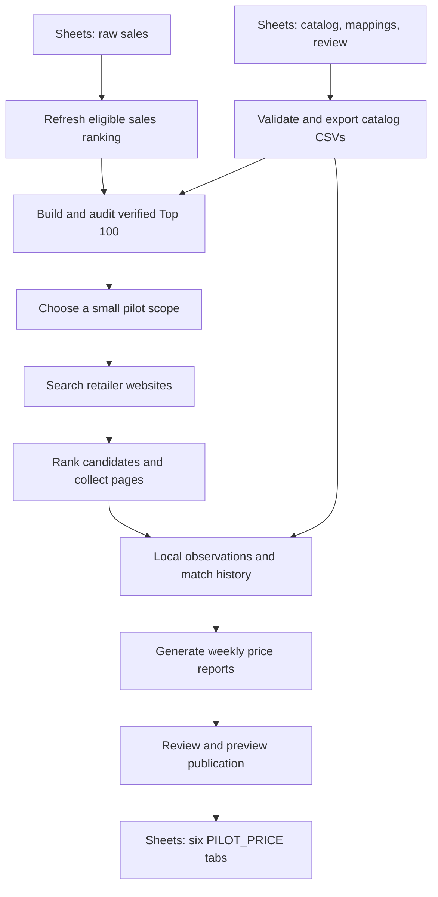

# Weekly workflow: from Google Sheets to retailer prices

Updated: **2026-10-19**. This guide describes the commands that exist today.

> **2026-10-27 grain change.** The live workbook now uses the **Shopee variation grain**
> (`shopee-variation-sheets-1`): one row per eligible Shopee seller variation, `PILOT_PRICE_SUMMARY`
> and `P1_TOP_100_CONFIGURATIONS` are retired, and publication goes through
> `publish_variation_prices.py` (preview first). The configuration-based Steps 3-9 below remain the
> description of the retailer layer (it now runs once per *context* of the selected variations) and
> of the legacy grain; the current operating procedure, commands and rules are in
> [SHOPEE_VARIATION_GRAIN_2026-10-27.md](SHOPEE_VARIATION_GRAIN_2026-10-27.md). `publish_prices.py`
> refuses a workbook prepared for the new grain.
>
> **2026-11-03 selection change.** The list is now the **Top 100 eligible mapped Shopee variations**:
> only variations with a verified mapping (`MAPPED_VERIFIED`) are selected, the filter runs before the
> 100-row limit, and a shortfall below 100 is reported, never padded. `build_top_shopee_variations.py`
> writes `mapping_exclusions.csv` (eligible variations left out, by mapping failure) instead of the
> pending-review file. See [MAPPED_TOP_100_2026-11-03.md](MAPPED_TOP_100_2026-11-03.md).

## Quick navigation

- [Google Sheets tabs](#1-what-the-google-sheets-tabs-mean)
- [CSV and database dictionary](#2-where-the-files-come-from)
- [What the different dates mean](#3-understand-the-dates)
- [Weekly commands, step by step](#4-weekly-run-commands-in-order)
- [Which commands write to Sheets](#5-which-commands-actually-change-things)
- [Troubleshooting](#8-when-something-stops)
- [Weekly checklist](#9-weekly-checklist)

## Start here

The tracker answers two questions:

1. **Which laptops matter?** Shopee sales plus the approved catalog determine the verified Top 100.
2. **What prices do retailers display?** Automatic search finds pages; extraction and matching check the configurations; price reports compare the offers.

**Google Sheets changing does not change a saved CSV.** Refresh the inputs before each weekly run. The dated October pilot folders are historical snapshots, not live links to Sheets.

The program can search retailer websites automatically. You still start the commands yourself, review uncertain results and explicitly publish the reports. There is no weekly scheduler or single command covering every step yet.

### The dataflow



The `raw` and catalog tabs are inputs. The six `PILOT_PRICE_*` tabs are report outputs. Searching, matching and publishing are separate operations.

## 1. What the Google Sheets tabs mean

The workbook may also contain dated backups and additional manually created review tabs.

| Tab | What it contains | How it is refreshed |
|---|---|---|
| `raw` | Imported Shopee data, including `grass_date`, `shopid`, `itemid`, `modelid`, listing names, `current_price`, `gmv_usd`, orders and amount. | Your upstream weekly import. This project's commands read it; they do not replace it. |
| `TARGET_MASTER` | Approved configurations with stable target IDs and specifications. | Reviewed catalog edits. Weekly validation exports a copy; it does not add targets. |
| `SOURCE_MODEL_MAP` | Approved Shopee variation-to-target links. Several variations can point to one configuration. | Reviewed mapping edits. The weekly commands do not create mappings. |
| `MATCH_REVIEW` | Catalog candidates, missing specifications, conflicts and review history. | Human/evidence review. Validation does not promote candidates. |
| `P1_TOP_100_TARGETS` | Source-level sales Top 100: Shopee variations, not unique configurations. | Optional legacy P1 writer; local generation alone does not update this tab. |
| Other generated `P1_*` tabs | Eligible ranking, exclusions, eligibility review, duplicate conflicts, validation errors, period summary and run log. | Optional `run_phase1.py --write-sheets`; see section 7. |
| `P1_ELIGIBILITY_DECISIONS` | Existing Sheet copy of eligibility decisions. | The optional P1 writer preserves/merges it. Classification currently reads local `config/eligibility_decisions.csv`, so editing this tab alone does not change classification. |
| `P1_TOP_100_CONFIGURATIONS` | Published display of the verified configuration-level Top 100. | Separate/manual publication. Neither the build command nor price publisher updates this tab. |
| `PILOT_PRICE_COMPARISON` | Pilot configurations, the dated Shopee snapshot price (link, variation, status, extract date), retailer prices/links, stock/status labels and the lowest retailer prices. | `publish_prices.py --write-sheets`. |
| `PILOT_PRICE_SUMMARY` | A minimal side-by-side grid: Laptop, Shopee (historical snapshot), DataBlitz, Laptop Factory, PC Express, PC Central, Octagon. The same prices as the comparison; context (snapshot date and listing, exact or listed-spec, stock, bundle, warnings, why a cell is blank) is in cell notes; listed-spec prices are italic. | Same publisher, from the same comparison rows. |
| `PILOT_PRICE_OVERVIEW` | Rank, Laptop, Screen, CPU family, RAM, Storage, Shopee (historical snapshot), DataBlitz, PC Express, Laptop Factory, PC Central, Octagon: one row per configuration in comparison-rank order, every value a numeric copy of the comparison cell; a blank stays blank. Each Laptop cell's note names the target ID; listed-spec prices are italic. | Same publisher since `pilot-sheets-6` (2026-10-22). The earlier owner-built, formula-linked tab is replaced only with `--adopt-overview` (see Step 9). |
| `PILOT_PRICE_HISTORY` | Dated pilot observations, stock, matches, prices and changes. | Same publisher, from cumulative local history. |
| `PILOT_PRICE_REVIEW` | Retailer matching problems and price exclusions in the published history/scope. | Same publisher. Older unresolved observations can remain here. |
| `PILOT_PRICE_RUN_LOG` | Publication IDs, cutoffs, counts, success/failure and readback results. | Same publisher; retains earlier publications. |

### The IDs are different

- Shopee `modelid` / `source_model_id`: a marketplace variation, **not** a manufacturer model code.
- `target_id`, such as `TGT-000042`: one catalog configuration across retailers.
- Manufacturer code, such as `ANV15-42-R2UH`: part of the laptop's identity.
- Retailer variant ID: an option on one store's page, bound to selected RAM/storage.

### The five required identity fields

**Model + screen size + CPU family + RAM capacity + storage capacity.**

Example: `ANV15-42-R2UH / 15.6 / Ryzen 5 / 16 / 512`.

`CONFIGURATION` targets use this identity and can match across retailers. `LISTING_ONLY` targets track individual marketplace listings; they do not enter configuration matching or the verified Top 100. Missing secondary specifications do not automatically block a match, but explicit secondary conflicts can require review.

`MATCH_REVIEW` concerns building the catalog. `PILOT_PRICE_REVIEW` concerns retailer observations. They are different queues.

## 2. Where the files come from

### Input snapshots and rankings

| File | Source and purpose |
|---|---|
| `eligible_model_ranking.csv` | Processed `raw` data: full eligible Shopee source ranking. This is derived data, not a complete raw-sheet export. |
| `top_100_targets.csv` | Same sales refresh: source-level Top 100, retained as a reference. |
| `phase1_run_summary.json`, `period_summary.csv` | Sales run ID, selected months, counts and period information. |
| `target_master_validated.csv` | Live `TARGET_MASTER` after validation: catalog snapshot for matching. |
| `source_model_map_validated.csv` | Live `SOURCE_MODEL_MAP` after validation: approved source-to-target links. |
| `match_review_validated.csv` | Live `MATCH_REVIEW` after validation: catalog review state. |
| `verified_configuration_ranking.csv` | Sales ranking + catalog + mappings: all qualifying configurations ranked by combined M-1 and MTD GMV. |
| `top_100_verified_configurations.csv` | First 100 qualifying rows: working list for discovery and reporting. |
| `verified_configuration_contributions.csv` | Explains which source variations contributed sales to targets and which were excluded. |
| `verified_configuration_exclusions.csv` | Reasons sources/targets were excluded. |
| `verified_configuration_review_priority.csv` | High-priority unresolved catalog work. |
| `verified_configuration_run_summary.json` | Sales provenance, fingerprints, counts and shortfall below 100. |
| `pilot_scope.csv` | Chosen subset of the current verified list to search and publish. |

Validated copies may add `source_row_number` to trace problems back to Sheets. The snapshot readers handle it. Keep IDs as text when opening/editing CSVs.

### Discovery and collection outputs

| File/folder | What to look for |
|---|---|
| `search_plan.csv` | Queries and retailer search mechanisms. |
| `search_requests.csv`, `search_results.csv` | Requests, returned products, empty results, failures and budget outcomes. |
| `candidates.csv` | Candidate URLs, ranking reasons and collection decisions. |
| `product_inspections.csv`, `variants.csv` | Product inspections and RAM/storage variants. |
| `manifest.csv` | URLs selected for collection. Expected target IDs are checks, never assignments. |
| `discovery_summary.json` | Overall status, counts, limits and provenance. |
| `evidence/` | Saved search responses and inspected-page evidence. |
| `collection/observations.csv` | Fresh page observations: price, stock, raw specs, URL, timestamp and source hash. |
| `collection/match_results.csv` | Matched target or unresolved result for each offer. |
| `collection/match_evidence.csv` | Field-level source text, extraction and matching evidence. |
| `collection/match_review_queue.csv` | Matching problems from this collection. |
| `collection/request_report.csv`, `collection/request_failures.csv` | Collection success/failure details. |
| `collection/collection_run_summary.json` | Counts, fingerprints, store changes and matching context. |

Search can use titles and URLs to find candidates. The collector reads the page and the matcher checks the five fields, including any explicitly recorded owner approvals. Since 2026-10-19 (second review) the page's own product title counts as evidence: an explicit title statement (`13"`, `A18 Pro Chip`, `8GB+256GB`) fills a field the specification rows omit, and a title statement contradicting the rows sends the offer to review. A shared parent title on a multi-variant page never overrides the selected variant, and URL wording never fills a field.

### Price reports and persistent history

| File | Purpose |
|---|---|
| `data/history/price_history.sqlite3` | Persistent observations, import batches and versioned matches. History accumulates here; do not delete it each week. |
| `weekly_price_comparison.csv` | Retailer prices and lowest price for the verified list. |
| `weekly_price_selections.csv` | Selected offer per target/retailer, reason and observation ID. |
| `weekly_price_series.csv` | Weekly prices and changes. |
| `price_history.csv` | Dated observations under the current matching context. |
| `price_review_queue.csv` | Matching problems and excluded prices in report history. |
| `configuration_source_ledger.csv` | Marketplace links, historical GMV and available Shopee snapshot prices. |
| `recheck_candidates.csv` | Every relevant unconfirmed page for each blank cell (with `--discovery-dir`): stage, short reason, exact URL, stock/time when observed, any amount labelled unconfirmed. Never a price. |
| `price_tracking_run_summary.json` | Week, cutoff, policy, sales snapshot label, counts and fingerprints. |
| `publications/*/publication_report.json` | Preview/write outcome, local backups, destination links and readback issues. |

An unchanged page fetched next week is a **new dated observation**. Importing the identical saved observation again does not duplicate it. Do not import reparsed historical records with changed content under their original identities.

### Local decision files

| File | Purpose |
|---|---|
| `config/eligibility_rules.csv` | Laptop inclusion/exclusion rules. |
| `config/eligibility_decisions.csv` | Eligibility decisions used by the sales refresh. |
| `config/duplicate_decisions.csv` | Recorded handling of conflicting source duplicates. |
| `config/identity_review_register.csv` | Known unresolved catalog/source identity conflicts. |
| `config/retailer_evidence_approvals.csv` | Listing-specific owner approvals, including the approved OPI/storage interpretations. These do not apply generally to every listing. |

## 3. Understand the dates

| Date | Meaning |
|---|---|
| Sales period | M-1 is the previous month; MTD is the latest source month. Ranking uses combined GMV, not just the last seven days. |
| Sales extraction/run date | When the program processed `raw`. It does not independently prove the upstream Sheet was updated that day. |
| Catalog snapshot date | When the catalog/mappings were exported. It says nothing about sales freshness. |
| Retailer retrieval time | When the retailer page was fetched. |
| Report week/cutoff | Monday-to-Monday in Asia/Singapore, with an explicit latest included time. Current-week reports are provisional. |
| Publication time | When saved reports were copied to the tracker. Publishing does not refresh prices. |

The historical pilot used sales extracted September 28 (August + September MTD), even though its catalog and retailer observations were refreshed in October. Refresh sales first for new weekly runs.

The sales freshness guard checks that the latest source month is the current month in Asia/Manila (the same UTC offset as Singapore). It does **not** check whether an upstream weekly import occurred within seven days. Confirm that import through your normal source-data process.

## 4. Weekly run: commands in order

**Run these blocks in the same Ubuntu/WSL terminal, one step at a time.** If a command fails, stop and inspect it; do not continue using old outputs.

From Windows PowerShell, enter Ubuntu:

```powershell
wsl.exe -d Ubuntu
```

### Step 0 - Open the project and create a dated run folder

```bash
cd /home/phsp8184/laptop-price-tracker
source .venv/bin/activate
set -euo pipefail

weekly_run="data/output/weekly_runs/$(date -u +%Y%m%dT%H%M%SZ)"
mkdir -p "$weekly_run/inputs" "$weekly_run/before_refresh"
export WEEKLY_RUN="$weekly_run"

# Preserve previous default CSVs before the sales command replaces them.
python - <<'PY'
import os
import shutil
from pathlib import Path

source = Path("data/output")
destination = Path(os.environ["WEEKLY_RUN"]) / "before_refresh"
for pattern in ("*.csv", "phase1_run_summary.json"):
    for path in source.glob(pattern):
        if path.is_file():
            shutil.copy2(path, destination / path.name)
print("Run folder:", os.environ["WEEKLY_RUN"])
PY
```

Your existing `.env` must point to the tracker and external service-account credentials. Do not copy credentials into this folder. See [setup and operations](SETUP_AND_OPERATIONS.md) for initial setup.

If the terminal closes, restore `weekly_run` and `WEEKLY_RUN` to the saved folder before continuing. Use a new output name such as `discovery_retry` for another live attempt; preserve earlier evidence.

### Step 1 - Refresh sales from the current raw Sheet

```bash
python run_phase1.py --dry-run | tee "$weekly_run/sales_refresh.log"

cp data/output/eligible_model_ranking.csv \
   data/output/top_100_targets.csv \
   data/output/phase1_run_summary.json \
   data/output/period_summary.csv \
   "$weekly_run/inputs/"
```

**Does:** reads live `raw`, validates rows, applies recorded duplicate decisions, determines M-1/MTD, classifies listings and creates sales rankings.

**Outputs:** default files in `data/output/`; the copy freezes this run's ranking and provenance. Inspect `phase1_run_summary.json` and `period_summary.csv` for expected months/counts.

`--dry-run` still reads Google Sheets and writes local files. It means **no Google Sheets writes**. This historical script name produces the sales-ranking inputs used by later phases.

**Duplicate conflicts (standing owner rule, 2026-11-03).** If the command stops on conflicting duplicates without a valid decision, run `python apply_latest_row_decisions.py --write` (keeps the record on the latest sheet row; backs up `config/duplicate_decisions.csv`) and repeat Step 1. Model-identity conflicts and keys with several conflict dates are not covered and need a human decision. See [DECISIONS.md](DECISIONS.md#standing-rule-for-conflicting-duplicates-keep-the-latest-sheet-row-owner-decision-2026-11-03).

Unresolved duplicate/identity conflicts or stale source months can stop this command. Review diagnostics in `data/output/` and decision files before continuing. Do not turn off freshness checks to present old sales as current.

### Step 2 - Export and validate the live catalog/mappings

```bash
python check_target_tables.py --from-sheets \
  --output-dir "$weekly_run/inputs" \
  | tee "$weekly_run/catalog_check.log"
```

**Does:** reads only `TARGET_MASTER`, `SOURCE_MODEL_MAP` and `MATCH_REVIEW`; checks headers, values, required fields and mapping references.

**Outputs:** three `*_validated.csv` snapshots plus validation reports. Continue when all three pass. No Sheet changes occur.

**Optional - reconcile name-identified targets (local).** Many targets record a family name (`IdeaPad`, `Aspire`, `Victus`) as `model`; no retailer page can confirm those until the catalog names the product. After Step 3, run:

```bash
python reconcile_catalog.py \
  --target-master "$weekly_run/inputs/target_master_validated.csv" \
  --selected-list "$weekly_run/verified_top_100/top_100_verified_configurations.csv" \
  --contributions "$weekly_run/verified_top_100/verified_configuration_contributions.csv" \
  --match-results "$weekly_run/discovery/collection/match_results.csv" \
  --output-dir "$weekly_run/catalog_reconciliation"
```

It writes `catalog_reconciliation.csv` (one row per selected target: original value, proposed code, source listings, evidence, retailer corroboration, conflicts, status and owner action), `owner_migration_report.md`, and DIAGNOSTIC copies of the catalog and selected list with only the `SUPPORTED_CORRECTION` rows changed. Apply supported corrections in `TARGET_MASTER` yourself (same target ID), then export again. Retailer offers with matching specifications are listed as leads only. A duplicate proposal needs the same complete configuration and no material secondary difference; the same code with another RAM/storage configuration is not a duplicate, and nothing is merged automatically. `INSUFFICIENT_EVIDENCE` means unresolved under the current evidence and parser, not permanently unpriceable: review those targets one by one. Nothing is written to Sheets. `--match-results` is optional.

### Step 3 - Rebuild and audit the verified Top 100

```bash
python build_verified_top_100.py \
  --ranking "$weekly_run/inputs/eligible_model_ranking.csv" \
  --source-top-100 "$weekly_run/inputs/top_100_targets.csv" \
  --target-master "$weekly_run/inputs/target_master_validated.csv" \
  --source-model-map "$weekly_run/inputs/source_model_map_validated.csv" \
  --match-review "$weekly_run/inputs/match_review_validated.csv" \
  --output-dir "$weekly_run/verified_top_100" \
  | tee "$weekly_run/verified_top_100_build.log"

python audit_verified_top_100.py \
  --run-dir "$weekly_run/verified_top_100" \
  --ranking "$weekly_run/inputs/eligible_model_ranking.csv" \
  --target-master "$weekly_run/inputs/target_master_validated.csv" \
  --source-model-map "$weekly_run/inputs/source_model_map_validated.csv" \
  --match-review "$weekly_run/inputs/match_review_validated.csv" \
  | tee "$weekly_run/verified_top_100_audit.log"
```

**Does:** combines approved variations into unique configurations and ranks them using refreshed sales. The audit checks identities, mappings, totals and order.

**Check:** the run summary's dates, selected count and `shortfall`; inspect exclusions and review priorities. A successful build can report fewer than 100 if fewer qualify. New raw listings do not automatically gain verified specs or mappings.

These commands do not update `P1_TOP_100_CONFIGURATIONS`, `TARGET_MASTER`, or mappings in Sheets.

### Step 4 - Choose the pilot configurations

This example chooses the **first seven in this week's rebuilt list**. It is not automatically the same seven as the earlier October pilot. For a consistent comparison group, deliberately select retained target IDs and confirm they still belong to the current verified list.

```bash
python - <<'PY'
import csv
import os
from pathlib import Path

run = Path(os.environ["WEEKLY_RUN"])
with (run / "verified_top_100/top_100_verified_configurations.csv").open(
    encoding="utf-8", newline=""
) as handle:
    reader = csv.DictReader(handle)
    columns = reader.fieldnames
    selected = list(reader)[:7]
if len(selected) != 7:
    raise SystemExit("Fewer than seven verified configurations: review the ranking first.")
with (run / "pilot_scope.csv").open("w", encoding="utf-8", newline="") as handle:
    writer = csv.DictWriter(handle, fieldnames=columns)
    writer.writeheader()
    writer.writerows(selected)
print("Pilot scope: 7 configurations. Review pilot_scope.csv before collection.")
PY
```

The supervised pilot is 5-19 configurations. Rebuilding all 100 does not mean all 100 are searched. The following limits are a small-pilot example, not a full-100 budget.

### Step 5 - Preview automatic search

```bash
pilot_args=(
  --scope-file "$weekly_run/pilot_scope.csv"
  --target-master "$weekly_run/inputs/target_master_validated.csv"
  --selected-list "$weekly_run/verified_top_100/top_100_verified_configurations.csv"
  --contributions "$weekly_run/verified_top_100/verified_configuration_contributions.csv"
  --retailers laptop_factory,datablitz,pcx,pcc,oct
  --max-total-requests 95
  --max-search-requests 60
  --max-search-pages 2
  --max-candidates-per-target-retailer 2
  --max-product-fetches 30
)

python discover_products.py --preview "${pilot_args[@]}" \
  --output-dir "$weekly_run/discovery_preview"
```

**Does:** validates local inputs and writes a plan. No retailer request, store import or Sheet update occurs. Review queries, scope and limits.

**Adaptive passes (2026-10-22).** `search_plan.csv` also lists, as `ONLY_IF_COMPLETE_CODE_RETURNED_NO_RESULT`, the identifier spellings of each model code: the code with spaces for its punctuation (`B12UC 1432PH`) and its most distinctive segment (`1432PH`). They run only when the complete code returned no result at all, at most `--max-identifier-variant-queries` per job (default 2; `0` turns them off), and a result is still plausible only when its title shows the complete code. A code target without a recorded series also gets `5_BRAND_CPU_MODEL_WITH_SPECS`. To collect relevant candidates that `--max-candidates-per-target-retailer` skipped, for configurations still without a suitable offer, add `--max-second-pass-candidates-per-target-retailer 2` (default `0`, off); it uses the same fetch budget and rounds, and `search_jobs.csv` records it in `second_pass`.

**Optional catalog leads (2026-10-22, live layouts not yet verified).** Store search misses products (Shopify predictive search shows at most 10 results; Laptop Factory's search omitted sold-out products and returned nothing for some complete hyphenated codes). Every store advertises a sitemap in robots.txt. To turn sitemap entries whose URL handle (or Shopify sitemap title) shows a scoped MODEL_CODE target's complete code into discovery leads:

```bash
python discover_catalog_leads.py --preview --scope-file "$weekly_run/pilot_scope.csv" \
  --target-master "$weekly_run/inputs/target_master_validated.csv" \
  --output-dir "$weekly_run/catalog_leads_preview"
python discover_catalog_leads.py --live --max-total-requests 35 --max-sitemaps-per-retailer 5 \
  --scope-file "$weekly_run/pilot_scope.csv" \
  --target-master "$weekly_run/inputs/target_master_validated.csv" \
  --output-dir "$weekly_run/catalog_leads"
pilot_args+=(--supplied-urls config/supplied_candidate_urls.csv
             --supplied-urls "$weekly_run/catalog_leads/catalog_leads.csv")
```

It reads robots.txt first and requests nothing it disallows, fetches no product page, and writes `catalog_leads.csv` in the supplied-URL format (`supplied_by` = `catalog_sitemap`). Discovery then checks a lead directly only when its own search missed the page, re-fetches and re-matches it; a lead is never a match. Family-name targets get no leads. Inspect `catalog_requests.csv` and `catalog_summary.json` (robots verdict, sitemaps read, leads) the first time, because the live sitemap layouts have not been verified yet. `--from-saved <run>` re-reads a run offline.

### Step 6 - Search, collect, extract and match

```bash
python discover_products.py --live --collect "${pilot_args[@]}" \
  --store data/history/price_history.sqlite3 \
  --output-dir "$weekly_run/discovery" \
  | tee "$weekly_run/discovery.log"
```

**Does:** searches retailers, ranks candidates, inspects variants, creates a manifest, collects selected pages and stores/matches fresh observations. No assistant needs to search manually for this command to work.

The collector backs up history before import. Observations accumulate across weeks. New catalog/rule matching contexts preserve earlier results rather than overwriting them.

**Review:** the discovery summary, candidates, variants and `discovery/collection/` reports. There must be an actual collection with valid observations before proceeding. Discovery can finish with no collectable manifest; limits/failures can produce partial success. A nonzero exit means inspect the run, not discard successful evidence or blindly retry every request.

Finding a result does not guarantee a match. Since 2026-10-15 a page without a model row can still match when its title shows exactly one full model code and the other four fields come from the page's own specifications (`TITLE_MODEL_CORROBORATED`). Conflicting model rows or URLs, unexplained suffixes such as `OPI`, and ambiguous specifications stay in review.

**Search titles that state another configuration (2026-10-27).** A candidate is no longer skipped merely because its search title states another configuration. Each title is assessed for established differences (screen, CPU, RAM, storage, GPU, and a different model code of the same brand and recognized family); one or two keep it for inspection (decision `COLLECT_CLOSE_ALTERNATIVE_CANDIDATE`, or `COLLECT_CHECK_CONFIGURATION` for code listings), more than two skip it (`SKIPPED_TOO_MANY_TITLE_DIFFERENCES`, reason names the dimensions), and a field the title does not state stays unknown. Candidates are ordered matching configuration, one-difference, two-difference, then incomplete titles (`alternative_tier`, `title_difference_count` in `candidates.csv`). Multi-variant pages whose variants differ from the target only in RAM/storage collect one variant per distinct configuration (`COLLECT_VARIANT_ALTERNATIVE`, `--max-alternative-variants-per-candidate`, default 1). The candidate limits, request ceilings, shared cooldowns, checkpoints and response reuse are unchanged, and a search title never supplies a price.

**Known search gap:** Laptop Factory appeared to omit sold-out pages in the October 13 search pilot. Since 2026-10-19, add `--seed-store data/history/price_history.sqlite3` (or `--seed-urls <earlier collection>/match_results.csv`) to `pilot_args` so offer URLs that matched a scope configuration `EXACT` before are re-checked as `HISTORICAL_VERIFIED_URL` candidates; they are re-fetched and re-matched, never carried forward. A `--seed-urls` file must have a `match_status` column; only its `EXACT` rows seed. Searches continue past results that show only another RAM/storage configuration or an unresolved code (`search_jobs.csv` records the tiers run and why each job stopped). `--baseline-manifest` only measures discovery coverage; it does not automatically fetch missing old URLs. Earlier-week prices are never carried into a new week as current prices.

**Known pages the search misses (supplied URLs, 2026-10-19).** List them in `config/supplied_candidate_urls.csv` (`supplied_id, retailer_id, url, search_target_id, supplied_by, supplied_on, notes`). Discovery reads that file automatically (`--supplied-urls <file>` to use another, `--no-supplied-urls` to skip it). Each URL is normalized (tracking parameters such as `srsltid`/`utm_*` and the fragment removed; the path and `?variant=` kept) and must be accepted unchanged by the retailer's adapter. It seeds the scoped configuration named in `search_target_id` (a search hint, never an assignment), otherwise every scoped configuration whose complete model code appears in its URL handle; anything else is reported `UNASSIGNED_NO_CODE_IN_URL` and not fetched. When the native search does not return the page, it is checked directly as a bounded fallback (`SUPPLIED_URL` candidate; at most `--max-supplied-urls-per-target-retailer`, within the product-fetch budget) and the job's `search_coverage` says `NATIVE_SEARCH_MISSED_SUPPLIED_URL`. A supplied URL is never a match, alias or approval: the page's own evidence and the matcher decide. `discovery/supplied_urls.csv` records what happened to each one.

**Continuation after collection (2026-10-19).** A plausible title is not suitability. Discovery now runs in rounds (`--max-discovery-rounds`, default 3): search, rank, collect and match; then a job that stopped at `PLAUSIBLE_CANDIDATE_FOUND` whose collected candidates did not confirm *its own* configuration (another configuration, unresolved, unmatched or a failed fetch) resumes its remaining query tiers in the next round. Pages already evaluated are skipped (never fetched twice), every round shares the same request limits, and the original candidate keeps its actual outcome; a match to another configuration stays valid for that configuration. `search_jobs.csv` records `initial_stop_reason`, `resumed`, `resume_reason`, `tiers_after_resume` (tier:outcome), pages and requests used after resuming, `candidate_outcomes`, and `discovery_outcome`: `SUITABLE_OFFER_FOUND` (an exact identity match; its price may still be excluded, see reports), `QUERY_PLAN_EXHAUSTED`, `BUDGET_EXHAUSTED` (request, query or round limit), `PROVIDER_FAILURE`, or `SEARCH_INCOMPLETE_REPLAY_ONLY`. `search_coverage` flags `POSSIBLY_TRUNCATED` result caps, unsent pages and provider failures. Collection rounds are kept in `discovery/collection_rounds/` and merged into `discovery/collection/`.

**Offline replay.** To replay a saved discovery, rerun it with `--live --replay-only --search-cache <saved discovery folder>` into a new output folder; no request is sent. Add `--collect --replay-collection <saved discovery>/collection` to replay collection too: URLs that collection already fetched reuse their saved observation records unchanged (current rules match them again), pages saved by a `--search-cache` inspection are parsed, and anything else is `NOT_SENT_REPLAY_ONLY`. Nothing is stored; import the replayed `observations.csv` only into a scratch copy of a store. Otherwise retain reviewed known URLs for recollection with `collect_and_match.py` when needed.

### Step 7 - Generate weekly reports from local history

Run after collection finishes. The cutoff generated now includes completed retrievals.

```bash
week_start="$(python - <<'PY'
from datetime import datetime, timedelta
from zoneinfo import ZoneInfo

today = datetime.now(ZoneInfo("Asia/Singapore")).date()
print(today - timedelta(days=today.weekday()))
PY
)"

as_of="$(python - <<'PY'
from datetime import UTC, datetime
print(datetime.now(UTC).isoformat())
PY
)"

python track_prices.py \
  --store data/history/price_history.sqlite3 \
  --target-master "$weekly_run/inputs/target_master_validated.csv" \
  --source-model-map "$weekly_run/inputs/source_model_map_validated.csv" \
  --match-review "$weekly_run/inputs/match_review_validated.csv" \
  --selected-list "$weekly_run/verified_top_100/top_100_verified_configurations.csv" \
  --contributions "$weekly_run/verified_top_100/verified_configuration_contributions.csv" \
  --sales-ranking "$weekly_run/inputs/eligible_model_ranking.csv" \
  --week-start "$week_start" \
  --as-of "$as_of" \
  --discovery-dir "$weekly_run/discovery" \
  --output-dir "$weekly_run/reports" \
  | tee "$weekly_run/price_report.log"
```

`--discovery-dir` (2026-10-19) must be this week's discovery: a folder whose discovery started outside the report week is refused. It links collected offers to the configurations they were requested or selected for, and gives every blank cell without a related offer the week's recorded search outcome instead of a generic `NO_OBSERVATION_IN_WEEK`: `NO_RELEVANT_CANDIDATE` (searches returned only other models or unrelated items, kept in `candidates.csv` for audit), `NO_CANDIDATE_FOUND` (no results), `SEARCH_FAILED`, `FETCH_FAILED`, `CANDIDATE_NOT_FETCHED` or `DISCOVERY_NOT_ATTEMPTED`, with the explanation in `<code>_Reason`. These are the same rules and words as `coverage.csv`. Earlier weeks in the series never take them.

**Does:** uses cumulative local history and this run's catalog/list to create six price/history/ledger CSVs plus a summary. No retailer or Google Sheets request occurs.

No `--observations` argument is needed: Step 6 imported the collection already. Reports cover the verified list (up to 100); uncollected configurations may have blank prices. Publication filters to your seven-item scope.

**Current policy:** valid displayed PHP prices from exactly matched IN_STOCK **and OUT_OF_STOCK** offers are eligible. A selected sold-out price is labeled OUT OF STOCK. Since 2026-10-19 purchase terms decide bundles: an ordinary offer with stated inclusions (Office, warranty, backpack) is comparable and labeled `INCLUDED_ITEMS_OFFER`; a paid package, a price requiring another purchase, a restricted (financing, card, trade-in, member) price, or bundle wording without evidence of the terms is excluded with that reason. Add `--offer-terms-policy bundle-flag/2026-10-15` to reproduce the earlier rule; `price_tracking_run_summary.json` → `offer_terms_effect` lists every exact match whose eligibility differs between the two rules (identity held fixed). Unknown bundle status, preorder/unknown availability, unknown price type and unresolved matches stay excluded. No accessory value is deducted; no missing price becomes zero; vouchers/shipping are not inferred.

Add `--search-context "$weekly_run/discovery/collection/match_results.csv"` to the command above so a blank price can name the offer found for that configuration that is not a confirmed match (`<code>_Candidate_URL`, `_Candidate_Status`, `_Candidate_Detail`, cell status `CANDIDATE_NOT_CONFIRMED`). Its price is never shown or used in a minimum.

**Recheck links (2026-10-19, second review).** With `--discovery-dir`, every blank cell lists the relevant pages that did not become a confirmed comparable offer: pages fetched but not confirmed (e.g. "Different configuration — 256GB storage; target requires 512GB", "Extraction incomplete — CPU not established", "Conflicting model statements", "Matches another target: TGT-…"), failed fetches, and relevant search results that were not fetched ("Not fetched — collection budget reached"). Family-name targets show up to three listings under the family name ("Catalog identity unresolved"), best supported first: a title naming the target's own recorded code, then more agreeing clues; a unitless number that differs from the target's screen is shown as unverified (2026-10-19, independent review). The first link and its reason go in `<code>_Candidate_URL` / `<code>_Recheck_Note`, the number of links in `<code>_Recheck_Count`, and all of them in `recheck_candidates.csv`. Accessories, unrelated results and other models are never listed, and a recheck amount never becomes a price, a counted retailer or a minimum. A family-name target's blank cell is `CATALOG_IDENTITY_UNRESOLVED`; fix it through the catalog reconciliation (Step 2), not the matcher.

**Listed-spec prices (2026-10-20).** A broad-family target (catalog model such as `IdeaPad` or `Aspire Lite`) is now priced by offers whose own page states the same brand, family, screen, CPU series, installed RAM and installed storage, with no contradicted recorded code or secondary specification. Such cells show match basis `LISTED_SPEC`, the warning `SPECIFIC_IDENTITY_UNRESOLVED` and the offer's own details (`<code>_Offer_Details`); their minimums are labelled "matching listed specs". They are not exact product matches: check `Offer_Details` and the review queue's `LISTED_SPEC_MATCH` rows, and expect retailers to carry different specific models under one family. An offer that fits several family targets equally prices none of them (`LISTED_SPEC_AMBIGUOUS` in review). Discovery now collects listings that state the brand and family; the catalog reconciliation is still worth doing, but is no longer required for a comparison.

**Close alternatives (2026-10-27).** `track_prices.py` also compares each offer of the report week with the selected configurations of the same brand and recognized product family (`config/product_family_registry.csv`) and labels an offer with at most two established differences across model, screen size, CPU, installed RAM, installed storage and GPU as `ALT 1` or `ALT 2` (GPU shares the budget; each dimension counts once). A retailer cell shows a matching configuration first, otherwise the best `ALT 1`, otherwise the best `ALT 2` (lowest price within the level); its status is `SELECTED` (matching) or `ALTERNATIVE_SELECTED`, and `<code>_Comparison_Tag` says `MATCH`, `ALT n · RAM`, or `RECHECK`. `Lowest_Price`, `Lowest_In_Stock_Price`, `Comparable_Retailer_Count` and the series stay matching-only; the alternative-only minimums (`Lowest_Alternative_Price*`, `Lowest_Alternative_In_Stock_Price*`) are taken over every eligible alternative of every retailer, including offers the main display does not show. New files: `weekly_price_alternatives.csv` (one row per target-retailer-offer association, with the differences, unknown fields, limitations, evidence and eligibility) and `alternative_evaluations.csv` (every evaluation, for audit). Contradictions inside a retailer's own evidence, a missing core value or a blocking conflict outside the six dimensions are rechecks, not alternatives. No stored match, target assignment or matching minimum changes; `--no-alternatives` reproduces the matching-only report. Check a run with:

```bash
python audit_alternatives.py --report-dir "$weekly_run/reports" \
  --store data/history/price_history.sqlite3 \
  --target-master "$weekly_run/inputs/target_master_validated.csv" \
  --output-dir "$weekly_run/alternative_audit"
```

The audit re-extracts every alternative's saved page independently of the evaluator and fails on any mismatch of values, differences, tag, price, stock, observation time or week. See [CLOSE_ALTERNATIVES_2026-10-27.md](CLOSE_ALTERNATIVES_2026-10-27.md).

**Offers that disagree (2026-10-19, independent review).** When the offers priced for one configuration state different resolutions, panel types or GPUs, each of those cells carries the warning `OFFERS_DISAGREE_<FIELD>` (shown in Sheets as "retailers state different ... (see review)") and the review queue lists each retailer's statement. Prices, counts and minima do not change; check the pages and the catalog record.

Check week, cutoff, sales label, selections, lowest prices and review. The **lowest observed** price (`Lowest_Price`) can be sold out; the **lowest in-stock** price (`Lowest_In_Stock_Price`, 2026-10-15) uses only in-stock eligible offers and is blank when there is none. Each retailer cell now has its stock, observation time, match basis, warnings and a reason for any blank. Review contains historical observations too, so its count is not the number of fresh failures.

Then explain coverage per configuration and retailer (offline; matches the saved collection again with the current rules and imports nothing):

```bash
python coverage_report.py \
  --observations "$weekly_run/discovery/collection/observations.csv" \
  --match-results "$weekly_run/discovery/collection/match_results.csv" \
  --target-master "$weekly_run/inputs/target_master_validated.csv" \
  --scope "$weekly_run/pilot_scope.csv" \
  --discovery-dir "$weekly_run/discovery" \
  --collection-dir "$weekly_run/discovery/collection" \
  --manifest "$weekly_run/discovery/manifest.csv" \
  --history "$weekly_run/reports/price_history.csv" \
  --output-dir "$weekly_run/coverage"
```

`coverage.csv` gives one status per pair: `PRICE_AVAILABLE` (comparable offer), `EXACT_PRICE_EXCLUDED`, `AMBIGUOUS_TARGET`, `IDENTITY_CONFLICT` (including the same model code stating another screen or processor: an unresolved discrepancy, never another configuration), `MODEL_UNVERIFIED`, `EXTRACTION_INCOMPLETE` (specifications missing or extraction failed), `SAME_MODEL_DIFFERENT_CONFIGURATION` (only RAM/storage options of the same model code), `DIFFERENT_CONFIGURATION`, `DIFFERENT_MODEL` (a page collected for the configuration turned out to be another model), `FETCH_FAILED` (candidate found, fetching failed), `CANDIDATE_NOT_FETCHED`, `NO_RELEVANT_CANDIDATE` (results were only other models or unrelated), `NO_CANDIDATE_FOUND` (no results), `SEARCH_FAILED`, `DISCOVERY_NOT_ATTEMPTED` (including searches never sent because of a limit), or `UNKNOWN_COVERAGE` (no search record). Since 2026-10-19 an offer explains a pair only through recorded lineage: matched to it, collected by a manifest request made for it, selected for collection as its search candidate (one page evaluated for two configurations keeps both), or a matcher near-match of the same model. A search result rejected for the configuration is kept in `coverage_offers.csv` as `REJECTED_SEARCH_RESULT` (audit only), even when the same page was collected for another configuration. New columns: `relevant_candidates`, `rejected_search_results`, `discovery_outcome`; offer rows carry the `request_id`. Rows for configurations outside the scope appear only when an offer was confirmed for them (`CONFIRMED_OUTSIDE_SCOPE`). Each row has a `current_reason` sentence, `candidate_url`, `differing_fields`, `confirmed_price` and a separate `unconfirmed_candidate_price`, and the discovery `search_stop_reason`. Repeat `--observations`/`--match-results` for earlier collections: the latest observation of each offer decides, older ones stay as history. `coverage_offers.csv` keeps every offer behind it with its relation (`MATCHED` vs search context). "Not found" never means out of stock.

**Per-cell diagnostics (2026-10-22).** One row per configuration x retailer, placed at the furthest stage it reached, with the queries and their outcomes, limits hit (`budget_flags`: result cap, query limit, request budget, candidate limit), best candidate, request outcome, observation ID, `observed_listing_price` (any amount a related page showed) and, separately, `owner_policy_comparable_price` (the published price only). `--audit-leads` overlays an external audit's claims (category-only URLs, URLs claimed for several targets, whether search ever returned the URL) without trusting them:

```bash
python diagnose_blank_cells.py \
  --report-dir "$weekly_run/reports" \
  --discovery-dir "$weekly_run/discovery" \
  --coverage "$weekly_run/coverage/coverage.csv" \
  --target-master "$weekly_run/inputs/target_master_validated.csv" \
  --output-dir "$weekly_run/diagnostics"
```

Stages: `NOT_SEARCHED`, `SEARCH_FAILED`, `ZERO_RESULTS_AFTER_BOUNDED_SEARCH`, `NO_RELEVANT_CANDIDATE`, `CATALOG_IDENTITY_UNRESOLVED`, `CANDIDATE_DISCOVERED_NOT_FETCHED`, `PAGE_FETCH_ERROR`, `PAGE_PARSED_NO_PRICE`, `VARIANT_UNRESOLVED`, `MATCH_REVIEW_REQUIRED`, `CONFIGURATION_MISMATCH`, `PRICE_KNOWN_NOT_COMPARABLE`, `COMPARABLE_PUBLISHED`. A blank is never evidence that a retailer does not sell the configuration.

### Step 8 - Preview the tracker update

```bash
python publish_prices.py --preview \
  --report-dir "$weekly_run/reports" \
  --pilot-scope "$weekly_run/pilot_scope.csv" \
  --collection-dir "$weekly_run/discovery/collection" \
  --selected-list "$weekly_run/verified_top_100/top_100_verified_configurations.csv" \
  --output-root "$weekly_run/publications"
```

**Does:** validates reports and reads the six pilot destination tabs (read-only scope) to check existing content/headers. No Sheet changes occur. Check counts, week, cutoff, sales-period label, the Shopee snapshot count, and that `PILOT_PRICE_SUMMARY` and `PILOT_PRICE_OVERVIEW` are new tabs or this publisher's. `plan_<tab>.csv` and `plan_<tab>_notes.csv` in the output folder show every tab and cell note before anything is written. A "Review: one offer prices N configurations" line names a retailer offer priced in several targets' cells (allowed by the listed-spec policy; check for a duplicate target).

**First `pilot-sheets-6` publication: the owner-built overview.** The live `PILOT_PRICE_OVERVIEW` built on 2026-10-20/21 by hand (twelve `FILTER`/`INDEX` formulas over the comparison) is recognised by its exact header and shown as `owner-built layout (needs --adopt-overview)`. The preview then writes `current_PILOT_PRICE_OVERVIEW.csv` (what the tab displays now) and `overview_migration.json` (displayed values compared with the plan, cell by cell, plus the number of formulas and notes that would be replaced). The 2026-10-22 preview found 762 compared cells, 6 differing: the Shopee header and 5 labels where the formula repeated the brand ("HP HP Laptop 14"). Every price agreed. Add `--adopt-overview` to the preview to see the adopted plan; a tab with any other content is refused.

Since publisher `pilot-sheets-5` (2026-10-20) the comparison shows, after the storage column, the configuration's Shopee snapshot price: the lowest eligible mapped-listing price of the 2026-09-28 sales extract, dated, with its product-page link (it does not select the variation), variation and `model_id`, and status. It is historical, never a current price, and never part of the "Lowest retailer price" or "Lowest in-stock retailer price" minimums. `PILOT_PRICE_SUMMARY` repeats the same prices in seven columns.

Since publisher `pilot-sheets-3` (2026-10-19), `PILOT_PRICE_COMPARISON` has two extra columns per retailer after its observed time: `<Retailer> recheck link (unconfirmed)` (clickable exact URL) and `<Retailer> recheck note` (short reason, plus "+N more in PILOT_PRICE_REVIEW"). They are filled only where that retailer's price is blank. `PILOT_PRICE_REVIEW` lists every recheck page as a "Recheck candidate (unconfirmed)" row with its link, stage, stock/time when known and "not priced". The publisher refuses a recheck row beside a comparable price. The earlier comparison header is still recognised as the publisher's own, so the first write replaces it.

**Close alternatives in the preview (2026-10-27, `pilot-sheets-7`).** The preview also plans `PILOT_PRICE_ALTERNATIVES` (a new tab, created on the first write), colours the retailer cells of `PILOT_PRICE_OVERVIEW` and `PILOT_PRICE_SUMMARY` by comparison tag (green MATCH, yellow ALT 1, orange ALT 2, gray RECHECK) with a text-label column and a legend, adds notes (basis, actual configuration, differences, unknowns, stock, link) and appends the new comparison columns at the right. Check `plan_PILOT_PRICE_ALTERNATIVES.csv`, the `Close alternatives` line of the preview output and that the earlier comparison header was recognised as this publisher's. Nothing is written until Step 9.

### Step 9 - Publish the reviewed reports

```bash
python publish_prices.py --write-sheets \
  --report-dir "$weekly_run/reports" \
  --pilot-scope "$weekly_run/pilot_scope.csv" \
  --collection-dir "$weekly_run/discovery/collection" \
  --selected-list "$weekly_run/verified_top_100/top_100_verified_configurations.csv" \
  --output-root "$weekly_run/publications"
```

**Does:** saves a full local snapshot of each existing pilot tab (`backup_<tab>.json`: values and formulas, displayed values, notes, formats, column widths, row heights, frozen panes, filter), writes the five data tabs (comparison, summary, overview, history, review) and their house layout, records the publication, then verifies values, links, PHP formats, frozen panes and column widths and, on the summary and overview, cell notes and italics by readback.

The first `pilot-sheets-6` write needs `--adopt-overview` once (see Step 8); later cycles regenerate the overview with the other tabs and need no flag. The run log records the adopted tab.

Finish with `Publication SUCCESS` and zero readback issues. Keep the run folder. This publisher does not update `raw`, catalog/mappings, or either Top 100 tab. Its backup is per-pilot-tab JSON, not a full workbook copy.

**Rollback.** To restore the data tabs exactly as they were before a publication (including the owner-built overview's formulas and notes):

```bash
python publish_prices.py --rollback "$weekly_run/publications/<timestamp>_write" \
  --output-root "$weekly_run/publications"
```

It restores only tabs backed up in that folder, only when each is still the same sheet (same ID), checks the result by readback and never rewrites the run log. A tab the publication created has no backup and is left as it is (listed as skipped).

**House layout (2026-10-22).** Every write styles the three price tabs the way the owner styled them by hand: navy headers with white text and an orange rule, orange Shopee headers, tinted price columns (Shopee orange, retailers blue, in-stock minimum green), monospaced numbers, muted links, alternate-row banding, hidden gridlines, frozen header row and key columns (comparison: Rank to Model; summary: Laptop; overview: Rank and Laptop), fixed column widths and row heights. Conditional-format rules are not touched; the comparison columns they address (statuses in Q, W, AC, AI, AO; prices in O, U, AA, AG, AM; lowest retailer price in AS) are kept in place by a test.

## 5. Which commands actually change things?

| Command | Reads live Sheets? | Requests retailers? | Local outputs | Writes Sheets? |
|---|---|---|---|---|
| `run_phase1.py --dry-run` | `raw` | No | Sales CSVs/diagnostics | No |
| `check_target_tables.py --from-sheets` | Three catalog/review tabs | No | Validated CSVs/diagnostics | No |
| `build_verified_top_100.py` with local inputs | No | No | Rankings, ledger, review priorities | No |
| `audit_verified_top_100.py` with local inputs | No | No | Console audit result | No |
| `reconcile_catalog.py` | No | No | Reconciliation CSV, owner report, DIAGNOSTIC catalog/list copies | No |
| `discover_products.py --preview` | No | No | Query plan | No |
| `discover_products.py --live --collect` | No | Yes | Evidence, observations, matches, store backup | No |
| `track_prices.py` | No | No | Reports and pending versioned matches in the store | No |
| `discover_catalog_leads.py --live` (optional) | No | robots.txt and sitemaps only | Lead CSV, requests, evidence | No |
| `diagnose_blank_cells.py`, `measure_discovery.py` | No | No | Per-cell diagnostics, metrics | No |
| `publish_prices.py --preview` | Six pilot tabs | No | Publication plan, overview migration preview | No |
| `publish_prices.py --write-sheets` | Six pilot tabs | No | Plan, full snapshots, publication report | **Six pilot tabs only** |
| `publish_prices.py --rollback <folder>` | Backed-up pilot tabs | No | Rollback report | **Backed-up pilot data tabs only** |
| `run_phase1.py --write-sheets` (optional) | `raw` and P1 decision/log inputs | No | New sales outputs | **Legacy P1 outputs** |

## 6. Folder structure

```text
data/
  history/
    price_history.sqlite3              Persistent across weeks
  output/
    weekly_runs/
      <UTC run timestamp>/
        before_refresh/                Previous default CSVs, preserved before Step 1
        inputs/                        This run's sales/catalog snapshots
        verified_top_100/              Rankings, contributions and review priorities
        pilot_scope.csv                Configurations searched/published
        discovery_preview/             Request plan
        discovery/
          evidence/                    Search/inspection responses
          manifest.csv
          candidates.csv
          variants.csv
          discovery_summary.json
          store_backup_before_collection.sqlite3
          collection/                  Fresh observations, matches and evidence
        reports/                       Prices, selections, series, history and review
        publications/                  Plans, backups and readback results
        *.log                          Console logs
```

Default sales files in `data/output/` are replaced on refresh. Dated folders preserve the exact files used for each run. Refreshing a CSV means exporting/building again; it is not automatic synchronization.

## 7. Optional actions and current boundaries

### Updating the older P1 sales-output tabs

If you also want these tabs refreshed, use this **instead of** Step 1's dry-run command:

```bash
python run_phase1.py --write-sheets
```

It reads `raw`, creates a new sales run and replaces the permitted generated P1 tabs; it also preserves/merges eligibility decisions and appends the P1 run log. Follow the existing P1 writer full-spreadsheet-backup procedure before that write. Then freeze the resulting files and continue Steps 2-9. Running it later as an unrelated extra refresh would create a different sales run from the current weekly files.

It does **not** publish `P1_TOP_100_CONFIGURATIONS` or retailer-price tabs. See [setup and operations](SETUP_AND_OPERATIONS.md) and [the decision log](DECISIONS.md) for writer details.

### Publishing the verified Top 100 display

`build_verified_top_100.py` produces CSVs locally. There is no repository CLI that writes `P1_TOP_100_CONFIGURATIONS`. Updating that display is a separate Sheet task using the built CSV and existing layout. The retailer pipeline reads the CSV you pass, not the display tab.

### Known URLs and human review

- If search misses a known page, recollect its reviewed URL through `collect_and_match.py` with fresh inputs and a new output directory. Expected IDs must belong to the current verified list. Review a supplemental collection's own reports too.
- Incomplete catalog candidates need evidence, reviewed promotion and mapping. Weekly commands do not manufacture specifications or create target IDs.
- Good search results can still need model/specification review. PC Express model evidence and some new DataBlitz/Octagon/PCC layouts remain gaps from the October 13 pilot.
- Shopify predictive search returns at most 10 results without pagination; broad queries can miss products. Such pages are flagged `RESULT_CAP_REACHED` (and Laptop Factory pages with an unread next page `MORE_PAGES_NOT_READ`) in `search_requests.csv`: the query plan ran, but the retailer's catalog was not exhaustively searched. Empty results do not prove a store never sells a model.
- No scheduled job is installed. Refresh, search, reporting and publication happen when the commands run.

## 8. When something stops

| Situation | Next action |
|---|---|
| Raw month is stale | Check the upstream weekly import and source periods. New CSVs can still contain old sales. |
| Duplicate/identity conflict | Inspect `conflicting_duplicates.csv` / `duplicate_review.csv`, resolve recorded decisions, then refresh sales again. |
| Catalog validation fails | Read the table's validation CSV, correct the live source through review and export again. |
| Catalog fingerprint or sales-run mismatch | Rebuild from this run's exact files. Do not mix old/new folders. |
| Fewer than 100 verified configurations | Review shortfall, exclusions and priorities. A raw update does not automatically resolve catalog coverage. |
| Search limit or retailer failure | Inspect search outcomes and completed work; use a scoped retry, preserving the first run. |
| No collection folder | There was no usable collected manifest. Review discovery status/candidates before reporting. |
| `MISSING_MODEL` / ambiguous field | Review evidence. A promising title does not authorize a match. |
| Collection matches a target outside the pilot scope | The publisher excludes that configuration from pilot comparison/history and prints the count. A related scoped search mismatch remains in review. Keep the original collection evidence and pilot scope; no recollection is needed. |
| Partial/failed publication | Read `publication_report.json`, address its issue and rerun the publisher on the same reviewed reports. |
| Restarted terminal | Restore `weekly_run` / `WEEKLY_RUN`; recreate `pilot_args` before using it. |

## 9. Weekly checklist

- [ ] Upstream raw import is complete and sales periods are correct.
- [ ] Sales ranking and all three catalog snapshots were refreshed into this run.
- [ ] Verified-list build/audit passed; count and shortfall were reviewed.
- [ ] Pilot scope belongs to the current verified list.
- [ ] Search/collection outcomes were reviewed, including limits and unresolved items.
- [ ] Prices, links, stock labels, cutoff and sales dates were reviewed.
- [ ] Publication preview passed.
- [ ] Publication succeeded with zero readback issues.
- [ ] Dated run folder and cumulative history store were retained.

Further details: [setup and operations](SETUP_AND_OPERATIONS.md), [catalog schema](TARGET_MASTER_SCHEMA.md), [matching](MATCHING.md), [price output schema](PRICE_TRACKING_OUTPUT_SCHEMA.md), and [pilot status](PHASE_10_PILOT.md).
